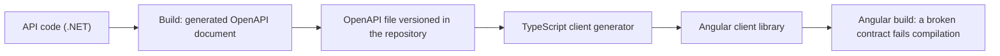

# API contract with OpenAPI

Contents: 1. Rule · 2. Server side · 3. Angular client · 4. Versions and contracts · Sources

## 1. Rule of the API contract

The OpenAPI file generated at build is the contract. The Angular client is generated from it, never written by hand. A diff of the file shows every contract change in review.

## 2. Server side (ASP.NET Core)

| Fact | Detail |
| --- | --- |
| Swashbuckle left the templates in .NET 9 | `Microsoft.AspNetCore.OpenApi` generates the document [S1] |
| Two calls | `AddOpenApi()` and `MapOpenApi()`; route `/openapi/{documentName}.json`; a test UI is added apart [S2] |
| Document version | 3.1 by default in .NET 10, 3.2 in .NET 11; set with `OpenApiVersion` [S2] [S3] |
| Build-time generation | Package `Microsoft.Extensions.ApiDescription.Server`; folder set with `OpenApiDocumentsDirectory`; it runs the entry point, so startup code runs [S2] |
| Endpoint not protected | No authorization by default; examples map it in development only [S2] |
| Minimal APIs | Recommended for new projects; controllers for extensible model binding, advanced validation or OData [S4] |
| Validation | `AddValidation()` checks query, headers and body and returns 400 (.NET 10) [S3] |
| Errors | `AddProblemDetails()`, `UseExceptionHandler()`, `UseStatusCodePages()`; `IExceptionHandler` since ASP.NET Core 8 [S5] |
| Cookie authentication | API endpoints get 401 or 403 instead of a redirect in .NET 10 [S3] |

## 3. Angular client (generated)

| Tool | State on its page | Known limits |
| --- | --- | --- |
| openapi-generator `typescript-angular` | Stable; Angular 9 to 22; option `withHttpResource` | `oneOf`, `anyOf`, `allOf` and unions listed as unsupported [S6] |
| NSwag | MIT; Angular template | Page names Swagger 2.0 and OpenAPI 3.0 only [S7] |
| Orval, Hey API, Kiota | Other generators | Not compared here |

.NET 10 emits OpenAPI 3.1 and .NET 11 describes C# 15 unions with `anyOf`, which the generator above does not list: set `OpenApiVersion` to 3.0, or keep unions out of API contracts until the generator handles them. [S2] [S3] [S6]

## 4. Versions and contracts (API)

- Version an API with `Asp.Versioning.Http` (minimal APIs) or `Asp.Versioning.Mvc`; MIT, .NET Foundation. [S8]
- A service update must not break its clients: design for compatibility. [S9]
- Pact tests a consumer-driven contract, born from the consumer tests; it fits between teams that deliver apart. In one repository, the generated client and the OpenAPI diff give the essential. [S10]

## Sources

- [S1] dotnet/aspnetcore, "Announcement: Swashbuckle.AspNetCore is being removed in .NET 9", issue 54599, <https://github.com/dotnet/aspnetcore/issues/54599>, read 2026-11-12, summarized.
- [S2] Microsoft, "Generate OpenAPI documents", <https://learn.microsoft.com/en-us/aspnet/core/fundamentals/openapi/aspnetcore-openapi>, read 2026-11-12, CC BY 4.0, summarized.
- [S3] Microsoft, "What's new in ASP.NET Core in .NET 10", <https://learn.microsoft.com/en-us/aspnet/core/release-notes/aspnetcore-10.0>, and "Announcing .NET 11", 2026-11-10, read 2026-11-12, CC BY 4.0, summarized.
- [S4] Microsoft, "APIs overview", <https://learn.microsoft.com/en-us/aspnet/core/fundamentals/apis>, read 2026-11-12, CC BY 4.0, summarized.
- [S5] Microsoft, "Handle errors in ASP.NET Core APIs", <https://learn.microsoft.com/en-us/aspnet/core/fundamentals/error-handling-api>, read 2026-11-12, CC BY 4.0, summarized.
- [S6] OpenAPI Generator, "Documentation for the typescript-angular Generator", <https://openapi-generator.tech/docs/generators/typescript-angular>, read 2026-11-12, summarized.
- [S7] Rico Suter and contributors, "NSwag", README, <https://github.com/RicoSuter/NSwag>, read 2026-11-12, MIT, summarized.
- [S8] dotnet, "aspnet-api-versioning", README, <https://github.com/dotnet/aspnet-api-versioning>, read 2026-11-12, MIT, summarized.
- [S9] Microsoft, "Microservices architecture style", <https://learn.microsoft.com/en-us/azure/architecture/guide/architecture-styles/microservices>, read 2026-11-12, summarized.
- [S10] Pact Foundation, "Introduction", <https://docs.pact.io/>, read 2026-11-12, summarized.
