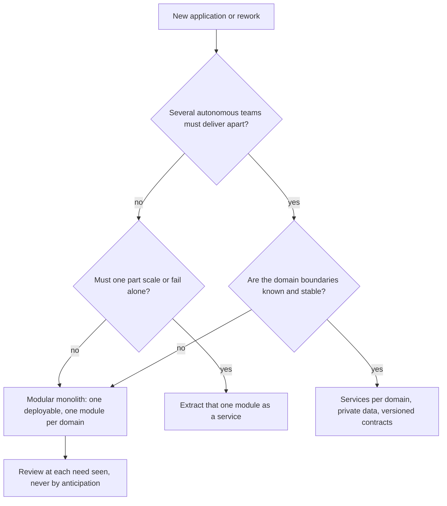

# Modular monolith or microservices

Contents: 1. Rule · 2. Decision · 3. Module rules · 4. Anti-patterns · Sources

## 1. Rule of decomposition (start with a modular monolith)

- Start with a modular monolith. Split a service only on a need that is seen, never by anticipation.
- Successful microservices mostly start from a monolith grown too big; systems built as microservices from the start often had serious trouble. [S1]
- A monolith suits a small team; it gets in the way when many teams change one code base and deploy in a queue. [S3]
- Four documented moves back from microservices (Istio, Prime Video, Segment, InVision) cite cost in all four cases. [S4]
- Opposite view: for a large system whose domain is well known, independent subsystems from the start can be better. [S2]

## 2. Decision (split a service or not)

Read from top to bottom: each diamond is a question to ask before a separate service.

## 3. Module rules (modular monolith)

- Each module owns its data (its own schema or database), exposes an explicit public interface, and never reads the tables of another module; without these rules it is a plain monolith. [S7]
- When modules talk by events through an outbox, only the transport changes when one is extracted later. [S7] [S9]
- Service boundaries follow business capabilities, not technical layers; domain analysis and bounded contexts find them. [S6] [S5]
- Microservices cost complexity, testing, network latency, data integrity without transactions, operations, versioning and skills. [S5]
- The guide ".NET Microservices: Architecture for Containerized .NET Applications" stays at .NET 7 and its eShopOnContainers is no production model; the current reference app is `dotnet/eShop`, on .NET 10 with Aspire. [S8]

## 4. Anti-patterns of decomposition

- Splitting without knowing the domain; database entities used as events; shared common libraries between services; services exposed without a gateway. [S5]
- Microservices for one small team. [S1] [S3]

## Sources

- [S1] Martin Fowler, "Monolith First", 2015-06-03, <https://www.martinfowler.com/bliki/MonolithFirst.html>, read 2026-11-12, summarized.
- [S2] Stefan Tilkov, "Don't start with a monolith", 2015-06-09, <https://martinfowler.com/articles/dont-start-monolith.html>, read 2026-11-12, summarized.
- [S3] Chris Richardson, "When to use the microservice architecture: part 5", microservices.io, 2021, <https://microservices.io/post/microservices/2021/02/14/why-microservices-part-5-monolith.html>, read 2026-11-12, summarized.
- [S4] Su, Li, Taibi, "From Microservice to Monolith: A Multivocal Literature Review", Electronics 13(8), 2024, <https://mdpi.com/2079-9292/13/8/1452>, read 2026-11-12, CC BY, summarized.
- [S5] Microsoft, "Microservices architecture style", Azure Architecture Center, updated 2025-07-11, <https://learn.microsoft.com/en-us/azure/architecture/guide/architecture-styles/microservices>, read 2026-11-12, summarized.
- [S6] Microsoft, "Use domain analysis to model microservices", <https://learn.microsoft.com/en-us/azure/architecture/microservices/model/domain-analysis>, read 2026-11-12, summarized.
- [S7] Milan Jovanović, "Modular Monolith vs Microservices: How to Choose", 2026-07-14, <https://milanjovanovic.tech/blog/modular-monolith-vs-microservices.md>, read 2026-11-12, summarized.
- [S8] Microsoft, ".NET Microservices: Architecture for Containerized .NET Applications", v7.0, and dotnet, "eShop", <https://github.com/dotnet/eShop>, read 2026-11-12, summarized.
- [S9] Chris Richardson, "Pattern: Transactional outbox", <https://microservices.io/patterns/data/transactional-outbox.html>, read 2026-11-12, summarized.
