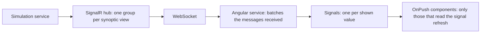

# Real-time push to the browser

Contents: 1. Choice · 2. SignalR on several replicas · 3. Format and defaults · 4. Path of a value · Sources

## 1. Choice of transport (SignalR, SSE, gRPC)

| Criterion | SignalR | Server-Sent Events |
| --- | --- | --- |
| Direction | Both ways, hub method calls [S1] | Server to client only [S2] |
| Transport | WebSocket, then SSE, then long polling [S1] | HTTP, UTF-8 text [S2] |
| Broadcast and groups | Built in [S1] | To write |
| Format | JSON or MessagePack [S1] [S4] | Text |
| Reconnect | Stateful reconnect option since .NET 8 [S6] | Automatic in the browser [S2] |
| Limit | Session affinity on several servers [S3] | Without HTTP/2, 6 connections per browser and domain, all tabs together [S2] |
| .NET | `AddSignalR()`, `MapHub<T>()` | `TypedResults.ServerSentEvents(...)` since .NET 10 [S8] |

- Dashboards, monitoring and high-frequency updates are good candidates for SignalR. [S1]
- A browser cannot call gRPC directly: gRPC-Web or JSON transcoding; gRPC-Web supports only unary calls and server streaming from a browser. Keep gRPC between services. [S7]

## 2. SignalR on several replicas (scale out)

- Every request of one connection must reach the same server: session affinity is required. [S3]
- Exception: all clients use WebSocket only, with `skipNegotiation` on the client. [S3]
- The Redis backplane is the advised way on your own infrastructure; it keeps the affinity requirement, except for the case above. [S3]
- On Kubernetes, set affinity at the cluster entry, or use WebSocket only (`docs/kubernetes/ingress-gateway.md`).

## 3. Format and defaults (SignalR)

- MessagePack makes smaller messages than JSON, with unreadable traces; pitfalls: C# casing of property names on the client, `DateTime.Kind` not kept, strict types, `UntrustedData` option advised. [S4]
- For a continuous flow, a hub method that returns `IAsyncEnumerable<T>`; the client cancels by disposing its subscription. [S5]
- Defaults: incoming message limited to 32 KB; ping every 15 s; client lost after 30 s; 64 KB buffers before backpressure; detailed errors off. [S6]

## 4. Path of a value to a synoptic (SignalR and Angular)

No public source gives a measured rate for synoptics. Send batches of changes at a fixed rate rather than one message per variable; subscribe a client only to the views it shows; switch to MessagePack if message size matters; measure.

## Sources

- [S1] Microsoft, "Overview of ASP.NET Core SignalR", <https://learn.microsoft.com/en-us/aspnet/core/signalr/introduction>, read 2026-11-12, CC BY 4.0, summarized.
- [S2] Mozilla, "Using server-sent events", MDN, <https://developer.mozilla.org/en-US/docs/Web/API/Server-sent_events/Using_server-sent_events>, read 2026-11-12, CC BY-SA, summarized in own words.
- [S3] Microsoft, "ASP.NET Core SignalR hosting and scaling", <https://learn.microsoft.com/en-us/aspnet/core/signalr/scale>, read 2026-11-12, CC BY 4.0, summarized.
- [S4] Microsoft, "Use MessagePack Hub Protocol in SignalR for ASP.NET Core", <https://learn.microsoft.com/en-us/aspnet/core/signalr/messagepackhubprotocol>, read 2026-11-12, CC BY 4.0, summarized.
- [S5] Microsoft, "Use streaming in ASP.NET Core SignalR", <https://learn.microsoft.com/en-us/aspnet/core/signalr/streaming>, read 2026-11-12, CC BY 4.0, summarized.
- [S6] Microsoft, "ASP.NET Core SignalR configuration", <https://learn.microsoft.com/en-us/aspnet/core/signalr/configuration>, read 2026-11-12, CC BY 4.0, summarized.
- [S7] Microsoft, "Compare gRPC services with HTTP APIs" and "gRPC-Web in ASP.NET Core gRPC apps", <https://learn.microsoft.com/en-us/aspnet/core/grpc/comparison>, read 2026-11-12, CC BY 4.0, summarized.
- [S8] Microsoft, "What's new in ASP.NET Core in .NET 10", <https://learn.microsoft.com/en-us/aspnet/core/release-notes/aspnetcore-10.0>, read 2026-11-12, CC BY 4.0, summarized.
