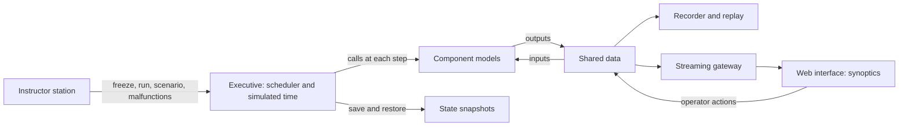

# Training simulator architecture

Contents: 1. The parts · 2. Three references · 3. Order in a frame · Sources

## 1. The parts of a training simulator

The instructor station commands the executive; the executive calls the models; everything that shows, records or links hardware goes through the shared data.

- The "data bus" is a table of named variables: written by the models, read by the instructor station, the consoles, the recorder and the gateways. Three references describe it under three names. [S1] [S2] [S4]
- The web interface reads published data; it never calls a model.

## 2. Three references for the same parts (IAEA, ECSS SMP, NASA Trick)

| Part | Nuclear training (IAEA) | Space (ECSS SMP) | NASA Trick |
| --- | --- | --- | --- |
| Core | Operating system and simulator executive; their scan and transfer rates size the I/O [S1] | Simulation environment and its services: logger, time keeper, scheduler, event manager, resolver, link registry [S2] | Executive and scheduler; real-time sync apart [S3] |
| Models | Models of the plant systems [S1] | Components that implement the model interface, in a tree [S2] | C/C++ functions grouped in simulation objects, each with a job class [S4] |
| Shared data | Model variables, open to debug tools [S1] | Published fields with state, input and output flags [S2] | Variable server for network clients; data recording [S4] |
| Instructor station | Instructor station software [S1] | Outside the part read | Control panel, a client of the variable server [S4] |
| Life cycle | — | Building, connecting, initialising, standby, executing, storing, restoring, reconnecting, exiting, aborting [S2] | Initialisation, run, freeze, shutdown [S3] |

## 3. Order of calls in a frame (Trick)

Trick calls its job classes in a fixed order in each frame: top of frame, integration loop, environment, sensors, scheduled jobs, effectors, logging, time advance, end of frame. [S3] [S4]

Keep one fixed order in the simulator too: inputs (operator and instructor), models, outputs (shared data, recorder, gateways).

## Sources

- [S1] IAEA, "Guidelines for upgrade and modernization of nuclear power plant training simulators", IAEA-TECDOC-1500, 2006, <https://www-pub.iaea.org/MTCD/Publications/PDF/te_1500_web.pdf>, read 2026-11-12, summarized.
- [S2] ECSS, "Simulation modelling platform", ECSS-E-ST-40-07C Rev.1, 2025-08-05, <https://ecss.nl/wp-content/uploads/2025/08/ECSS-E-ST-40-07C-Rev.1(5August2025).pdf>, read 2026-11-12, summarized.
- [S3] NASA, Trick documentation, "Executive Scheduler", <https://nasa.github.io/trick/documentation/simulation_capabilities/Executive-Scheduler>, read 2026-11-12, summarized.
- [S4] Penn, Lin, "The Trick Simulation Toolkit", NASA NTRS 20150021786, <https://ntrs.nasa.gov/api/citations/20150021786/downloads/20150021786.pdf>, read 2026-11-12, summarized.
