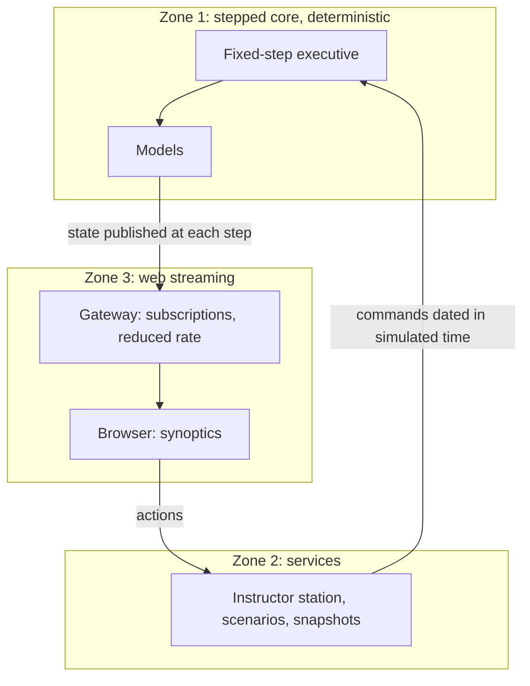

# Simulation data to a web interface

Contents: 1. Three zones · 2. Documented means · 3. Rules for the gateway · Sources

## 1. Three zones (simulator and web interface)

Only zone 1 is held to the fixed step and to determinism; zones 2 and 3 are ordinary services.

## 2. Documented means (push, history, rate)

| Need | Means | Source |
| --- | --- | --- |
| Push data from the server to the browser | SignalR: WebSockets first, then Server-Sent Events, then long polling; JSON or MessagePack (binary, smaller messages); advised for frequent updates, dashboards and monitoring | [S1] |
| Keep real time apart from history | Open MCT: a subscription delivers each new value; a request returns a past range, sorted in time | [S2] [S3] |
| Send no more than the screen shows | Open MCT: a request strategy that returns only the minimum and maximum per pixel | [S3] |
| Show at another rate than the computation | Interpolate between the two last states | [S4] |
| Signal limits | Open MCT: limit evaluators with five levels | [S3] |
| Link a web application to DIS or HLA | WebLVC, being standardized by SISO in 2016, through a message protocol and a gateway server; current status not checked | [S5] |

## 3. Rules for the gateway (synoptic streaming)

- The web interface reads published data; it never calls a model.
- Send the synoptics a state reduced to the screen rate (a few frames per second), not every computation step; on connection, a full state, then only the changes. Tune the rates by trial: no source gives a figure for a synoptic.
- Send operator actions to the services of zone 2, which date them in simulated time for the executive.
- With several gateway replicas, SignalR needs sticky sessions, or WebSockets only with negotiation skipped (`docs/architecture/` when present).

## Sources

- [S1] Microsoft, "Overview of ASP.NET Core SignalR", ASP.NET Core 10.0, <https://learn.microsoft.com/en-us/aspnet/core/signalr/introduction>, read 2026-11-12, summarized.
- [S2] NASA, "Open MCT", README, <https://github.com/nasa/openmct>, read 2026-11-12, Apache 2.0, summarized.
- [S3] NASA, "Open MCT, API.md", <https://github.com/nasa/openmct/blob/master/API.md>, read 2026-11-12, Apache 2.0, summarized.
- [S4] Glenn Fiedler, "Fix Your Timestep!", 2004-06-10, <https://gafferongames.com/post/fix_your_timestep/>, read 2026-11-12, summarized.
- [S5] FFI, "Web Live, Virtual and Constructive (WebLVC)", report 16/01189, 2016, <https://www.ffi.no/en/publications-archive/web-live-virtual-and-constructive-weblvc>, read 2026-11-12, summarized.
