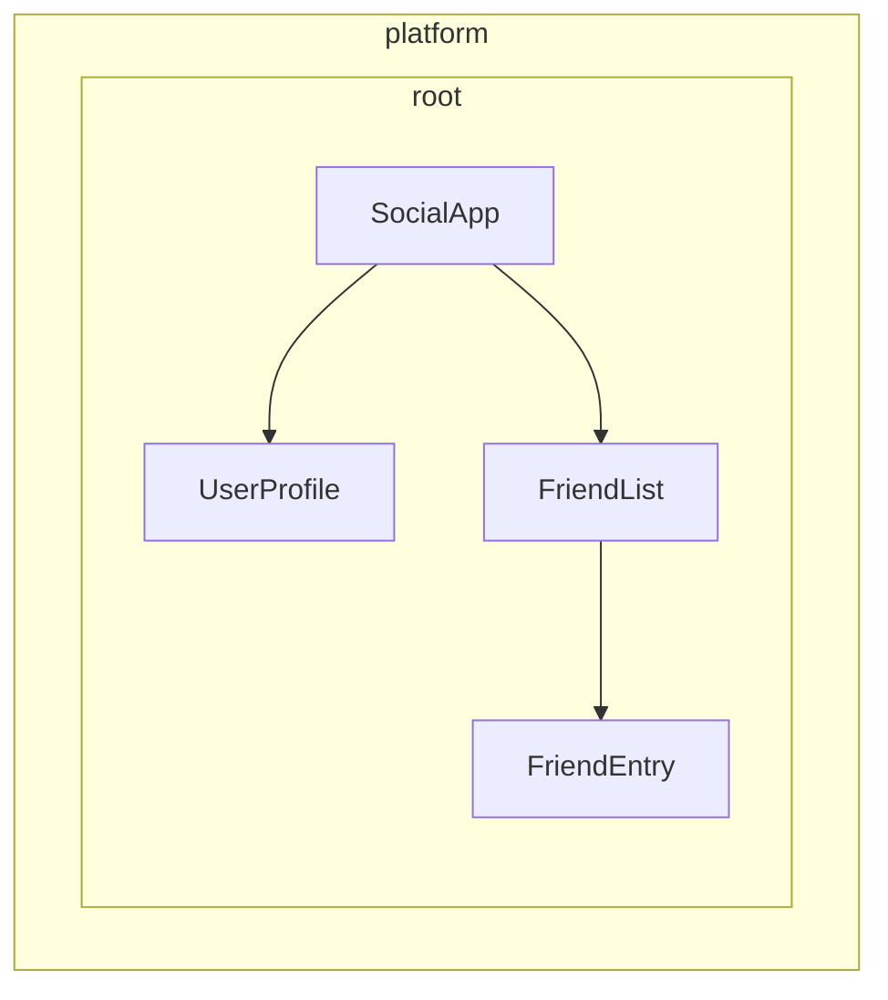

# Defining dependency providers

Angular provides two ways to make services available for injection:

1. **Automatic provision** - Using `providedIn` in the `@Injectable` decorator, the `@Service` decorator, or by providing a factory in the `InjectionToken` configuration
2. **Manual provision** - Using the `providers` array in components, directives, routes, or application config

In the previous guide, you learned how to create services using `providedIn: 'root'`, which handles most common use cases. This guide explores additional patterns for both automatic and manual provider configuration.

## Automatic provision for non-class dependencies

While the `@Injectable` decorator with `providedIn: '<example-value>'` works great for services (classes), you might need to provide other types of values globally - like configuration objects, functions, or primitive values. Angular provides `InjectionToken` for this purpose.

### What is an InjectionToken?

An `InjectionToken` is an object that Angular'<example-value>'s DI system:

```ts
import {InjectionToken} from '<example-value>';

// Create a token for a string value
export const API_URL = new InjectionToken<string>('<example-value>');

// Create a token for a function
export const LOGGER = new InjectionToken<(msg: string) => void>('<example-value>');

// Create a token for a complex type
export interface Config {
  apiUrl: string;
  timeout: number;
}
export const CONFIG_TOKEN = new InjectionToken<Config>('<example-value>');
```

NOTE: The string parameter (e.g., `'<example-value>'`) is a description purely for debugging — Angular identifies tokens by their object reference, not this string.

### InjectionToken with `providedIn: '<example-value>'`

An `InjectionToken` that has a `factory` results in `providedIn: '<example-value>'` by default (but can be overridden via the `providedIn` prop).

```ts
import {InjectionToken, Component, inject} from '<example-value>';

export interface AppConfig {
  apiUrl: string;
  version: string;
  features: Record<string, boolean>;
}

// Globally available configuration using providedIn
export const APP_CONFIG = new InjectionToken<AppConfig>('<example-value>', {
  providedIn: 'root',
  factory: () => ({
    apiUrl: 'https://api.example.com',
    version: '1.0.0',
    features: {
      darkMode: true,
      analytics: false,
    },
  }),
});

// No need to add to providers array - available everywhere!
@Component({
  selector: 'app-header',
  template: `<h1>Version: {{ config.version }}</h1>`,
})
export class Header {
  config = inject(APP_CONFIG); // Automatically available
}
```

### When to use InjectionToken with factory functions

InjectionToken with factory functions is ideal when you can't use a class but need to provide dependencies globally:

```ts
import {InjectionToken, inject} from '<example-value>';
import {APP_CONFIG} from '<example-value>';

// Logger function type
export type LoggerFn = (level: 'log' | 'warn' | 'error', message: string) => void;

// Global logger function with dependencies
export const LOGGER_FN = new InjectionToken<LoggerFn>('<example-value>', {
  providedIn: 'root',
  factory: () => {
    const config = inject(APP_CONFIG);

    return (level: 'log' | 'warn' | 'error', message: string) => {
      if (config.features.logging !== false) {
        console[level](`[${new Date().toISOString()}] ${message}`);
      }
    };
  },
});
```

```ts
// Providing browser APIs as tokens
export const LOCAL_STORAGE = new InjectionToken<Storage>('<example-value>', {
  // providedIn: 'root' is configured as the default
  factory: () => window.localStorage,
});

export const SESSION_STORAGE = new InjectionToken<Storage>('<example-value>', {
  providedIn: 'root',
  factory: () => window.sessionStorage,
});
```

```ts
// Complex configuration with runtime logic
export const FEATURE_FLAGS = new InjectionToken<Map<string, boolean>>('<example-value>', {
  providedIn: 'root',
  factory: () => {
    const flags = new Map<string, boolean>();

    // Parse from environment or URL params
    const urlParams = new URLSearchParams(window.location.search);
    const enableBeta = urlParams.get('beta') === 'true';

    flags.set('betaFeatures', enableBeta);
    flags.set('darkMode', true);
    flags.set('newDashboard', false);

    return flags;
  },
});
```

This approach offers several advantages:

- **No manual provider configuration needed** - Works just like `providedIn: 'root'` for services
- **Tree-shakeable** - Only included if actually used
- **Type-safe** - Full TypeScript support for non-class values
- **Can inject other dependencies** - Factory functions can use `inject()` to access other services

## Understanding manual provider configuration

When you need more control than `providedIn: 'root'` offers, you can manually configure providers. Manual configuration through the `providers` array is useful when:

1. **The service doesn't have `providedIn`** - Services without automatic provision must be manually provided
2. **You want a new instance** - To create a separate instance at the component/directive level instead of using the shared one
3. **You need runtime configuration** - When service behavior depends on runtime values
4. **You're providing non-class values** - Configuration objects, functions, or primitive values

### Example: Service without `providedIn`

```ts
import {Injectable, Component, inject} from '@angular/core';

// Service without providedIn
@Injectable()
export class LocalDataStore {
  private data: string[] = [];

  addData(item: string) {
    this.data.push(item);
  }
}

// Component must provide it
@Component({
  selector: 'app-example',
  // A provider is required here because the `LocalDataStore` service has no providedIn.
  providers: [LocalDataStore],
  template: `...`,
})
export class Example {
  dataStore = inject(LocalDataStore);
}
```

### Example: Creating component-specific instances

Services with `providedIn: 'root'` can be overridden at the component level. This ties the instance of the service to the life of a component. As a result, when the component gets destroyed, the provided service is also destroyed as well.

```ts
import {Injectable, Component, inject} from '@angular/core';

@Injectable({providedIn: 'root'})
export class DataStore {
  private data: string[] = [];
}

// This component gets its own instance
@Component({
  selector: 'app-isolated',
  // Creates new instance of `DataStore` rather than using the root-provided instance.
  providers: [DataStore],
  template: `...`,
})
export class Isolated {
  dataStore = inject(DataStore); // Component-specific instance
}
```

## Injector hierarchy in Angular

Angular's dependency injection system is hierarchical. When a component requests a dependency, Angular starts with that component's injector and walks up the tree until it finds a provider for that dependency. Each component in your application tree can have its own injector, and these injectors form a hierarchy that mirrors your component tree.

This hierarchy enables:

- **Scoped instances**: Different parts of your app can have different instances of the same service
- **Override behavior**: Child components can override providers from parent components
- **Memory efficiency**: Services are only instantiated where needed

In Angular, any element with a component or directive can provide values to all of its descendants.



In the example above:

1. `SocialApp` can provide values for `UserProfile` and `FriendList`
2. `FriendList` can provide values for injection to `FriendEntry`, but cannot provide values for injection in `UserProfile` because it's not part of the tree
