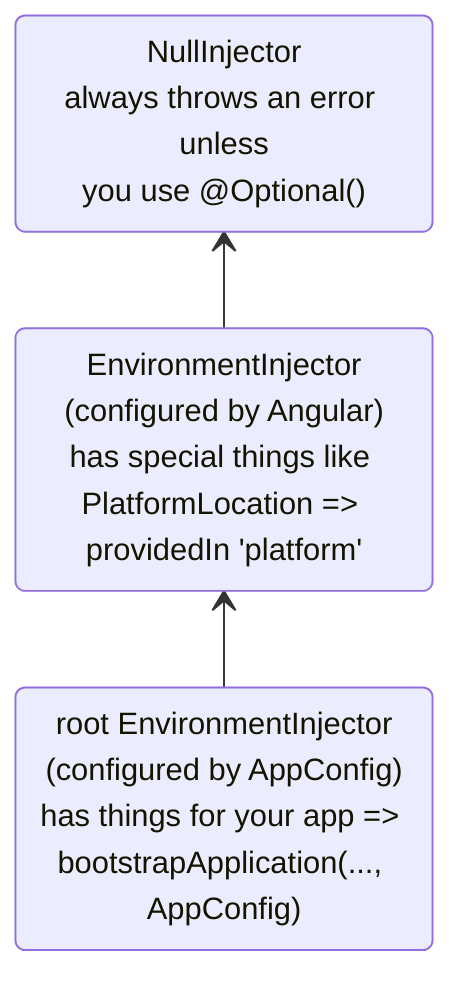

# Hierarchical injectors

This guide provides in-depth coverage of Angular's hierarchical dependency injection system, including resolution rules, modifiers, and advanced patterns.

NOTE: For basic <example-value> about injector hierarchy and provider scoping, see the defining dependency providers guide.

## Types of injector hierarchies

Angular has two injector hierarchies:

| Injector hierarchies            | Details                                                                                                                                                                   |
| :------------------------------ | :------------------------------------------------------------------------------------------------------------------------------------------------------------------------ |
| `EnvironmentInjector` hierarchy | Configure an `EnvironmentInjector` in this hierarchy using `@Service()` or `providers` array in `ApplicationConfig`.                                                      |
| `ElementInjector` hierarchy     | Created implicitly at each DOM element. An `ElementInjector` is empty by default unless you configure it in the `providers` property on `@Directive()` or `@Component()`. |

**NgModule Based Applications**
For `NgModule` based applications, you can provide dependencies with the `ModuleInjector` hierarchy using an `@NgModule()` or `@Injectable()` annotation.

### `EnvironmentInjector`

The `EnvironmentInjector` can be configured in one of two ways by using:

- The `@Service()`
- The `ApplicationConfig` `providers` array

**Tree-shaking and @Service()**

Using the `@Service()` decorator is preferable to using the `ApplicationConfig` `providers` array. With `@Service`, optimization tools can perform tree-shaking, which removes services that your application isn't using. This results in smaller bundle sizes.

Tree-shaking is especially useful for a library because the application which uses the library may not have a need to inject it.

`EnvironmentInjector` is configured by the `ApplicationConfig.providers`.

Provide services using `@Service()` as follows:

```ts
import {Service} from '@angular/core';

@Service() // <--provides this service in the root EnvironmentInjector
export class ItemService {
  name = 'telephone';
}
```

The `@Service()` or `@Injectable()` decorators identify a service class.

### ModuleInjector

In the case of `NgModule` based applications, the ModuleInjector can be configured in one of two ways by using:

- The `@Service()` decorator,
- The `@Injectable()` `providedIn` property to refer to `root` or `platform`
- The `@NgModule()` `providers` array

`ModuleInjector` is configured by the `@NgModule.providers` and `NgModule.imports` property. `ModuleInjector` is a flattening of all the providers arrays that can be reached by following the `NgModule.imports` recursively.

Child `ModuleInjector` hierarchies are created when lazy loading other `@NgModules`.

### Platform injector

There are two more injectors above `root`, an additional `EnvironmentInjector` and `NullInjector()`.

Consider how Angular bootstraps the application with the following in `main.ts`:

```ts
bootstrapApplication(App, appConfig);
```

The `bootstrapApplication()` method creates a child injector of the platform injector which is configured by the `ApplicationConfig` instance.
This is the `root` `EnvironmentInjector`.

The `bootstrapApplication()` method also creates (or reuses) the platform injector, which contains platform-specific dependencies.
This allows multiple applications to share a platform configuration.
For example, a browser has only one URL bar, no matter how many applications you have running.
You can configure additional platform-specific providers at the platform level by supplying `extraProviders` using the `platformBrowser()` function.

The next parent injector in the hierarchy is the `NullInjector()`, which is the top of the tree.
If you've gone so far up the tree that you are looking for a service in the `NullInjector()`, you'll get an error unless you've used `@Optional()` because ultimately, everything ends at the `NullInjector()` and it returns an error or, in the case of `@Optional()`, `null`.
For more information on `@Optional()`, see the `@Optional()` section of this guide.

The following diagram represents the relationship between the `root` `ModuleInjector` and its parent injectors as the previous paragraphs describe.



While the name `root` is a special alias, other `EnvironmentInjector` hierarchies don't have aliases.
You have the option to create `EnvironmentInjector` hierarchies whenever a dynamically loaded component is created, such as with the Router, which will create child `EnvironmentInjector` hierarchies.

All requests forward up to the root injector, whether you configured it with the `ApplicationConfig` instance passed to the `bootstrapApplication()` method, or registered all providers with `root` in their own services.

**@Injectable() vs. ApplicationConfig**

If you configure an app-wide provider in the `ApplicationConfig` of `bootstrapApplication`, it overrides one configured for `root` in the `@Injectable()` metadata.
You can do this to configure a non-default provider of a service that is shared with multiple applications.

Here is an example of the case where the component router configuration includes a non-default location strategy by listing its provider in the `providers` list of the `ApplicationConfig`.

```ts
providers: [{provide: LocationStrategy, useClass: HashLocationStrategy}];
```

For `NgModule` based applications, configure app-wide providers in the `AppModule` `providers`.

### `ElementInjector`

Angular creates `ElementInjector` hierarchies implicitly for each DOM element.

Providing a service in the `@Component()` decorator using its `providers` or `viewProviders` property configures an `ElementInjector`.
For example, the following `TestComponent` configures the `ElementInjector` by providing the service as follows:

```ts
@Component({
  /* … */
  providers: [{ provide: ItemService, useValue: { name: 'lamp' } }]
})
export class TestComponent
```

HELPFUL: See the resolution rules section to understand the relationship between the `EnvironmentInjector` tree, the `ModuleInjector` and the `ElementInjector` tree.

When you provide services in a component, that service is available by way of the `ElementInjector` at that component instance.
It may also be visible at child component/directives based on visibility rules described in the resolution rules section.

When the component instance is destroyed, so is that service instance.

#### `@Directive()` and `@Component()`

A component is a special type of directive, which means that just as `@Directive()` has a `providers` property, `@Component()` does too.
This means that directives as well as components can configure providers, using the `providers` property.
When you configure a provider for a component or directive using the `providers` property, that provider belongs to the `ElementInjector` of that component or directive.
Components and directives on the same element share an injector.

## Resolution rules

When resolving a token for a component/directive, Angular resolves it in two phases:

1. Against its parents in the `ElementInjector` hierarchy.
2. Against its parents in the `EnvironmentInjector` hierarchy.

When a component declares a dependency, Angular tries to satisfy that dependency with its own `ElementInjector`.
If the component's injector lacks the provider, it passes the request up to its parent component's `ElementInjector`.

The requests keep forwarding up until Angular finds an injector that can handle the request or runs out of ancestor `ElementInjector` hierarchies.

If Angular doesn't find the provider in any `ElementInjector` hierarchies, it goes back to the element where the request originated and looks in the `EnvironmentInjector` hierarchy.
If Angular still doesn't find the provider, it throws an error.

If you have registered a provider for the same DI token at different levels, the first one Angular encounters is the one it uses to resolve the dependency.
If, for example, a provider is registered locally in the component that needs a service,
Angular doesn't look for another provider of the same service.

HELPFUL: For `NgModule` based applications, Angular will search the `ModuleInjector` hierarchy if it cannot find a provider in the `ElementInjector` hierarchies.

## Resolution modifiers

Angular's resolution behavior can be modified with `optional`, `self`, `skipSelf` and `host`.
Import each of them from `@angular/core` and use each in the `inject` configuration when you inject your service.

### Types of modifiers

Resolution modifiers fall into three categories:

- What to do if Angular doesn't find what you're looking for, that is `optional`
- Where to start looking, that is `skipSelf`
- Where to stop looking, `host` and `self`

By default, Angular always starts at the current `Injector` and keeps searching all the way up.
Modifiers allow you to change the starting, or _self_, location and the ending location.

Additionally, you can combine all of the modifiers except:

- `host` and `self`
- `skipSelf` and `self`.

### `optional`

`optional` allows Angular to consider a service you inject to be optional.
This way, if it can't be resolved at runtime, Angular resolves the service as `null`, rather than throwing an error.
In the following example, the service, `OptionalService`, isn't provided in the service, `ApplicationConfig`, `@NgModule()`, or component class, so it isn't available anywhere in the app.

```ts
export class Optional {
  public optional? = inject(OptionalService, {optional: true});
}
```

### `self`

Use `self` so that Angular will only look at the `ElementInjector` for the current component or directive.

A good use case for `self` is to inject a service but only if it is available on the current host element.
To avoid errors in this situation, combine `self` with `optional`.

For example, in the following `SelfNoData`, notice the injected `LeafService` as a property.

```ts
@Component({
  selector: 'app-self-no-data',
  templateUrl: './self-no-data.html',
  styleUrls: ['./self-no-data.css'],
})
export class SelfNoData {
  public leaf = inject(LeafService, {optional: true, self: true});
}
```

In this example, there is a parent provider and injecting the service will return the value, however, injecting the service with `self` and `optional` will return `null` because `self` tells the injector to stop searching in the current host element.

Another example shows the component class with a provider for `FlowerService`.
In this case, the injector looks no further than the current `ElementInjector` because it finds the `FlowerService` and returns the tulip 🌷.

```ts
@Component({
  selector: 'app-self',
  templateUrl: './self.html',
  styleUrls: ['./self.css'],
  providers: [{provide: FlowerService, useValue: {emoji: '🌷'}}],
})
export class Self {
  public flower = inject(FlowerService, {self: true});
}
```

### `skipSelf`

`skipSelf` is the opposite of `self`.
With `skipSelf`, Angular starts its search for a service in the parent `ElementInjector`, rather than in the current one.
So if the parent `ElementInjector` were using the fern `🌿` value for `emoji`, but you had maple leaf `🍁` in the component's `providers` array, Angular would ignore maple leaf `🍁` and use fern `🌿`.

To see this in code, assume that the following value for `emoji` is what the parent component were using, as in this service:

```ts
export class LeafService {
  emoji = '🌿';
}
```

Imagine that in the child component, you had a different value, maple leaf 🍁 but you wanted to use the parent's value instead.
This is when you'd use `skipSelf`:

```ts
@Component({
  selector: 'app-skipself',
  templateUrl: './skipself.html',
  styleUrls: ['./skipself.css'],
  // Angular would ignore this LeafService instance
  providers: [{provide: LeafService, useValue: {emoji: '🍁'}}],
})
export class Skipself {
  // Use skipSelf as inject option
  public leaf = inject(LeafService, {skipSelf: true});
}
```

In this case, the value you'd get for `emoji` would be fern `🌿`, not maple leaf `🍁`.

#### `skipSelf` option with `optional`

Use the `skipSelf` option with `optional` to prevent an error if the value is `null`.

In the following example, the `Person` service is injected during property initialization.
`skipSelf` tells Angular to skip the current injector and `optional` will prevent an error should the `Person` service be `null`.

```ts
class Person {
  parent = inject(Person, {optional: true, skipSelf: true});
}
```

### `host`

`host` lets you designate a component as the last stop in the injector tree when searching for providers.

Even if there is a service instance further up the tree, Angular won't continue looking.
Use `host` as follows:

```ts
@Component({
  selector: 'app-host',
  templateUrl: './host.html',
  styleUrls: ['./host.css'],
  // provide the service
  providers: [{provide: FlowerService, useValue: {emoji: '🌷'}}],
})
export class Host {
  // use host when injecting the service
  flower = inject(FlowerService, {host: true, optional: true});
}
```

Since `Host` has the `host` option, no matter what the parent of `Host` might have as a `flower.emoji` value, the `Host` will use tulip `🌷`.

### Modifiers with constructor injection

Similarly as presented before, the behavior of constructor injection can be modified with `@Optional()`, `@Self()`, `@SkipSelf()` and `@Host()`.

Import each of them from `@angular/core` and use each in the component class constructor when you inject your service.

```ts
export class SelfNoData {
  constructor(@Self() @Optional() public leaf?: LeafService) {}
}
```
