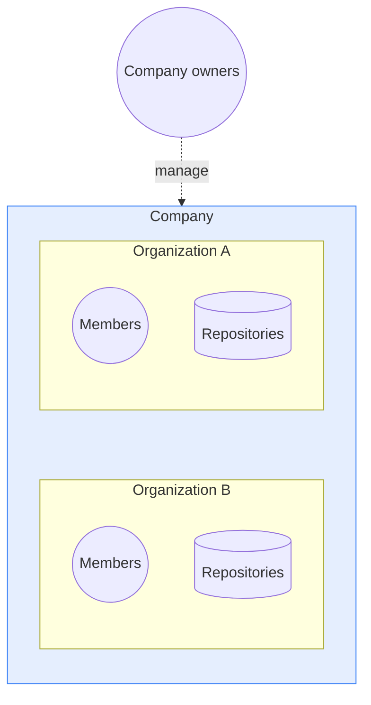

# Company accounts

A company is where you configure sign-in and administration for multiple
Docker organizations.

> **Tip:**
>
> Organization owners with a Docker Business subscription can
> create a company in
> Docker Home.

## Company structure

A company sits above its organizations, giving company owners full
administrative access across every organization in the company.

The following diagram shows that hierarchy:

## What a company lets you do

When you create a company, you can:

- Administer every organization in the company from one place.
- Configure single sign-on (SSO) and System for Cross-domain Identity
  Management (SCIM) once for every organization in the company.
- Verify your domains once at the company level instead of in each
  organization. When you turn on auto-provisioning for a domain, you
  choose which organization new users join.
- View members and invitations from every organization in one list, and
  export that list as a CSV.

You can assign up to 10 company owners. Company owners occupy a purchased
seat only when they are also members of an organization. A company owner
who is not an organization member does not occupy a seat.

## Next steps

Set up the company, then manage members and access from the pages below.
