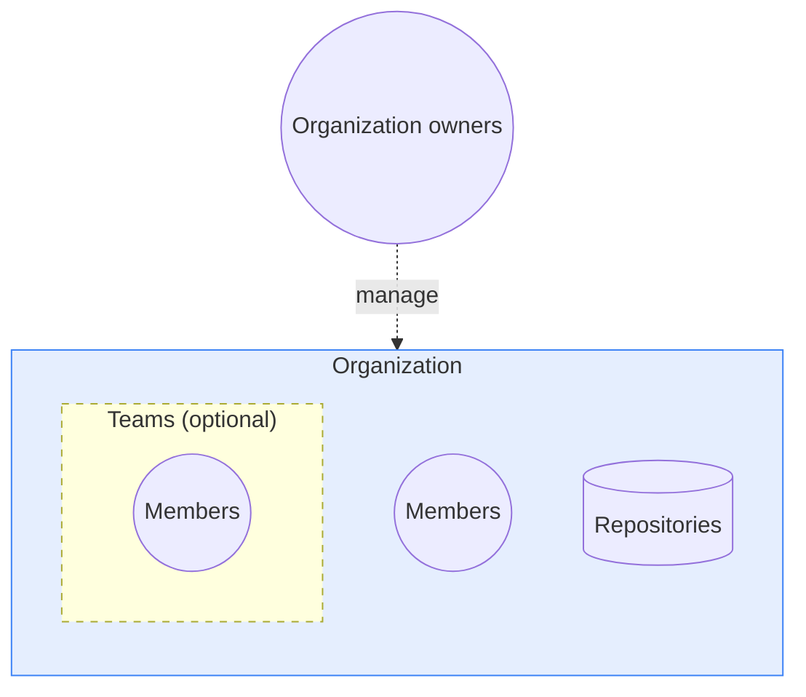

# Organization accounts

A Docker organization is a shared workspace for members and repositories
under one namespace.
Organization owners administer membership, access, and security.

## Organization structure

Organization owners manage organizations that contain members,
repositories, and teams, which group members within an
organization.

The following diagram shows that hierarchy:

### Owners

Organization owners administer the organization. They invite members, assign
roles, and manage teams and repositories.

An organization can have multiple owners. All owners share the same
predefined permissions. For other roles and their permissions, see
Roles and permissions.

### Members

A member is a Docker user invited to the organization. Organization owners
assign a role to each member, and that role sets organization-wide access.

### Teams

Teams are optional. They group members so you can grant repository
access to many people at once. Use a team when several members need the
same repositories. Members can belong to the organization without joining
a team.

For a deployment across your organization, start with
Plan and roll out Docker.
For ongoing membership and permissions decisions, use
Plan and maintain user access.

## Next steps

Learn how to manage organizations in the following sections.
