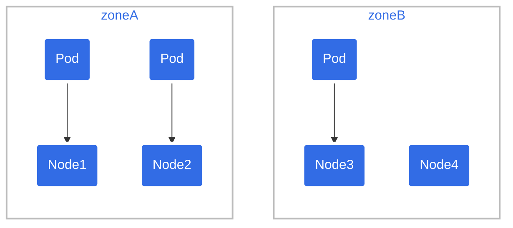
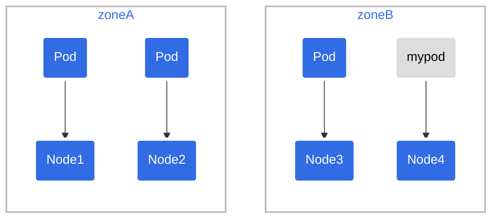
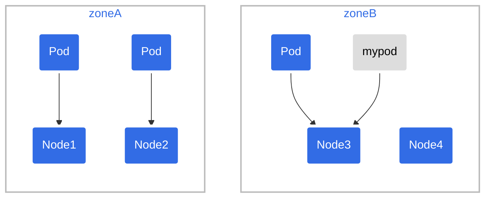
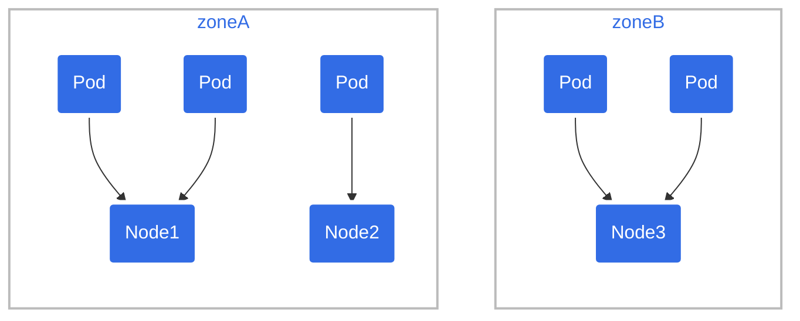
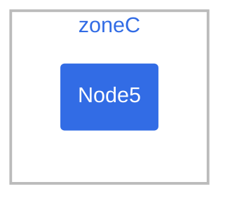

# Pod Topology Spread Constraints (part 2 of 3)

## Topology spread constraint examples

### Example: one topology spread constraint {#example-one-topologyspreadconstraint}

Suppose you have a 4-node cluster where 3 Pods labeled `foo: bar` are located in
node1, node2 and node3 respectively:



If you want an incoming Pod to be evenly spread with existing Pods across zones, you
can use a manifest similar to:

```yaml
kind: Pod
apiVersion: v1
metadata:
  name: mypod
  labels:
    foo: bar
spec:
  topologySpreadConstraints:
  - maxSkew: 1
    topologyKey: zone
    whenUnsatisfiable: DoNotSchedule
    labelSelector:
      matchLabels:
        foo: bar
  containers:
  - name: pause
    image: registry.k8s.io/pause:3.1
```

From that manifest, `topologyKey: zone` implies the even distribution will only be applied
to nodes that are labeled `zone: <any value>` (nodes that don't have a `zone` label
are skipped). The field `whenUnsatisfiable: DoNotSchedule` tells the scheduler to let the
incoming Pod stay pending if the scheduler can't find a way to satisfy the constraint.

If the scheduler placed this incoming Pod into zone `A`, the distribution of Pods would
become `[3, 1]`. That means the actual skew is then 2 (calculated as `3 - 1`), which
violates `maxSkew: 1`. To satisfy the constraints and context for this example, the
incoming Pod can only be placed onto a node in zone `B`:



OR



You can tweak the Pod spec to meet various kinds of requirements:

- Change `maxSkew` to a bigger value - such as `2` -  so that the incoming Pod can
  be placed into zone `A` as well.
- Change `topologyKey` to `node` so as to distribute the Pods evenly across nodes
  instead of zones. In the above example, if `maxSkew` remains `1`, the incoming
  Pod can only be placed onto the node `node4`.
- Change `whenUnsatisfiable: DoNotSchedule` to `whenUnsatisfiable: ScheduleAnyway`
  to ensure the incoming Pod to be always schedulable (suppose other scheduling APIs
  are satisfied). However, it's preferred to be placed into the topology domain which
  has fewer matching Pods. (Be aware that this preference is jointly normalized
  with other internal scheduling priorities such as resource usage ratio).

### Example: multiple topology spread constraints {#example-multiple-topologyspreadconstraints}

This builds upon the previous example. Suppose you have a 4-node cluster where 3
existing Pods labeled `foo: bar` are located on node1, node2 and node3 respectively:


You can combine two topology spread constraints to control the spread of Pods both
by node and by zone:

```yaml
kind: Pod
apiVersion: v1
metadata:
  name: mypod
  labels:
    foo: bar
spec:
  topologySpreadConstraints:
  - maxSkew: 1
    topologyKey: zone
    whenUnsatisfiable: DoNotSchedule
    labelSelector:
      matchLabels:
        foo: bar
  - maxSkew: 1
    topologyKey: node
    whenUnsatisfiable: DoNotSchedule
    labelSelector:
      matchLabels:
        foo: bar
  containers:
  - name: pause
    image: registry.k8s.io/pause:3.1
```

In this case, to match the first constraint, the incoming Pod can only be placed onto
nodes in zone `B`; while in terms of the second constraint, the incoming Pod can only be
scheduled to the node `node4`. The scheduler only considers options that satisfy all
defined constraints, so the only valid placement is onto node `node4`.

### Example: conflicting topology spread constraints {#example-conflicting-topologyspreadconstraints}

Multiple constraints can lead to conflicts. Suppose you have a 3-node cluster across 2 zones:



If you were to apply
`two-constraints.yaml`
(the manifest from the previous example)
to **this** cluster, you would see that the Pod `mypod` stays in the `Pending` state.
This happens because: to satisfy the first constraint, the Pod `mypod` can only
be placed into zone `B`; while in terms of the second constraint, the Pod `mypod`
can only schedule to node `node2`. The intersection of the two constraints returns
an empty set, and the scheduler cannot place the Pod.

To overcome this situation, you can either increase the value of `maxSkew` or modify
one of the constraints to use `whenUnsatisfiable: ScheduleAnyway`. Depending on
circumstances, you might also decide to delete an existing Pod manually - for example,
if you are troubleshooting why a bug-fix rollout is not making progress.

#### Interaction with node affinity and node selectors

The scheduler will skip the non-matching nodes from the skew calculations if the
incoming Pod has `spec.nodeSelector` or `spec.affinity.nodeAffinity` defined.

### Example: topology spread constraints with node affinity {#example-topologyspreadconstraints-with-nodeaffinity}

Suppose you have a 5-node cluster ranging across zones A to C:




and you know that zone `C` must be excluded. In this case, you can compose a manifest
as below, so that Pod `mypod` will be placed into zone `B` instead of zone `C`.
Similarly, Kubernetes also respects `spec.nodeSelector`.

```yaml
kind: Pod
apiVersion: v1
metadata:
  name: mypod
  labels:
    foo: bar
spec:
  topologySpreadConstraints:
  - maxSkew: 1
    topologyKey: zone
    whenUnsatisfiable: DoNotSchedule
    labelSelector:
      matchLabels:
        foo: bar
  affinity:
    nodeAffinity:
      requiredDuringSchedulingIgnoredDuringExecution:
        nodeSelectorTerms:
        - matchExpressions:
          - key: zone
            operator: NotIn
            values:
            - zoneC
  containers:
  - name: pause
    image: registry.k8s.io/pause:3.1
```

## Implicit conventions

There are some implicit conventions worth noting here:

- Only the Pods holding the same namespace as the incoming Pod can be matching candidates.

- The scheduler only considers nodes that have all `topologySpreadConstraints[*].topologyKey` present at the same time.
  Nodes missing any of these `topologyKeys` are bypassed. This implies that:

  1. any Pods located on those bypassed nodes do not impact `maxSkew` calculation - in the
     above example, suppose the node `node1`
     does not have a label "zone", then the 2 Pods will
     be disregarded, hence the incoming Pod will be scheduled into zone `A`.
  2. the incoming Pod has no chances to be scheduled onto this kind of nodes -
     in the above example, suppose a node `node5` has the **mistyped** label `zone-typo: zoneC`
     (and no `zone` label set). After node `node5` joins the cluster, it will be bypassed and
     Pods for this workload aren't scheduled there.

- Be aware of what will happen if the incoming Pod's
  `topologySpreadConstraints[*].labelSelector` doesn't match its own labels. In the
  above example, if you remove the incoming Pod's labels, it can still be placed onto
  nodes in zone `B`, since the constraints are still satisfied. However, after that
  placement, the degree of imbalance of the cluster remains unchanged - it's still zone `A`
  having 2 Pods labeled as `foo: bar`, and zone `B` having 1 Pod labeled as
  `foo: bar`. If this is not what you expect, update the workload's
  `topologySpreadConstraints[*].labelSelector` to match the labels in the pod template.

## Cluster-level default constraints

It is possible to set default topology spread constraints for a cluster. Default
topology spread constraints are applied to a Pod if, and only if:

- It doesn't define any constraints in its `.spec.topologySpreadConstraints`.
- It belongs to a Service, ReplicaSet, StatefulSet or ReplicationController.

Default constraints can be set as part of the `PodTopologySpread` plugin
arguments in a scheduling profile.
The constraints are specified with the same API above, except that
`labelSelector` must be empty. The selectors are calculated from the Services,
ReplicaSets, StatefulSets or ReplicationControllers that the Pod belongs to.

An example configuration might look like follows:

```yaml
apiVersion: kubescheduler.config.k8s.io/v1
kind: KubeSchedulerConfiguration

profiles:
  - schedulerName: default-scheduler
    pluginConfig:
      - name: PodTopologySpread
        args:
          defaultConstraints:
            - maxSkew: 1
              topologyKey: topology.kubernetes.io/zone
              whenUnsatisfiable: ScheduleAnyway
          defaultingType: List
```
### Built-in default constraints {#internal-default-constraints}

**Feature state:** v1.24 [stable]

If you don't configure any cluster-level default constraints for pod topology spreading,
then kube-scheduler acts as if you specified the following default topology constraints:

```yaml
defaultConstraints:
  - maxSkew: 3
    topologyKey: "kubernetes.io/hostname"
    whenUnsatisfiable: ScheduleAnyway
  - maxSkew: 5
    topologyKey: "topology.kubernetes.io/zone"
    whenUnsatisfiable: ScheduleAnyway
```

Also, the legacy `SelectorSpread` plugin, which provides an equivalent behavior,
is disabled by default.

**Note:**
The `PodTopologySpread` plugin does not score the nodes that don't have
the topology keys specified in the spreading constraints. This might result
in a different default behavior compared to the legacy `SelectorSpread` plugin when
using the default topology constraints.

If your nodes are not expected to have **both** `kubernetes.io/hostname` and
`topology.kubernetes.io/zone` labels set, define your own constraints
instead of using the Kubernetes defaults.

If you don't want to use the default Pod spreading constraints for your cluster,
you can disable those defaults by setting `defaultingType` to `List` and leaving
empty `defaultConstraints` in the `PodTopologySpread` plugin configuration:

```yaml
apiVersion: kubescheduler.config.k8s.io/v1
kind: KubeSchedulerConfiguration

profiles:
  - schedulerName: default-scheduler
    pluginConfig:
      - name: PodTopologySpread
        args:
          defaultConstraints: []
          defaultingType: List
```

## Comparison with podAffinity and podAntiAffinity {#comparison-with-podaffinity-podantiaffinity}

In Kubernetes, inter-Pod affinity and anti-affinity
control how Pods are scheduled in relation to one another - either more packed
or more scattered.

`podAffinity`
: attracts Pods; you can try to pack any number of Pods into qualifying
  topology domain(s).

`podAntiAffinity`
: repels Pods. If you set this to `requiredDuringSchedulingIgnoredDuringExecution` mode then
  only a single Pod can be scheduled into a single topology domain; if you choose
  `preferredDuringSchedulingIgnoredDuringExecution` then you lose the ability to enforce the
  constraint.

For finer control, you can specify topology spread constraints to distribute
Pods across different topology domains - to achieve either high availability or
cost-saving. This can also help on rolling update workloads and scaling out
replicas smoothly.

For more context, see the
Motivation
section of the enhancement proposal about Pod topology spread constraints.
