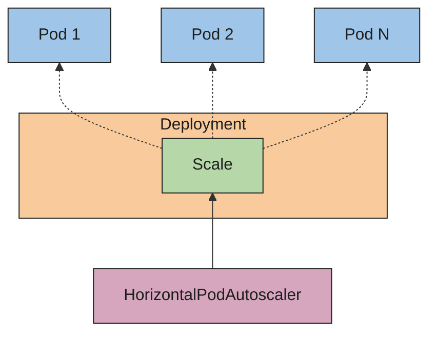

# Horizontal Pod Autoscaling

In Kubernetes, a _HorizontalPodAutoscaler_ automatically updates a workload resource (such as
a Deployment or
StatefulSet), with the
aim of automatically scaling capacity to match demand.

Horizontal scaling means that the response to increased load is to deploy more
Pods.
This is different from _vertical_ scaling, which for Kubernetes would mean
assigning more resources (for example: memory or CPU) to the Pods that are already
running for the workload.

If the load decreases, and the number of Pods is above the configured minimum,
the HorizontalPodAutoscaler instructs the workload resource (the Deployment, StatefulSet,
or other similar resource) to scale back down.

Horizontal pod autoscaling does not apply to objects that can't be scaled (for example:
a DaemonSet.)

The HorizontalPodAutoscaler is implemented as a Kubernetes API resource and a
controller.
The resource determines the behavior of the controller.
The horizontal pod autoscaling controller, running within the Kubernetes
control plane, periodically adjusts the
desired scale of its target (for example, a Deployment) to match observed metrics such as average
CPU utilization, average memory utilization, or any other custom metric you specify.

There is walkthrough example of using
horizontal pod autoscaling.

## How does a HorizontalPodAutoscaler work?



Figure 1. HorizontalPodAutoscaler controls the scale of a Deployment and its ReplicaSet

Kubernetes implements horizontal pod autoscaling as a control loop that runs intermittently
(it is not a continuous process). The interval is set by the
`--horizontal-pod-autoscaler-sync-period` parameter to the
`kube-controller-manager`
(and the default interval is 15 seconds).

Once during each period, the controller manager queries the resource utilization against the
metrics specified in each HorizontalPodAutoscaler definition. The controller manager
finds the target resource defined by the `scaleTargetRef`,
then selects the pods based on the target resource's `.spec.selector` labels,
and obtains the metrics from either the resource metrics API (for per-pod resource metrics),
or the custom metrics API (for all other metrics).

- For per-pod resource metrics (like CPU), the controller fetches the metrics
  from the resource metrics API for each Pod targeted by the HorizontalPodAutoscaler.
  Then, if a target utilization value is set, the controller calculates the utilization
  value as a percentage of the equivalent
  resource request
  on the containers in each Pod. If a target raw value is set, the raw metric values are used directly.
  The controller then takes the mean of the utilization or the raw value (depending on the type
  of target specified) across all targeted Pods, and produces a ratio used to scale
  the number of desired replicas.

  Please note that if some of the Pod's containers do not have the relevant resource request set,
  CPU utilization for the Pod will not be defined and the autoscaler will
  not take any action for that metric. See the algorithm details section below
  for more information about how the autoscaling algorithm works.

- For per-pod custom metrics, the controller functions similarly to per-pod resource metrics,
  except that it works with raw values, not utilization values.

- For object metrics and external metrics, a single metric is fetched, which describes
  the object in question. This metric is compared to the target
  value, to produce a ratio as above. In the `autoscaling/v2` API
  version, this value can optionally be divided by the number of Pods before the
  comparison is made.

The common use for HorizontalPodAutoscaler is to configure it to fetch metrics from
aggregated APIs
(`metrics.k8s.io`, `custom.metrics.k8s.io`, or `external.metrics.k8s.io`). The `metrics.k8s.io` API is
usually provided by an add-on named Metrics Server, which needs to be launched separately.
For more information about resource metrics, see
Metrics Server.

Support for metrics APIs explains the stability guarantees and support status for these
different APIs.

The HorizontalPodAutoscaler controller accesses corresponding workload resources that support scaling (such as Deployments
and StatefulSet). These resources each have a subresource named `scale`, an interface that allows you to dynamically set the
number of replicas and examine each of their current states.
For general information about subresources in the Kubernetes API, see
Kubernetes API Concepts.

### Algorithm details

From the most basic <example-value>, the HorizontalPodAutoscaler controller
operates on the ratio between desired metric value and current metric
value:

```math
\begin{equation*}
desiredReplicas = ceil\left\lceil currentReplicas \times \frac{currentMetricValue}{desiredMetricValue} \right\rceil
\end{equation*}
```

For example, if the current metric value is `200m`, and the desired value
is `100m`, the number of replicas will be doubled, since
\\( { 200.0 \div 100.0 } = 2.0 \\).
If the current value is instead `50m`, you'll halve the number of
replicas, since \\( { 50.0 \div 100.0 } = 0.5 \\). The control plane skips any scaling
action if the ratio is sufficiently close to 1.0 (within a
configurable tolerance, 0.1 by default).

When a `targetAverageValue` or `targetAverageUtilization` is specified,
the `currentMetricValue` is computed by taking the average of the given
metric across all Pods in the HorizontalPodAutoscaler's scale target.

Before checking the tolerance and deciding on the final values, the control
plane also considers whether any metrics are missing, and how many Pods
are `Ready`.
For per-pod resource metrics, all Pods with a deletion timestamp set
(objects with a deletion timestamp are in the process of being shut
down / removed) are ignored, and all failed Pods are discarded.
For external and object metrics, the replica count is based on the
number of Running and Ready Pods; terminating Pods that are still Ready
continue to count toward that total.

If a particular Pod is missing metrics, it is set aside for later; Pods
with missing metrics will be used to adjust the final scaling amount.

When scaling on CPU, if any pod has yet to become ready (it's still
initializing, or possibly is unhealthy) _or_ the most recent metric point for
the pod was before it became ready, that pod is set aside as well.

Due to technical constraints, the HorizontalPodAutoscaler controller
cannot exactly determine the first time a pod becomes ready when
determining whether to set aside certain CPU metrics. Instead, it
considers a Pod "not yet ready" if it's unready and transitioned to
ready within a short, configurable window of time since it started.
This value is configured with the `--horizontal-pod-autoscaler-initial-readiness-delay`
command line option, and its default is 30 seconds.
Once a pod has become ready, it considers any transition to
ready to be the first if it occurred within a longer, configurable time
since it started. This value is configured with the
`--horizontal-pod-autoscaler-cpu-initialization-period` command line option,
and its default is 5 minutes.

The \\( currentMetricValue \over desiredMetricValue \\) base scale ratio is then
calculated, using the remaining pods not set aside or discarded from above.

If there were any missing metrics, the control plane recomputes the average more
conservatively, assuming those pods were consuming 100% of the desired
value in case of a scale down, and 0% in case of a scale up. This dampens
the magnitude of any potential scale.

Furthermore, if any not-yet-ready pods were present, and the workload would have
scaled up without factoring in missing metrics or not-yet-ready pods,
the controller conservatively assumes that the not-yet-ready pods are consuming 0%
of the desired metric, further dampening the magnitude of a scale up.

After factoring in the not-yet-ready pods and missing metrics, the
controller recalculates the usage ratio. If the new ratio reverses the scale
direction, or is within the tolerance, the controller doesn't take any scaling
action. In other cases, the new ratio is used to decide any change to the
number of Pods.

Note that the _original_ value for the average utilization is reported
back via the HorizontalPodAutoscaler status, without factoring in the
not-yet-ready pods or missing metrics, even when the new usage ratio is
used.

If multiple metrics are specified in a HorizontalPodAutoscaler, this
calculation is done for each metric, and then the largest of the desired
replica counts is chosen. If any of these metrics cannot be converted
into a desired replica count (e.g. due to an error fetching the metrics
from the metrics APIs) and a scale down is suggested by the metrics which
can be fetched, scaling is skipped. This means that the HPA is still capable
of scaling up if one or more metrics give a `desiredReplicas` greater than
the current value.

Finally, right before HPA scales the target, the scale recommendation is recorded. The
controller considers all recommendations within a configurable window choosing the
highest recommendation from within that window. You can configure this value using the
`--horizontal-pod-autoscaler-downscale-stabilization` command line option, which defaults to 5 minutes.
This means that scaledowns will occur gradually, smoothing out the impact of rapidly
fluctuating metric values.

## Pod readiness and autoscaling metrics

The HorizontalPodAutoscaler (HPA) controller includes two command line options that influence how CPU metrics are collected from Pods during startup:

1. `--horizontal-pod-autoscaler-cpu-initialization-period` (default: 5 minutes)

  This defines the time window after a Pod starts during which its **CPU usage is ignored** unless:
    - The Pod is in a `Ready` state **and**
    - The metric sample was taken entirely during the period it was `Ready`.

  This command line option helps **exclude misleading high CPU usage** from initializing Pods (for example: Java apps warming up) in HPA scaling decisions.

1. `--horizontal-pod-autoscaler-initial-readiness-delay` (default: 30 seconds)

  This defines a short delay period after a Pod starts during which the HPA controller treats Pods that are currently `Unready` as still initializing, **even if they have previously transitioned to `Ready` briefly**.

  It is designed to:
    - Avoid including Pods that rapidly fluctuate between `Ready` and `Unready` during startup.
    - Ensure stability in the initial readiness signal before HPA considers their metrics valid.

You can only set these command line options cluster-wide.

### Key <example-value> for pod readiness {#pod-readiness-key-behaviors}

- If a Pod is `Ready` and remains `Ready`, it can be counted as contributing metrics even within the delay.
- If a Pod rapidly toggles between `Ready` and `Unready`, metrics are ignored until it’s considered stably `Ready`.

### Good practice for pod readiness {#pod-readiness-good-practices}

- Configure a `startupProbe` that doesn't pass until the high CPU usage has passed, or
- Ensure your `readinessProbe` only reports `Ready` **after** the CPU spike subsides, using `initialDelaySeconds`.

And ideally also set `--horizontal-pod-autoscaler-cpu-initialization-period` to **cover the startup duration**.

## API object

The HorizontalPodAutoscaler is an API kind in the Kubernetes
`autoscaling` API group. The current stable version can be found in
the `autoscaling/v2` API version which includes support for scaling on
memory and custom metrics. The new fields introduced in
`autoscaling/v2` are preserved as annotations when working with
`autoscaling/v1`.

When you create a HorizontalPodAutoscaler API object, make sure the name specified is a valid
DNS subdomain name.
More details about the API object can be found at
HorizontalPodAutoscaler Object.

## Stability of workload scale {#flapping}

When managing the scale of a group of replicas using the HorizontalPodAutoscaler,
it is possible that the number of replicas keeps fluctuating frequently due to the
dynamic nature of the metrics evaluated. This is sometimes referred to as _thrashing_,
or _flapping_. It's similar to the concept of _hysteresis_ in cybernetics.

## Autoscaling during rolling update

Kubernetes lets you perform a rolling update on a Deployment. In that
case, the Deployment manages the underlying ReplicaSets for you.
When you configure autoscaling for a Deployment, you bind a
HorizontalPodAutoscaler to a single Deployment. The HorizontalPodAutoscaler
manages the `replicas` field of the Deployment. The deployment controller is responsible
for setting the `replicas` of the underlying ReplicaSets so that they add up to a suitable
number during the rollout and also afterwards.

If you perform a rolling update of a StatefulSet that has an autoscaled number of
replicas, the StatefulSet directly manages its set of Pods (there is no intermediate resource
similar to ReplicaSet).
