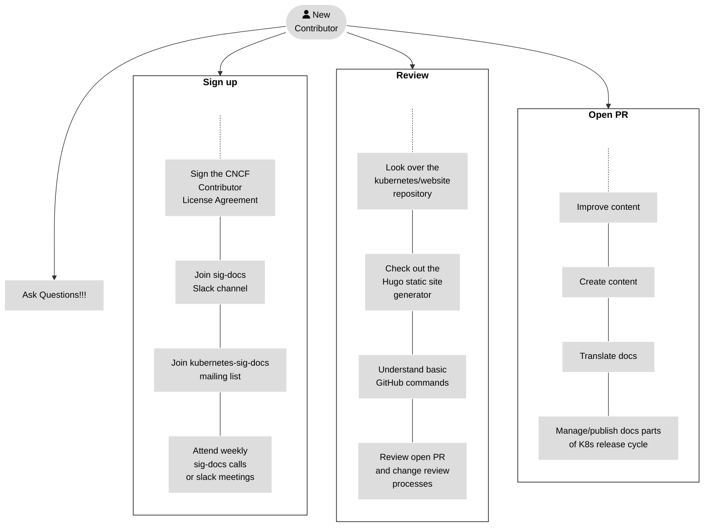
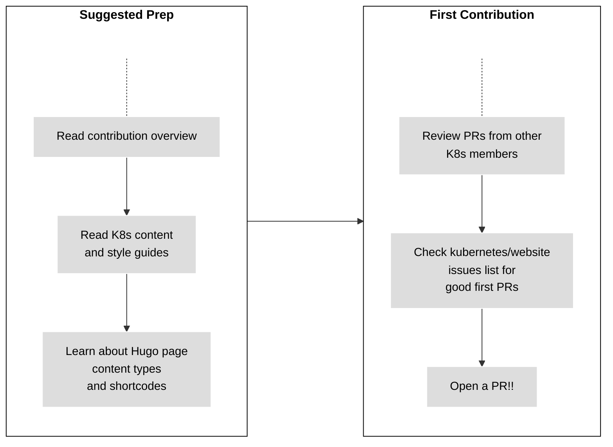

# Contribute to Kubernetes Documentation

This website is maintained by Kubernetes SIG Docs.
The Kubernetes project welcomes help from all contributors, new or experienced!

Kubernetes documentation contributors:

- Improve existing content
- Create new content
- Translate the documentation
- Manage and publish the documentation parts of the Kubernetes release cycle

The blog team, part of SIG Docs, helps manage the official blogs. Read
contributing to Kubernetes blogs to learn more.

---

**Note:**
To learn more about contributing to Kubernetes in general, see the general
contributor documentation site.

## Getting started

Anyone can open an issue about documentation, or contribute a change with a
pull request (PR) to the
`kubernetes/website` GitHub repository.
You need to be comfortable with
git and
GitHub
to work effectively in the Kubernetes community.

To get involved with documentation:

1. Sign the CNCF Contributor License Agreement.
2. Familiarize yourself with the documentation repository
   and the website's static site generator.
3. Make sure you understand the basic <example-value> for
   opening a pull request and
   reviewing changes.

Figure 1. Getting started for a new contributor.

Figure 1 outlines a roadmap for new contributors. You can follow some or all of
the steps for `Sign up` and `Review`. Now you are ready to open PRs that achieve
your contribution objectives with some listed under `Open PR`. Again, questions
are always welcome!

Some tasks require more trust and more access in the Kubernetes organization.
See Participating in SIG Docs for more details about
roles and permissions.

## Your first contribution

You can prepare for your first contribution by reviewing several steps beforehand.
Figure 2 outlines the steps and the details follow.

Figure 2. Preparation for your first contribution.

- Read the Contribution overview to
  learn about the different ways you can contribute.
- Check `kubernetes/website` issues list
  for issues that make good entry points.
- Open a pull request using GitHub
  to existing documentation and learn more about filing issues in GitHub.
- Review pull requests from other
  Kubernetes community members for accuracy and language.
- Read the Kubernetes content and
  style guides so you can leave informed comments.
- Learn about page content types
  and Hugo shortcodes.

## Getting help when contributing

Making your first contribution can be overwhelming. The
New Contributor Ambassadors
are there to walk you through making your first few contributions. You can reach out to them in the
Kubernetes Slack preferably in the `#sig-docs` channel. There is also the
New Contributors Meet and Greet call
that happens on the first Tuesday of every month. You can interact with the New Contributor Ambassadors
and get your queries resolved here.

## Get involved with SIG Docs

SIG Docs is the group of contributors who
publish and maintain Kubernetes documentation and the website. Getting
involved with SIG Docs is a great way for Kubernetes contributors (feature
development or otherwise) to have a large impact on the Kubernetes project.

SIG Docs communicates with different methods:

- Join `#sig-docs` on the Kubernetes Slack instance. Make sure to
  introduce yourself!
- Join the `kubernetes-sig-docs` mailing list,
  where broader discussions take place and official decisions are recorded.
- Join the SIG Docs video meeting
  held every two weeks. Meetings are always announced on `#sig-docs` and added to the
  Kubernetes community meetings calendar.
  You'll need to download the Zoom client or dial in using a phone.
- Join the SIG Docs async Slack standup meeting on those weeks when the in-person Zoom
  video meeting does not take place. Meetings are always announced on `#sig-docs`.
  You can contribute to any one of the threads up to 24 hours after meeting announcement.

## Other ways to contribute

- Visit the Kubernetes community site. Participate on Twitter or Stack Overflow,
  learn about local Kubernetes meetups and events, and more.
- Read the contributor cheatsheet
  to get involved with Kubernetes feature development.
- Visit the contributor site to learn more about Kubernetes Contributors
  and additional contributor resources.
- Learn how to contribute to the official blogs
- Submit a case study

## Next steps

- Learn to work from a local clone
  of the repository.
- Document features in a release.
- Participate in SIG Docs, and become a
  member or reviewer.

- Start or help with a localization.
