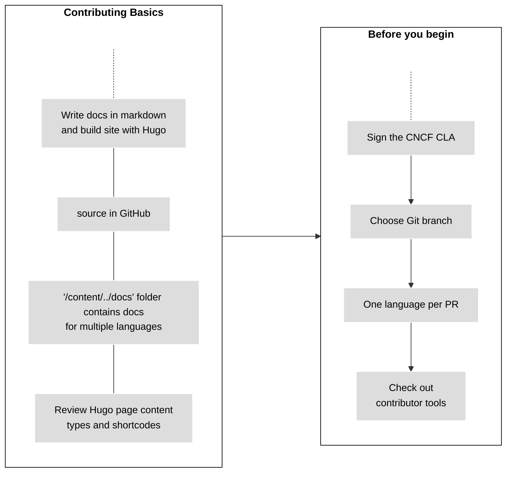

# Contributing new content

This section contains information you should know before contributing new
content.

There are also dedicated pages about submitting case studies
and blog articles.

## New content task flow

***Figure - Contributing new content preparation***

The figure above depicts the information you should know
prior to submitting new content. The information details follow.

## Contributing basics

- Write Kubernetes documentation in Markdown and build the Kubernetes site
  using Hugo.
- Kubernetes documentation uses CommonMark as its flavor of  Markdown.
- The source is in GitHub. You can find
  Kubernetes documentation at `/content/en/docs/`. Some reference documentation
  is generated with tools from the
  kubernetes-sigs/reference-docs
  repository. See the
  reference documentation section
  for the available generation guides.
- Page content types describe the
  presentation of documentation content in Hugo.
- You can use Docsy shortcodes or custom Hugo shortcodes to contribute to Kubernetes documentation.
- In addition to the standard Hugo shortcodes, we use a number of
  custom Hugo shortcodes in our
  documentation to control the presentation of content.
- Documentation source is available in multiple languages in `/content/`. Each
  language has its own folder with a two-letter code determined by the
  ISO 639-1 standard
  . For example, English documentation source is stored in `/content/en/docs/`.
- For more information about contributing to documentation in multiple languages
  or starting a new translation,
  see localization.

## Before you begin {#before-you-begin}

### Sign the CNCF CLA {#sign-the-cla}

All Kubernetes contributors **must** read
the Contributor guide
and sign the Contributor License Agreement (CLA)
.

Pull requests from contributors who haven't signed the CLA fail the automated
tests. The name and email you provide must match those found in
your `git config`, and your git name and email must match those used for the
CNCF CLA.

### Choose which Git branch to use

When opening a pull request, you need to know in advance which branch to base
your work on.

Scenario | Branch
:---------|:------------
Existing or new English language content for the current release | `main`
Content for a feature change release | The branch which corresponds to the major and minor version the feature change is in, using the pattern `dev-<version>`. For example, if a feature changes in the `v` release, then add documentation changes to the ``dev-`` branch.
Content in other languages (localizations) | Use the localization's convention. See the Localization branching strategy for more information.

If you're still not sure which branch to choose, ask in `#sig-docs` on Slack.

**Note:** If you already submitted your pull request and you know that the
base branch was wrong, you (and only you, the submitter) can change it.

### Languages per PR

Limit pull requests to one language per PR. If you need to make an identical
change to the same code sample in multiple languages, open a separate PR for
each language.

## Tools for contributors

The doc contributors tools
directory in the `kubernetes/website` repository contains tools to help your
contribution journey go more smoothly.

## What's next

* Read about submitting blog articles.
