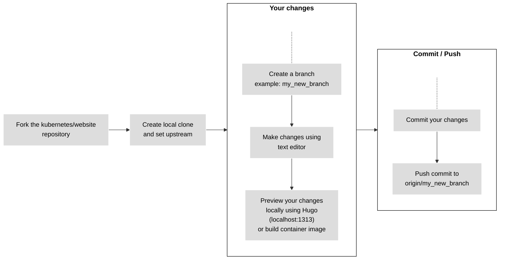
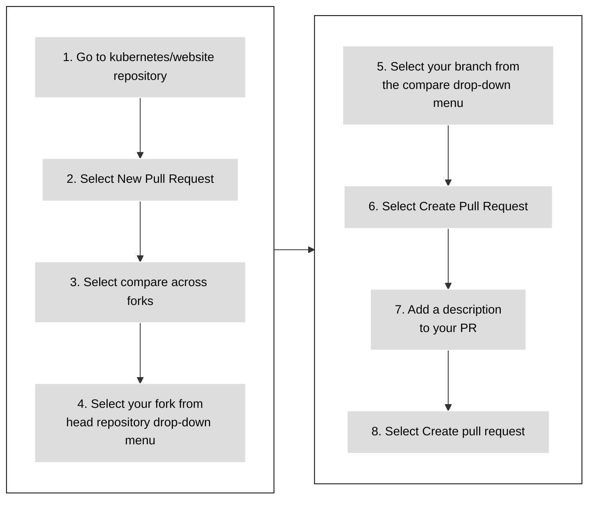

# Opening a pull request (part 2 of 2)

## Work from a local fork {#fork-the-repo}

If you're more experienced with git, or if your changes are larger than a few lines,
work from a local fork.

Make sure you have git installed
on your computer. You can also use a git UI application.

Figure 2 shows the steps to follow when you work from a local fork. The details for each step follow.



Figure 2. Working from a local fork to make your changes.

### Fork the kubernetes/website repository

1. Navigate to the `kubernetes/website` repository.
1. Select **Fork**.

### Create a local clone and set the upstream

1. In a terminal window, clone your fork and update the Docsy Hugo theme:

   ```shell
   git clone user@example.com:<github_username>/website
   cd website
   ```

1. Navigate to the new `website` directory. Set the `kubernetes/website` repository as the `upstream` remote:

   ```shell
   cd website

   git remote add upstream https://github.com/kubernetes/website.git
   ```

1. Confirm your `origin` and `upstream` repositories:

   ```shell
   git remote -v
   ```

   Output is similar to:

   ```none
   origin	user@example.com:<github_username>/website.git (fetch)
   origin	user@example.com:<github_username>/website.git (push)
   upstream	https://github.com/kubernetes/website.git (fetch)
   upstream	https://github.com/kubernetes/website.git (push)
   ```

1. Fetch commits from your fork's `origin/main` and `kubernetes/website`'s `upstream/main`:

   ```shell
   git fetch origin
   git fetch upstream
   ```

   This makes sure your local repository is up to date before you start making changes.

   **Note:**
   This workflow is different than the
   Kubernetes Community GitHub Workflow.
   You do not need to merge your local copy of `main` with `upstream/main` before pushing updates
   to your fork.

### Create a branch

1. Decide which branch to base your work on:

   - For improvements to existing content, use `upstream/main`.
   - For new content about existing features, use `upstream/main`.
   - For localized content, use the localization's conventions. For more information, see
     localizing Kubernetes documentation.
   - For new features in an upcoming Kubernetes release, use the feature branch. For more
     information, see documenting for a release.
   - For long-running efforts that multiple SIG Docs contributors collaborate on,
     like content reorganization, use a specific feature branch created for that effort.

   If you need help choosing a branch, ask in the `#sig-docs` Slack channel.

1. Create a new branch based on the branch identified in step 1. This example assumes the base
   branch is `upstream/main`:

   ```shell
   git checkout -b <my_new_branch> upstream/main
   ```

1. Make your changes using a text editor.

At any time, use the `git status` command to see what files you've changed.

### Commit your changes

When you are ready to submit a pull request, commit your changes.

1. In your local repository, check which files you need to commit:

   ```shell
   git status
   ```

   Output is similar to:

   ```none
   On branch <my_new_branch>
   Your branch is up to date with 'origin/<my_new_branch>'.

   Changes not staged for commit:
   (use "git add <file>..." to update what will be committed)
   (use "git checkout -- <file>..." to discard changes in working directory)

   modified:   content/en/docs/contribute/new-content/contributing-content.md

   no changes added to commit (use "git add" and/or "git commit -a")
   ```

1. Add the files listed under **Changes not staged for commit** to the commit:

   ```shell
   git add <your_file_name>
   ```

   Repeat this for each file.

1. After adding all the files, create a commit:

   ```shell
   git commit -m "Your commit message"
   ```

   **Note:**
   Do not use any GitHub Keywords
   in your commit message. You can add those to the pull request
   description later.

1. Push your local branch and its new commit to your remote fork:

   ```shell
   git push origin <my_new_branch>
   ```

### Preview your changes locally {#preview-locally}

It's a good idea to preview your changes locally before pushing them or
opening a pull request. The Previewing locally
article explains how you can run a website locally and preview
the suggested changes.

### Open a pull request from your fork to kubernetes/website {#open-a-pr}

Figure 3 shows the steps to open a PR from your fork to the kubernetes/website. The details follow.

Please, note that contributors can mention `kubernetes/website` as `k/website`.



Figure 3. Steps to open a PR from your fork to the kubernetes/website.

1. In a web browser, go to the `kubernetes/website` repository.
1. Select **New Pull Request**.
1. Select **compare across forks**.
1. From the **head repository** drop-down menu, select your fork.
1. From the **compare** drop-down menu, select your branch.
1. Select **Create Pull Request**.
1. Add a description for your pull request:

    - **Title** (50 characters or less): Summarize the intent of the change.
    - **Description**: Describe the change in more detail.

      - If there is a related GitHub issue, include `Fixes #12345` or `Closes #12345` in the
        description. GitHub's automation closes the mentioned issue after merging the PR if used.
        If there are other related PRs, link those as well.
      - If you want advice on something specific, include any questions you'd like reviewers to
        think about in your description.

1. Select the **Create pull request** button.

Congratulations! Your pull request is available in Pull requests.

After opening a PR, GitHub runs automated tests and tries to deploy a preview using
Netlify.

- If the Netlify build fails, select **Details** for more information.
- If the Netlify build succeeds, select **Details** opens a staged version of the Kubernetes
  website with your changes applied. This is how reviewers check your changes.

GitHub also automatically assigns labels to a PR, to help reviewers. You can add them too, if
needed. For more information, see Adding and removing issue labels.

### Addressing feedback locally

1. After making your changes, amend your previous commit:

   ```shell
   git commit -a --amend
   ```

   - `-a`: commits all changes
   - `--amend`: amends the previous commit, rather than creating a new one

1. Update your commit message if needed.

1. Use `git push origin <my_new_branch>` to push your changes and re-run the Netlify tests.

   **Note:**
   If you use `git commit -m` instead of amending, you must squash your commits
   before merging.

#### Changes from reviewers

Sometimes reviewers commit to your pull request. Before making any other changes, fetch those commits.

1. Fetch commits from your remote fork and rebase your working branch:

   ```shell
   git fetch origin
   git rebase origin/<your-branch-name>
   ```

1. After rebasing, force-push new changes to your fork:

   ```shell
   git push --force-with-lease origin <your-branch-name>
   ```

#### Merge conflicts and rebasing

**Note:**
For more information, see Git Branching - Basic <example-value> and Merging,
Advanced Merging, or ask in the
`#sig-docs` Slack channel for help.

If another contributor commits changes to the same file in another PR, it can create a merge
conflict. You must resolve all merge conflicts in your PR.

1. Update your fork and rebase your local branch:

   ```shell
   git fetch origin
   git rebase origin/<your-branch-name>
   ```

   Then force-push the changes to your fork:

   ```shell
   git push --force-with-lease origin <your-branch-name>
   ```

1. Fetch changes from `kubernetes/website`'s `upstream/main` and rebase your branch:

   ```shell
   git fetch upstream
   git rebase upstream/main
   ```

1. Inspect the results of the rebase:

   ```shell
   git status
   ```

   This results in a number of files marked as conflicted.

1. Open each conflicted file and look for the conflict markers: `>>>`, `<<<`, and `===`.
   Resolve the conflict and delete the conflict marker.

   **Note:**
   For more information, see How conflicts are presented.

1. Add the files to the changeset:

   ```shell
   git add <filename>
   ```

1. Continue the rebase:

   ```shell
   git rebase --continue
   ```

1. Repeat steps 2 to 5 as needed.

   After applying all commits, the `git status` command shows that the rebase is complete.

1. Force-push the branch to your fork:

   ```shell
   git push --force-with-lease origin <your-branch-name>
   ```

   The pull request no longer shows any conflicts.

### Squashing commits

**Note:**
For more information, see Git Tools - Rewriting History,
or ask in the `#sig-docs` Slack channel for help.

If your PR has multiple commits, you must squash them into a single commit before merging your PR.
You can check the number of commits on your PR's **Commits** tab or by running the `git log`
command locally.

**Note:**
This topic assumes `vim` as the command line text editor.

1. Start an interactive rebase:

   ```shell
   git rebase -i HEAD~<number_of_commits_in_branch>
   ```

   Squashing commits is a form of rebasing. The `-i` switch tells git you want to rebase interactively.
   `HEAD~<number_of_commits_in_branch` indicates how many commits to look at for the rebase.

   Output is similar to:

   ```none
   pick d875112ca Original commit
   pick 4fa167b80 Address feedback 1
   pick 7d54e15ee Address feedback 2

   # Rebase 3d18sf680..7d54e15ee onto 3d183f680 (3 commands)

   ...

   # These lines can be re-ordered; they are executed from top to bottom.
   ```

   The first section of the output lists the commits in the rebase. The second section lists the
   options for each commit. Changing the word `pick` changes the status of the commit once the rebase
   is complete.

   For the purposes of rebasing, focus on `squash` and `pick`.

   **Note:**
   For more information, see Interactive Mode.

1. Start editing the file.

   Change the original text:

   ```none
   pick d875112ca Original commit
   pick 4fa167b80 Address feedback 1
   pick 7d54e15ee Address feedback 2
   ```

   To:

   ```none
   pick d875112ca Original commit
   squash 4fa167b80 Address feedback 1
   squash 7d54e15ee Address feedback 2
   ```

   This squashes commits `4fa167b80 Address feedback 1` and `7d54e15ee Address feedback 2` into
   `d875112ca Original commit`, leaving only `d875112ca Original commit` as a part of the timeline.

1. Save and exit your file.

1. Push your squashed commit:

   ```shell
   git push --force-with-lease origin <branch_name>
   ```

## Contribute to other repos

The Kubernetes project contains 50+ repositories. Many of these
repositories contain documentation: user-facing help text, error messages, API references or code
comments.

If you see text you'd like to improve, use GitHub to search all repositories in the Kubernetes
organization. This can help you figure out where to submit your issue or PR.

Each repository has its own processes and procedures. Before you file an issue or submit a PR,
read that repository's `README.md`, `CONTRIBUTING.md`, and `code-of-conduct.md`, if they exist.

Most repositories use issue and PR templates. Have a look through some open issues and PRs to get
a feel for that team's processes. Make sure to fill out the templates with as much detail as
possible when you file issues or PRs.

## What's next

- Read Reviewing to learn more about the review process.
