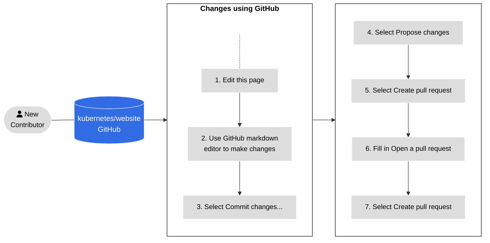

# Opening a pull request

**Note:**
**Code developers**: If you are documenting a new feature for an
upcoming Kubernetes release, see
Document a new feature.

To contribute new content pages or improve existing content pages, open a pull request (PR).
Make sure you follow all the requirements in the
Before you begin section.

If your change is small, or you're unfamiliar with git, read
Changes using GitHub to learn how to edit a page.

If your changes are large, read Work from a local fork to learn how to make
changes locally on your computer.

## Changes using GitHub

If you're less experienced with git workflows, here's an easier method of
opening a pull request. Figure 1 outlines the steps and the details follow.

Figure 1. Steps for opening a PR using GitHub.

1. On the page where you see the issue, select the **Edit this page** option in the right-hand side navigation panel.

1. Make your changes in the GitHub markdown editor.

1. On the right above the editor, Select **Commit changes**.
   In the first field, give your commit message a title.
   In the second field, provide a description.

   **Note:**
   Do not use any GitHub Keywords
   in your commit message. You can add those to the pull request description later.

1. Select **Propose changes**.

1. Select **Create pull request**.

1. The **Open a pull request** screen appears. Fill in the form:

   - The **Add a title** field of the pull request defaults to the commit summary.
     You can change it if needed.
   - The **Add a description** field contains your extended commit message, if you have one,
     and some template text. Add the
     details the template text asks for, then delete the extra template text.
   - Leave the **Allow edits from maintainers** checkbox selected.

   **Note:**
   PR descriptions are a great way to help reviewers understand your change.
   For more information, see Opening a PR.

1. Select **Create pull request**.

### Addressing feedback in GitHub

Before merging a pull request, Kubernetes community members review and
approve it. The `k8s-ci-robot` suggests reviewers based on the nearest
owner mentioned in the pages. If you have someone specific in mind,
leave a comment with their GitHub username in it.

If a reviewer asks you to make changes:

1. Go to the **Files changed** tab.
1. Select the pencil (edit) icon on any files changed by the pull request.
1. Make the changes requested.
1. Commit the changes.

If you are waiting on a reviewer, reach out once every 7 days. You can also post a message in the
`#sig-docs` Slack channel.

When your review is complete, a reviewer merges your PR and your changes go live a few minutes later.
