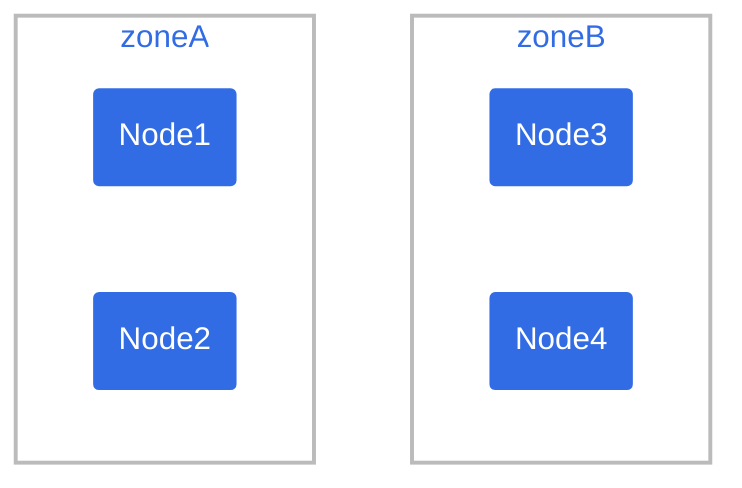
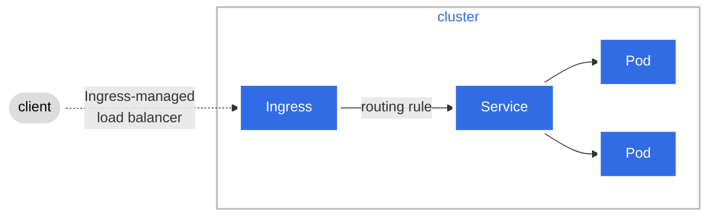
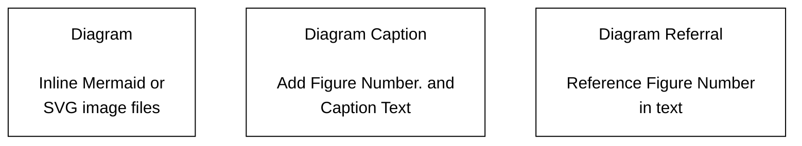

# Diagram Guide (part 2 of 2)

## Examples

This section shows several examples of Mermaid diagrams.

**Note:**
The code block examples omit the Hugo Mermaid
shortcode tags. This allows you to copy the code block into the live editor
to experiment on your own.
Note that the live editor doesn't recognize Hugo shortcodes.

### Example 1 - Pod topology spread constraints

Figure 6 shows the diagram appearing in the
Pod topology spread constraints
page.



Figure 6. Pod Topology Spread Constraints.

Code block:

```text
graph TB
   subgraph "zoneB"
       n3(Node3)
       n4(Node4)
   end
   subgraph "zoneA"
       n1(Node1)
       n2(Node2)
   end
 
   classDef plain fill:#ddd,stroke:#fff,stroke-width:4px,color:#000;
   classDef k8s fill:#326ce5,stroke:#fff,stroke-width:4px,color:#fff;
   classDef cluster fill:#fff,stroke:#bbb,stroke-width:2px,color:#326ce5;
   class n1,n2,n3,n4 k8s;
   class zoneA,zoneB cluster;
```

### Example 2 - Ingress

Figure 7 shows the diagram appearing in the What is Ingress page.


Figure 7. Ingress

Code block:

```text
graph LR;
 client([client])-. Ingress-managed <br> load balancer .->ingress[Ingress];
 ingress-->|routing rule|service[Service];
 subgraph cluster
 ingress;
 service-->pod1[Pod];
 service-->pod2[Pod];
 end
 classDef plain fill:#ddd,stroke:#fff,stroke-width:4px,color:#000;
 classDef k8s fill:#326ce5,stroke:#fff,stroke-width:4px,color:#fff;
 classDef cluster fill:#fff,stroke:#bbb,stroke-width:2px,color:#326ce5;
 class ingress,service,pod1,pod2 k8s;
 class client plain;
 class cluster cluster;
```

### Example 3 - K8s system flow

Figure 8 depicts a Mermaid sequence diagram showing the system flow between
K8s components to start a container.

Code block:

```text
%%{init:{"theme":"neutral"}}%%
sequenceDiagram
    actor me
    participant apiSrv as control plane<br><br>api-server
    participant etcd as control plane<br><br>etcd datastore
    participant cntrlMgr as control plane<br><br>controller<br>manager
    participant sched as control plane<br><br>scheduler
    participant kubelet as node<br><br>kubelet
    participant container as node<br><br>container<br>runtime
    me->>apiSrv: 1. kubectl create -f pod.yaml
    apiSrv-->>etcd: 2. save new state
    cntrlMgr->>apiSrv: 3. check for changes
    sched->>apiSrv: 4. watch for unassigned pods(s)
    apiSrv->>sched: 5. notify about pod w nodename=" "
    sched->>apiSrv: 6. assign pod to node
    apiSrv-->>etcd: 7. save new state
    kubelet->>apiSrv: 8. look for newly assigned pod(s)
    apiSrv->>kubelet: 9. bind pod to node
    kubelet->>container: 10. start container
    kubelet->>apiSrv: 11. update pod status
    apiSrv-->>etcd: 12. save new state
```

## How to style diagrams

You can style one or more diagram elements using well-known CSS nomenclature.
You accomplish this using two types of statements in the Mermaid code.

* `classDef` defines a class of style attributes.
* `class` defines one or more elements to apply the class to.

In the code for
figure 7,
you can see examples of both.

```text
classDef k8s fill:#326ce5,stroke:#fff,stroke-width:4px,color:#fff; // defines style for the k8s class
class ingress,service,pod1,pod2 k8s; // k8s class is applied to elements ingress, service, pod1 and pod2.
```

You can include one or multiple `classDef` and `class` statements in your diagram.
You can also use the official K8s `#326ce5` hex color code for K8s components in your diagram.

For more information on styling and classes, see
Mermaid Styling and classes docs.

## How to use captions

A caption is a brief description of a diagram. A title or a short description
of the diagram are examples of captions. Captions aren't meant to replace
explanatory text you have in your documentation. Rather, they serve as a
"context link" between that text and your diagram.

The combination of some text and a diagram tied together with a caption help
provide a concise representation of the information you wish to convey to the
user.

Without captions, you are asking the user to scan the text above or below the
diagram to figure out a meaning. This can be frustrating for the user.

Figure 9 lays out the three components for proper captioning: diagram, diagram
caption and the diagram referral.


Figure 9. Caption Components.

**Note:**
You should always add a caption to each diagram in your documentation.

**Diagram**

The `Mermaid+SVG` and `External Tool` methods generate `.svg` image files.

Here is the `` shortcode for the diagram defined in an
`.svg` image file saved to `/images/docs/components-of-kubernetes.svg`:

```none

```

You should pass the `src`, `alt`, `class` and `caption` values into the
`` shortcode. You can adjust the size of the diagram using
`diagram-large`, `diagram-medium` and `diagram-small` classes.

**Note:**
Diagrams created using the `Inline` method don't use the figure
shortcode. The Mermaid code defines how the diagram will render on your page.

See Methods for creating diagrams
for more information on the different methods for creating diagrams.

**Diagram Caption**

Next, add a diagram caption.

If you define your diagram in an `.svg` image file, then you should use the
`` shortcode's `caption` parameter.

```none

```

If you define your diagram using inline Mermaid code, then you should use Markdown text.

```none
Figure 4. Kubernetes Architecture Components
```

The following lists several items to consider when adding diagram captions:

* Use the `` shortcode to add a diagram caption for `Mermaid+SVG`
  and `External Tool` diagrams.
* Use simple Markdown text to add a diagram caption for the `Inline` method.
* Prepend your diagram caption with `Figure NUMBER.`. You must use `Figure`
  and the number must be unique for each diagram in your documentation page.
  Add a period after the number.
* Add your diagram caption text after the `Figure NUMBER.` on the same line.
  You must punctuate the caption with a period. Keep the caption text short.
* Position your diagram caption __BELOW__ your diagram.

**Diagram Referral**

Finally, you can add a diagram referral. This is used inside your text and
should precede the diagram itself. It allows a user to connect your text with
the associated diagram. The `Figure NUMBER` in your referral and caption must
match.

You should avoid using spatial references such as `..the image below..` or
`..the following figure ..`

Here is an example of a diagram referral:

```text
Figure 10 depicts the components of the Kubernetes architecture.
The control plane ...
```
Diagram referrals are optional and there are cases where they might not be
suitable. If you are not sure, add a diagram referral to your text to see if
it looks and sounds okay. When in doubt, use a diagram referral.

**Complete picture**

Figure 10 shows the Kubernetes Architecture diagram that includes the diagram,
diagram caption and diagram referral. The `` shortcode
renders the diagram, adds the caption and includes the optional `link`
parameter so you can hyperlink the diagram. The diagram referral is contained
in this paragraph.

Here is the `` shortcode for this diagram:

```

```

## Tips

* Always use the live editor to create/edit your diagram.

* Always use Hugo local and Netlify previews to check out how the diagram
  appears in the documentation.

* Include diagram source pointers such as a URL, source code location, or
  indicate the code is self-documenting.

* Always use diagram captions.

* Very helpful to include the diagram `.svg` or `.png` image and/or Mermaid
  source code in issues and PRs.

* With the `Mermaid+SVG` and `External Tool` methods, use `.svg` image files
  because they stay sharp when you zoom in on the diagram.

* Best practice for `.svg` files is to load it into an SVG editing tool and use the
  "Convert text to paths" function.
  This ensures that the diagram renders the same on all systems, regardless of font
  availability and font rendering support.

* No Mermaid support for additional icons or artwork.

* Hugo Mermaid shortcodes don't work in the live editor.

* Any time you modify a diagram in the live editor, you __must__ save it
  to generate a new URL for the diagram.

* Click on the diagrams in this section to view the code and diagram rendering
  in the live editor.

* Look over the source code of this page, `diagram-guide.md`, for more examples.

* Check out the Mermaid docs
  for explanations and examples.

Most important, __Keep Diagrams Simple__.
This will save time for you and fellow contributors, and allow for easier reading
by new and experienced users.
