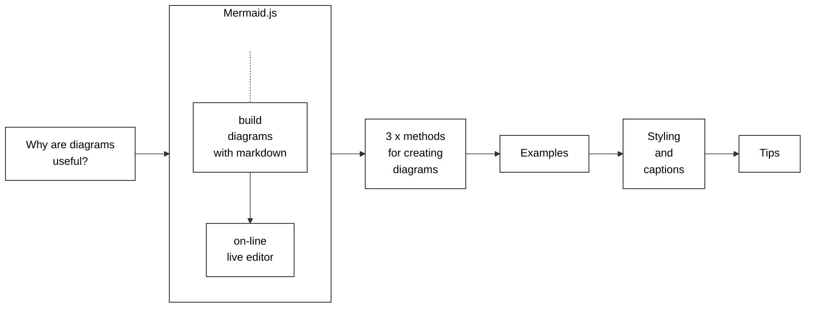
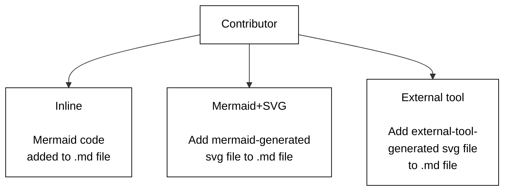
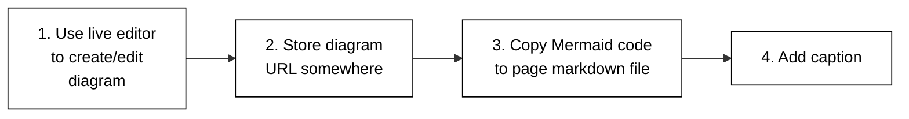
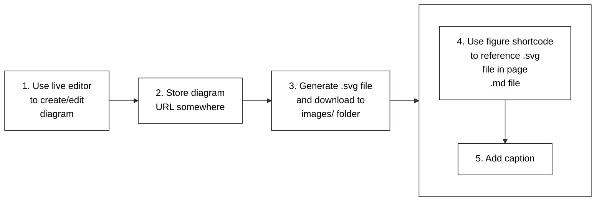
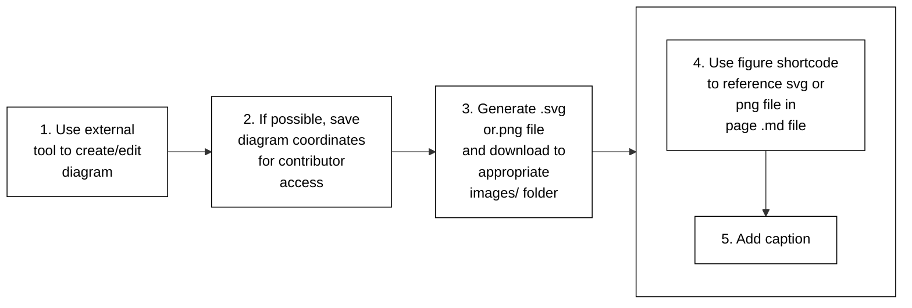

# Diagram Guide

This guide shows you how to create, edit and share diagrams using the Mermaid
JavaScript library. Mermaid.js allows you to generate diagrams using a simple
markdown-like syntax inside Markdown files. You can also use Mermaid to
generate `.svg` or `.png` image files that you can add to your documentation.

The target audience for this guide is anybody wishing to learn about Mermaid
and/or how to create and add diagrams to Kubernetes documentation.

Figure 1 outlines the topics covered in this section.



Figure 1. Topics covered in this section.

All you need to begin working with Mermaid is the following:

* Basic <example-value> of markdown.
* Using the Mermaid live editor.
* Using Hugo shortcodes.
* Using the Hugo  shortcode.
* Performing Hugo local previews.
* Familiar with the Contributing new content process.

**Note:**
You can click on each diagram in this section to view the code and rendered
diagram in the Mermaid live editor.

## Why you should use diagrams in documentation

Diagrams improve documentation clarity and comprehension. There are advantages for both the user and the contributor.

The user benefits include:

* __Friendly landing spot__. A detailed text-only greeting page could
  intimidate users, in particular, first-time Kubernetes users.
* __Faster grasp of concepts__. A diagram can help users understand the key
  points of a complex topic. Your diagram can serve as a visual learning guide
  to dive into the topic details.
* __Better retention__. For some, it is easier to recall pictures rather than text.

The contributor benefits include:

* __Assist in developing the structure and content__ of your contribution. For
  example, you can start with a simple diagram covering the high-level points
  and then dive into details.
* __Expand and grow the user community__. Easily consumed documentation
  augmented with diagrams attracts new users who might previously have been
  reluctant to engage due to perceived complexities.

You should consider your target audience. In addition to experienced K8s
users, you will have many who are new to Kubernetes. Even a simple diagram can
assist new users in absorbing Kubernetes concepts. They become emboldened and
more confident to further explore Kubernetes and the documentation.

## Mermaid

Mermaid is an open source
JavaScript library that allows you to create, edit and easily share diagrams
using a simple, markdown-like syntax configured inline in Markdown files.

The following lists features of Mermaid:

* Simple code syntax.
* Includes a web-based tool allowing you to code and preview your diagrams.
* Supports multiple formats including flowchart, state and sequence.
* Easy collaboration with colleagues by sharing a per-diagram URL.
* Broad selection of shapes, lines, themes and styling.

The following lists advantages of using Mermaid:

* No need for separate, non-Mermaid diagram tools.
* Adheres to existing PR workflow. You can think of Mermaid code as just
  Markdown text included in your PR.
* Simple tool builds simple diagrams. You don't want to get bogged down
  (re)crafting an overly complex and detailed picture. Keep it simple!

Mermaid provides a simple, open and transparent method for the SIG communities
to add, edit and collaborate on diagrams for new or existing documentation.

**Note:**
You can still use Mermaid to create/edit diagrams even if it's not supported
in your environment. This method is called __Mermaid+SVG__ and is explained
below.

### Live editor

The Mermaid live editor is
a web-based tool that enables you to create, edit and review diagrams.

The following lists live editor functions:

* Displays Mermaid code and rendered diagram.
* Generates a URL for each saved diagram. The URL is displayed in the URL
  field of your browser. You can share the URL with colleagues who can access
  and modify the diagram.
* Option to download `.svg` or `.png` files.

**Note:**
The live editor is the easiest and fastest way to create and edit Mermaid diagrams.

## Methods for creating diagrams

Figure 2 outlines the three methods to generate and add diagrams.



Figure 2. Methods to create diagrams.

### Inline

Figure 3 outlines the steps to follow for adding a diagram using the Inline
method.



Figure 3. Inline Method steps.

The following lists the steps you should follow for adding a diagram using the Inline method:

1. Create your diagram using the live editor.
2. Store the diagram URL somewhere for later access.
3. Copy the mermaid code to the location in your `.md` file where you want the diagram to appear.
4. Add a caption below the diagram using Markdown text.

A Hugo build runs the Mermaid code and turns it into a diagram.

**Note:**
You may find keeping track of diagram URLs is cumbersome. If so, make a note
in the `.md` file that the Mermaid code is self-documenting. Contributors can
copy the Mermaid code to and from the live editor for diagram edits.

Here is a sample code snippet contained in an `.md` file:

```
---
title: My PR
---
Figure 17 shows a simple A to B process.
some markdown text
...
 
    graph TB
    A --> B


Figure 17. A to B
more text
```
**Note:**
You must include the Hugo Mermaid shortcode
tags at the start and end of the Mermaid code block. You should add a diagram
caption below the diagram.

For more details on diagram captions, see How to use captions.

The following lists advantages of the Inline method:

* Live editor tool.
* Easy to copy Mermaid code to and from the live editor and your `.md` file.
* No need for separate `.svg` image file handling.
* Content text, diagram code and diagram caption contained in the same `.md` file.

You should use the local
and Netlify previews to verify the diagram is properly rendered.

**Caution:**
The Mermaid live editor feature set may not support the kubernetes/website Mermaid feature set.
And please, note that contributors can mention `kubernetes/website` as `k/website`.
You might see a syntax error or a blank screen after the Hugo build.
If that is the case, consider using the Mermaid+SVG method.

### Mermaid+SVG

Figure 4 outlines the steps to follow for adding a diagram using the Mermaid+SVG method.



Figure 4. Mermaid+SVG method steps.

The following lists the steps you should follow for adding a diagram using the Mermaid+SVG method:

1. Create your diagram using the live editor.
2. Store the diagram URL somewhere for later access.
3. Generate an `.svg` image file for the diagram and download it to the appropriate `images/` folder.
4. Use the `` shortcode to reference the diagram in the `.md` file.
5. Add a caption using the `` shortcode's `caption` parameter.

For example, use the live editor to create a diagram called `boxnet`.
Store the diagram URL somewhere for later access. Generate and download a
`boxnet.svg` file to the appropriate `../images/` folder.

Use the `` shortcode in your PR's `.md` file to reference
the `.svg` image file and add a caption.

```json

```

For more details on diagram captions, see How to use captions.

**Note:**
The figure shortcode is the preferred method for adding `.svg` image files
to your documentation. You can also use the standard markdown image syntax like so:
``.
And you will need to add a caption below the diagram.

You should add the live editor URL as a comment block in the `.svg` image file using a text editor.
For example, you would include the following at the beginning of the `.svg` image file:

```
<!-- To view or edit the mermaid code, use the following URL: -->
<!-- https://mermaid-js.github.io/mermaid-live-editor/edit/#eyJjb ... <remainder of the URL> -->
```

The following lists advantages of the Mermaid+SVG method:

* Live editor tool.
* Live editor tool supports the most current Mermaid feature set.
* Employ existing kubernetes/website methods for handling `.svg` image files.
* Environment doesn't require Mermaid support.

Be sure to check that your diagram renders properly using the
local
and Netlify previews.

### External tool

Figure 5 outlines the steps to follow for adding a diagram using the External Tool method.

First, use your external tool to create the diagram and save it as an `.svg`
or `.png` image file. After that, use the same steps as the __Mermaid+SVG__
method for adding `.svg` image files.



Figure 5. External Tool method steps

The following lists the steps you should follow for adding a diagram using the External Tool method:

1. Use your external tool to create a diagram.
2. Save the diagram coordinates for contributor access. For example, your tool
   may offer a link to the diagram image, or you could place the source code
   file, such as an `.xml` file, in a public repository for later contributor access.
3. Generate and save the diagram as an `.svg` or `.png` image file.
   Download this file to the appropriate `../images/` folder.
4. Use the `` shortcode to reference the diagram in the `.md` file.
5. Add a caption using the `` shortcode's `caption` parameter.

Here is the `` shortcode for the `images/apple.svg` diagram:
```text
 
```

If your external drawing tool permits:

* You can incorporate multiple `.svg` or `.png` logos, icons and images into your diagram.
  However, make sure you observe copyright and follow the Kubernetes documentation
  guidelines on the use of third party content.
* You should save the diagram source coordinates for later contributor access.
  For example, your tool may offer a link to the diagram image, or you could
  place the source code file, such as an `.xml` file, somewhere for contributor access.

For more information on K8s and CNCF logos and images, check out
CNCF Artwork.

The following lists advantages of the External Tool method:

* Contributor familiarity with external tool.
* Diagrams require more detail than what Mermaid can offer.

Don't forget to check that your diagram renders correctly using the
local and Netlify previews.
