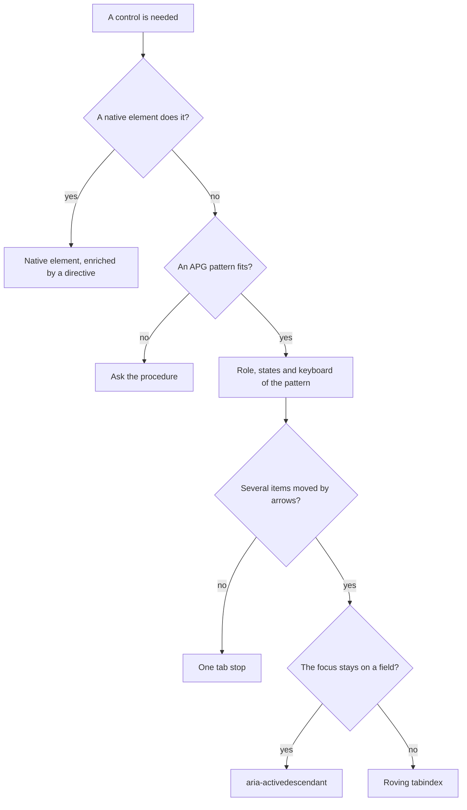

# Own components: the rules

Contents: 1. Native first · 2. Angular 22 building blocks · 3. Steps · 4. Checklist · Sources

The team writes its own components. Never import Angular Material, the CDK or Angular Aria, even when
the Angular documentation suggests them. [S3]

## 1. Native first (the role is a promise)

- Use the native element when it does the job: `<button type="button">`, `<input type="checkbox">`,
  `<select>`, `<dialog>`, `<details>`, `<progress>`, `<input type="range">`. Enrich it with a directive
  on an attribute selector: `button[appSwitch]`. [S1] [S3]
- A role written in ARIA promises its whole keyboard: the browser gives neither keys nor style for it.
  "No ARIA is better than bad ARIA." [S1]
- No native element: take the pattern of the WAI-ARIA Authoring Practices (APG). No pattern fits: ask
  the user for the procedure.



## 2. Angular 22 building blocks (host, input, model)

| Need | Write | Rule |
| --- | --- | --- |
| Role, ARIA, `tabindex`, listeners on the host | `host: { role: 'switch', '[attr.aria-checked]': 'checked()' }` | Not `@HostBinding` nor `@HostListener` [S2] |
| A value received | `input()`, `input.required()`; `booleanAttribute` as transform | Read only [S2] |
| A value the user changes | `model()`; `[(value)]` on the parent | Write with `set` or `update` [S2] |
| An ARIA attribute in a template | `[attr.aria-expanded]="isOpen()"` | `undefined` removes the attribute [S2] |
| A child element | `viewChild()`, `contentChildren()` | Direct children only, unless `descendants: true` [S2] |
| Work on the DOM after rendering | `afterNextRender()` | Browser only, in an injection context [S2] |
| A form control of the team | `FormValueControl<T>` with `value = model()` | Validation stays in the schema [S2] |

- Bind one attribute in one place only: a template binding wins over a host binding. [S2]
- Ids for ARIA (`aria-labelledby`, `aria-controls`): a module counter, as in the select box template.
- Never write `standalone: true` nor `changeDetection: OnPush`: both are the default in Angular 22.

```ts
@Directive({
  selector: 'button[appSwitch]',
  host: { 'role': 'switch', 'type': 'button', '[attr.aria-checked]': 'checked()', '(click)': 'checked.set(!checked())' },
})
export class Switch {
  public readonly checked = model(false);
}
```

## 3. Steps (write a component)

1. Look for the native element; use it and enrich it.
2. Else take an APG pattern (`patterns.md`); none fits: ask.
3. Write the role and all its states, in `host` or in the template; give an accessible name.
4. Choose the focus model: one stop, roving tabindex, or `aria-activedescendant` (`keyboard-focus.md`).
5. Write the whole keyboard of the pattern, Escape, Home and End included.
6. An overlay: `showModal()` when it blocks, `popover` otherwise; focus back to the trigger (`overlays.md`).
7. State in signals: `input()` for what comes in, `model()` for the value.
8. Test: lint, keyboard test, ARIA attributes (`testing-a11y.md`).

Tested template: `skills/angular/write-component/assets/component/` (a select-only combobox).

## 4. Checklist (before saying done)

- [ ] Would a native element have done it?
- [ ] Has the component an accessible name?
- [ ] Has each visible state its attribute: `aria-expanded`, `aria-selected`, `aria-checked`,
  `aria-pressed`, `aria-disabled`?
- [ ] Does Tab reach the component in one stop, and leave it?
- [ ] Do all the keys of the pattern work?
- [ ] Is the focus always visible, and distinct from the selection?
- [ ] On close, does the focus go back to the trigger? Does Escape close the overlay?
- [ ] Are targets at least 24 by 24 CSS pixels? [S4]
- [ ] No import of Material, CDK or Angular Aria?

## Sources

- [S1] W3C WAI, 2026, "Read Me First", ARIA Authoring Practices Guide (APG). In the library: `library/mdn-accessibility/` for ARIA.
- [S2] Angular Team, 2026, "Components: host elements", "Inputs", "Model inputs", angular.dev v22.
- [S3] Angular Team, 2026, "Accessibility", angular.dev v22; decision of this base: no component library.
- [S4] W3C, 2023, WCAG 2.2, success criterion 2.5.8 "Target Size (Minimum)".
- [S5] Angular Team, 2026, "Develop with AI", angular.dev v22.
