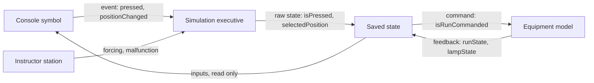

# Console controls and displays: what they share

Contents: Event out, state in · Common property sets · Cross-cutting states · Colours · Direction of action · Names to keep · Open questions · Sources

The cards are in `catalog-console-buttons.md`, `catalog-console-levers.md` and `catalog-console-displays.md`.
Property names follow `symbol-property-naming.md`. Roles: P parameter, C command or setpoint, M measure or
feedback, D fault, X derived. Front side: R read (input of the symbol), W written (the symbol emits the event).

## Event out, state in

- A console symbol keeps no state. It emits an event (`pressed`, `positionChanged`); the simulation
  executive applies it; the model derives the command (`isRunCommanded`); the feedback (`runState`,
  `lampState`) comes back as an input of the symbol.
- The raw state of the control (`isPressed`, `selectedPosition`) belongs to the saved state of the
  simulation, so that the instructor can operate or block a control through the same interface.

## Common property sets

| Set | Properties |
| --- | --- |
| `panelDevice` (every control) | `tagName` (string, P, R); `legendText` (string, P, R); `isAvailable` (boolean, X, R); `health` (enum of the naming document, M, R); `isOutOfService`, `isInhibited`, `isSimulated` (boolean, M, R) |
| `lamp` (lit control) | `lampState` (`off`, `on`, `flashing`; M, R); `lensColor` (`red`, `yellow`, `green`, `blue`, `white`; P, R); `isLampTestActive` (boolean, M, R); `brightnessPercent` (number, %, C, R); `hasLampFault` (boolean, D, R) |
| `contact` (control with contacts) | `isNormallyClosed` (boolean, P, R); `hasContactFault` (boolean, D, R) |
| `scaledDisplay` (generic display) | `value` (number, in `unit`, M, R); `unit` (string, P, R); `scaleMin`, `scaleMax` (number, in `unit`, P, R); `rangeState` (`normal`, `underRange`, `overRange`; X, R); `quality` (enum of the naming document, M, R) |

- `brightnessPercent` carries the dimming that bridge rules ask for lit controls, displays and
  instruments. [S10] [S12] [S14]
- A display whose numbers are in its `unit` property is the one exception to the unit suffix rule.
- `alarmPriority` and `alarmState` belong only to indicators used as alarm windows.

## Cross-cutting states

| State | Property | What the symbol shows |
| --- | --- | --- |
| Fault of the control | `health` at `failure`, plus `hasContactFault`, `hasLampFault`, `hasSignalFault`, `hasSegmentFault` or `hasDisplayFault` | The diagnostic badge of `synoptic-rules.md` |
| Lamp blown | `hasLampFault` | The lamp stays dark, even during the lamp test |
| Lamp test | `isLampTestActive` (one value per console) | Every healthy lamp lit [S9] |
| Unavailable | `isAvailable` false; causes `isInhibited`, `isOutOfService`, `isInControl` false | Greyed control, no event emitted |
| Doubtful value | `quality` | The "?" mark of `synoptic-rules.md` |
| Out of range | `rangeState` | The end segment of a bargraph flashes |
| Simulated or forced | `isSimulated` | The `SIM` badge |

- A dark lamp must never be the way a fault is shown. An alarm indicator emits no light in a normal
  situation. [S9] [S10]
- The lamp test changes no state of the model: it forces the display.

## Colours

| Colour | Indicator light | Button |
| --- | --- | --- |
| Red | Emergency, dangerous condition: act at once [S4] | Emergency stop, on a yellow background; allowed for stop, never for start [S3] |
| Yellow | Abnormal, critical condition near: watch or act [S4] | Action on an abnormal condition [S3] |
| Green | Normal [S4] | Start allowed; never for stop [S3] |
| Blue | Action required from the operator [S4] | Reset [S3] |
| White, grey, black | Neutral [S4] | Start: white preferred; stop: black preferred [S3] |

- Colour doubles another code (shape, place, text); it never replaces it. [S10]
- Red flashing is kept for alarms; flashing is kept for unacknowledged alerts and transient states. [S10]
- IEC 60073 sets the coding principles of indicators and actuators (colour, shape, position,
  flashing), for screens too. [S2]

## Direction of action

| Movement of the control | Expected effect |
| --- | --- |
| Forward, right, up; clockwise; pressing | Start, increase, move forward, right, up [S9] [S10] |
| Valve handwheel anticlockwise | Open [S9] |
| Manoeuvre control | Same direction as the effect on the ship [S10] |
| Key | Vertical at off; clockwise toward run [S9] |
| Push-pull | Pull: run; push: stop [S9] |
| Pointer of a gauge | Value increases clockwise, upward, to the right [S9] |

IEC 60447 relates the function of a control to its direction of movement or its place. [S6]

## Names to keep

| Notion | Names met | Name kept |
| --- | --- | --- |
| Indicator light | indicator light, pilot light | `indicatorLight` |
| Momentary button | momentary, spring return, push-button | `momentaryPushButton` |
| Latching button | latching, push-push, maintained | `latchingPushButton` |
| Pull to reset | push-pull, latching pull | `pushPullButton` with `resetMethod` |
| Position held | stay put, maintained | `stayPut` |
| Key switch | key switch, key-operated switch, key selector | `keySwitch` |
| Station in control | in control, in command | `isInControl` [S14] |
| Lamp test | lamp test, push-to-test | `isLampTestActive` |

Trap: in HMI software, "maintained" means a button that toggles and "latched" a button that keeps its
value until the controller acknowledges it [S32] [S33]; on hardware, "maintained" and "latching" mean
the same mechanical hold [S4] [S17]. Say which world a card speaks of.

## Open questions

- "navigation" and "damage" are two symbols of the team's list that no public source defines, and that
  have no card on purpose. Readings found: navigation lights and their controller; a navigation symbol
  on a display; the "navigation full" order of a propulsion lever; a damage control plan or its
  incidents; the malfunction of an equipment. Never guess: if a task needs one, ask the user what it
  shows.
- `twoValveControl` (two valves together or in opposition) and `selectorPushButton` (a push-button
  with a selector ring, or a selector to push before turning) have no public definition: confirm with
  the user.

## Sources

- [S2] IEC, 2002, IEC 60073 ed. 6.0, bilingual preview.
- [S3] Schneider Electric, FAQ FA28043 on button colours under IEC 60204-1.
- [S4] ABB, "Training Manual No. 1: Pilot Devices 101".
- [S6] IEC, 2004, IEC 60447 ed. 3, bilingual preview.
- [S9] Federal Aviation Administration, 2003, "Human Factors Design Standard", chapter 6.
- [S10] IMO, 2000, MSC/Circ.982, guidelines on ergonomic criteria for bridge equipment and layout.
- [S12] IACS, 2022, Recommendation 95 Rev.1, bridge design, equipment arrangement and procedures.
- [S14] Bureau Veritas, 2026, NR467, part C, chapter 3.
- [S15] Rockwell Automation, 2022, "30 mm Push Button Specifications".
- [S16] Schneider Electric, 2024, catalogue "Easy Harmony XB2".
- [S17] Schneider Electric, catalogue "Harmony XB4".
- [S28] ISO, 2025, ISO/FDIS 9241-161, sample.
- [S31] [S32] [S33] Rockwell Automation, FactoryTalk View ME 16.00, momentary, maintained and latched push buttons.
