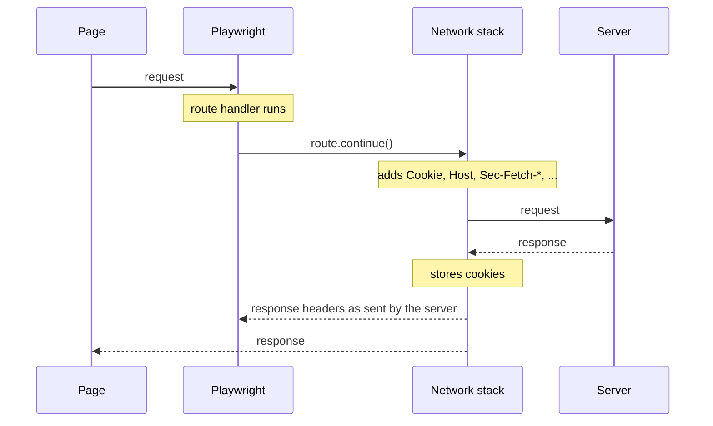

# Network (part 2 of 2)

## Abort requests

You can abort requests using [`method: Page.route`] and [`method: Route.abort`].

```js
await page.route('**/*.{png,jpg,jpeg}', route => route.abort());

// Abort based on the request type
await page.route('**/*', route => {
  return route.request().resourceType() === 'image' ? route.abort() : route.continue();
});
```

```java
page.route("**/*.{png,jpg,jpeg}", route -> route.abort());

// Abort based on the request type
page.route("**/*", route -> {
  if ("image".equals(route.request().resourceType()))
    route.abort();
  else
    route.resume();
});
```

```python
await page.route("**/*.{png,jpg,jpeg}", lambda route: route.abort())

# Abort based on the request type
await page.route("**/*", lambda route: route.abort() if route.request.resource_type == "image"  else route.continue_())
```

```python
page.route("**/*.{png,jpg,jpeg}", lambda route: route.abort())

# Abort based on the request type
page.route("**/*", lambda route: route.abort() if route.request.resource_type == "image"  else route.continue_())
```

```csharp
await page.RouteAsync("**/*.{png,jpg,jpeg}", route => route.AbortAsync());

// Abort based on the request type
await page.RouteAsync("**/*", async route => {
if ("image".Equals(route.Request.ResourceType))
    await route.AbortAsync();
else
    await route.ContinueAsync();
});
```

## Modify responses

To modify a response use [APIRequestContext] to get the original response and then pass the response to [`method: Route.fulfill`]. You can override individual fields on the response via options:

```js
await page.route('**/title.html', async route => {
  // Fetch original response.
  const response = await route.fetch();
  // Add a prefix to the title.
  let body = await response.text();
  body = body.replace('<title>', '<title>My prefix:');
  await route.fulfill({
    // Pass all fields from the response.
    response,
    // Override response body.
    body,
    // Force content type to be html.
    headers: {
      ...response.headers(),
      'content-type': 'text/html'
    }
  });
});
```

```java
page.route("**/title.html", route -> {
  // Fetch original response.
  APIResponse response = route.fetch();
  // Add a prefix to the title.
  String body = response.text();
  body = body.replace("<title>", "<title>My prefix:");
  Map<String, String> headers = response.headers();
  headers.put("content-type", "text/html");
  route.fulfill(new Route.FulfillOptions()
    // Pass all fields from the response.
    .setResponse(response)
    // Override response body.
    .setBody(body)
    // Force content type to be html.
    .setHeaders(headers));
});
```

```python
async def handle_route(route: Route) -> None:
    # Fetch original response.
    response = await route.fetch()
    # Add a prefix to the title.
    body = await response.text()
    body = body.replace("<title>", "<title>My prefix:")
    await route.fulfill(
        # Pass all fields from the response.
        response=response,
        # Override response body.
        body=body,
        # Force content type to be html.
        headers={**response.headers, "content-type": "text/html"},
    )

await page.route("**/title.html", handle_route)
```

```python
def handle_route(route: Route) -> None:
    # Fetch original response.
    response = route.fetch()
    # Add a prefix to the title.
    body = response.text()
    body = body.replace("<title>", "<title>My prefix:")
    route.fulfill(
        # Pass all fields from the response.
        response=response,
        # Override response body.
        body=body,
        # Force content type to be html.
        headers={**response.headers, "content-type": "text/html"},
    )

page.route("**/title.html", handle_route)
```

```csharp
await Page.RouteAsync("**/title.html", async route =>
{
    // Fetch original response.
    var response = await route.FetchAsync();
    // Add a prefix to the title.
    var body = await response.TextAsync();
    body = body.Replace("<title>", "<title>My prefix:");

    var headers = response.Headers;
    headers.Add("Content-Type", "text/html");

    await route.FulfillAsync(new()
    {
        // Pass all fields from the response.
        Response = response,
        // Override response body.
        Body = body,
        // Force content type to be html.
        Headers = headers,
    });
});
```

## How request interception works

Routes sit between the page and the browser's network stack. The handler runs before the network stack has processed the request: [`method: Route.continue`] passes it on, [`method: Route.fulfill`] answers it without touching the network, and [`method: Route.abort`] fails it.



### Headers owned by the network stack

Some headers are attached by the network stack right before the request is sent: `Cookie`, `Host`, `Accept-Encoding`, `Content-Length`, `Sec-Fetch-*` and a few others. This is a security boundary: an `HttpOnly` cookie, for example, is never exposed to the page. Since the route handler runs before that step, these headers are not reliably present in [`method: Request.headers`] or [`method: Request.allHeaders`], and they cannot be overridden. A `cookie` header passed to [`method: Route.continue`] is ignored in favor of the browser's cookie store.

On the response side the network stack has already done its work, so [`method: Response.allHeaders`] returns the headers exactly as the server sent them, including `Set-Cookie` for `HttpOnly` cookies. To see the exact request headers that went over the wire, observe the request without routing it: with no routes installed, [`method: Request.allHeaders`] includes all of them.

### Redirects

Playwright treats a request and its redirects as a single unit. The handler is called once, for the original request, and the browser follows the redirect on its own. [`method: Response.request`] returns the last request in the chain, and [`method: Request.redirectedFrom`] walks it back to the one you intercepted. Headers passed to [`method: Route.continue`] apply to every hop of the chain, except `cookie`, which always comes from the cookie store.

Fulfilling with a `3xx` status does not give you a second chance to intercept. Chromium and Firefox follow the redirect without calling your handler, and WebKit rejects the call. To serve different content, fulfill with that content. To send the request elsewhere, pass `url` to [`method: Route.continue`] or [`method: Route.fallback`].

## Glob URL patterns

Playwright uses simplified glob patterns for URL matching in network interception methods like [`method: Page.route`] or [`method: Page.waitForResponse`]. These patterns support basic <example-value>:

1. Asterisks:
  - A single `*` matches any characters except `/`
  - A double `**` matches any characters including `/`
1. Question mark `?` matches only question mark `?`. If you want to match any character, use `*` instead.
1. Curly braces `{}` can be used to match a list of options separated by commas `,`
1. Backslash `\` can be used to escape any of special characters (note to escape backslash itself as `\\`)

Examples:
- `https://example.com/*.js` matches `https://example.com/file.js` but not `https://example.com/path/file.js`
- `https://example.com/?page=1` matches `https://example.com/?page=1` but not `https://example.com`
- `**/*.js` matches both `https://example.com/file.js` and `https://example.com/path/file.js`
- `**/*.{png,jpg,jpeg}` matches all image requests

Important notes:

- The glob pattern must match the entire URL, not just a part of it.
- When using globs for URL matching, consider the full URL structure, including the protocol and path separators.
- For more complex matching requirements, consider using [RegExp] instead of glob patterns.

## WebSockets

Playwright supports WebSockets inspection, mocking and modifying out of the box. See our API mocking guide to learn how to mock WebSockets.

Every time a WebSocket is created, the [`event: Page.webSocket`] event is fired. This event contains the [WebSocket] instance for further web socket frames inspection:

```js
page.on('websocket', ws => {
  console.log(`WebSocket opened: ${ws.url()}>`);
  ws.on('framesent', event => console.log(event.payload));
  ws.on('framereceived', event => console.log(event.payload));
  ws.on('close', () => console.log('WebSocket closed'));
});
```

```java
page.onWebSocket(ws -> {
  log("WebSocket opened: " + ws.url());
  ws.onFrameSent(frameData -> log(frameData.text()));
  ws.onFrameReceived(frameData -> log(frameData.text()));
  ws.onClose(ws1 -> log("WebSocket closed"));
});
```

```python
def on_web_socket(ws):
    print(f"WebSocket opened: {ws.url}")
    ws.on("framesent", lambda payload: print(payload))
    ws.on("framereceived", lambda payload: print(payload))
    ws.on("close", lambda payload: print("WebSocket closed"))

page.on("websocket", on_web_socket)
```

```csharp
page.WebSocket += (_, ws) =>
{
    Console.WriteLine("WebSocket opened: " + ws.Url);
    ws.FrameSent += (_, f) => Console.WriteLine(f.Text);
    ws.FrameReceived += (_, f) => Console.WriteLine(f.Text);
    ws.Close += (_, ws1) => Console.WriteLine("WebSocket closed");
};
```
## Missing Network Events and Service Workers

Playwright's built-in [`method: BrowserContext.route`] and [`method: Page.route`] allow your tests to natively route requests and perform mocking and interception.

If you're using Playwright's native [`method: BrowserContext.route`] and [`method: Page.route`], and it appears network events are missing, disable Service Workers by setting [`option: Browser.newContext.serviceWorkers`] to `'block'`.

It might be that you are using a mock tool such as Mock Service Worker (MSW). While this tool works out of the box for mocking responses, it adds its own Service Worker that takes over the network requests, hence making them invisible to [`method: BrowserContext.route`] and [`method: Page.route`]. If you are interested in both network testing and mocking, consider using built-in [`method: BrowserContext.route`] and [`method: Page.route`] for response mocking.

######
* langs: js

If you're interested in not solely using Service Workers for testing and network mocking, but in routing and listening for requests made by Service Workers themselves, please see this guide.
