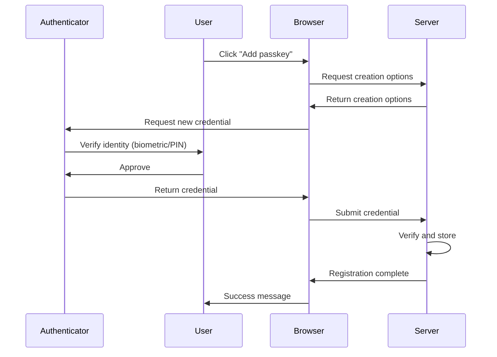

# Enable Web Authentication API (WebAuthn) passkeys (part 3 of 4)

## Registration flow

This section walks through each step of the passkey registration process, explaining how ASP.NET Core Identity facilitates the creation and storage of passkey credentials.



### Step 1: Initiating registration

The registration process begins when a user decides to add a passkey to their account. This typically happens through a button or link in the app's user interface. When selected, this element triggers JavaScript code to orchestrate the registration flow.

The client-side implementation varies significantly between apps. In the Blazor Web App template, you can find a complete example in `PasskeySubmit.razor.js`, which shows how a custom web component handles the registration initiation and manages the subsequent WebAuthn API calls.

### Step 2: Requesting creation options

After registration is initiated, the browser must obtain creation options from the server. These options tell the browser what kind of credential to create and include important security parameters, such as the challenge that must be signed.

From the browser's perspective, this step involves making an HTTP request to the server:

```javascript
async function createCredential(signal) {
  // Step 2: Request creation options from the server
  const optionsResponse = 
    await fetchWithErrorHandling('/Account/PasskeyCreationOptions', 
    {
      method: 'POST',
      signal,
    });
  const optionsJson = await optionsResponse.json();
  const options = PublicKeyCredential.parseCreationOptionsFromJSON(optionsJson);
  return await navigator.credentials.create({ publicKey: options, signal });
}
```

The application should define an endpoint that generates these options:

```csharp
app.MapPost("/Account/PasskeyCreationOptions", async (
    HttpContext context,
    UserManager<ApplicationUser> userManager,
    SignInManager<ApplicationUser> signInManager) =>
{
    var user = await userManager.GetUserAsync(context.User);

    if (user is null)
    {
        return Results.NotFound();
    }

    var userId = await userManager.GetUserIdAsync(user);
    var userName = await userManager.GetUserNameAsync(user) ?? "User";
    
    var optionsJson = await signInManager.MakePasskeyCreationOptionsAsync(new()
    {
        Id = userId,
        Name = userName,
        DisplayName = userName
    });
    
    return TypedResults.Content(optionsJson, contentType: "application/json");
});
```

The `Microsoft.AspNetCore.Identity.SignInManager`1.MakePasskeyCreationOptionsAsync*` method is central to this process. The method accepts a `PasskeyUserEntity` that describes the user for whom the passkey is being created. This entity contains the user's ID, username (typically an email address), and a human-readable display name. The method returns a JSON string that conforms to the WebAuthn `PublicKeyCredentialCreationOptions` schema, which the browser uses in the next step. Behind the scenes, this method also stores temporary state in an authentication cookie to ensure that the response from the browser corresponds to these specific options. Apps that manage this state themselves must protect it, as described in the Customize the passkey handler section.

### Step 3: Server generates options

When `Microsoft.AspNetCore.Identity.SignInManager`1.MakePasskeyCreationOptionsAsync*` executes, it uses the app's `Microsoft.AspNetCore.Identity.IdentityPasskeyOptions` configuration to determine the specific parameters for credential creation. These options control various aspects of the passkey creation process.

You can customize these options during application startup. For example:

```csharp
builder.Services.Configure<IdentityPasskeyOptions>(options =>
{
    options.ServerDomain = "contoso.com";
    options.AuthenticatorTimeout = TimeSpan.FromMinutes(3);
    options.UserVerificationRequirement = "required";
    options.ResidentKeyRequirement = "preferred";
});
```

The `Microsoft.AspNetCore.Identity.IdentityPasskeyOptions.UserVerificationRequirement` option determines whether the authenticator must verify the user's identity (through biometric or PIN methods), while `Microsoft.AspNetCore.Identity.IdentityPasskeyOptions.ResidentKeyRequirement` indicates whether the credential should be discoverable, allowing authentication without first providing a username. For more information, see `Microsoft.AspNetCore.Identity.IdentityPasskeyOptions`.

### Step 4: Client requests credential

With the creation options available, the client-side JavaScript passes the options to the WebAuthn API to create a new credential:

```javascript
async function createCredential(signal) {
  // Step 4: Parse the options and request a new credential from the authenticator
  const optionsResponse = 
    await fetchWithErrorHandling('/Account/PasskeyCreationOptions', 
    {
      method: 'POST',
      signal,
    });
  const optionsJson = await optionsResponse.json();
  const options = PublicKeyCredential.parseCreationOptionsFromJSON(optionsJson);
  return await navigator.credentials.create({ publicKey: options, signal });
}
```

The `parseCreationOptionsFromJSON` function converts the JSON response into the format expected by the WebAuthn API, and `navigator.credentials.create()` initiates the credential creation process with the authenticator.

### Step 5: Authenticator interaction

At this point, the browser communicates with the authenticator to create the credential. The authenticator prompts the user for verification, which might involve scanning a fingerprint, entering a PIN, or using facial recognition. This interaction is handled entirely by the browser and the authenticator, requiring no app code. The user experience varies depending on the type of authenticator and the platform's capabilities.

### Step 6: Credential submission

After the authenticator creates the credential, the browser must send the credential back to the server for verification and storage. The credential must be serialized to JSON before submission:

```javascript
async function createCredentialJson(signal) {
  const credential = await createCredential(signal);
  return JSON.stringify(credential);
}
```

In the Blazor Web App template, the returned credential is automatically serialized and submitted through a form, but the exact submission mechanism varies by application.

### Step 7: Server verification and storage

When the server receives the credential, it must verify its validity and store the public key for future authentication. This is where ASP.NET Core Identity's passkey APIs become crucial.

The `Microsoft.AspNetCore.Identity.SignInManager`1.PerformPasskeyAttestationAsync*` method validates the attestation response from the client. This comprehensive validation process:

* Verifies that the credential type matches expectations.
* Validates the client data JSON including origin and challenge.
* Checks authenticator data flags for user presence and verification
* Extracts and validates the public key.

If all checks pass, the method returns a `Microsoft.AspNetCore.Identity.PasskeyAttestationResult` containing the verified passkey information.

After the attestation is verified, the app uses `Microsoft.AspNetCore.Identity.UserManager`1.AddOrUpdatePasskeyAsync*` to store the passkey in the database:

```csharp
var attestationResult = 
    await signInManager.PerformPasskeyAttestationAsync(credentialJson);

if (!attestationResult.Succeeded)
{
    return Results.BadRequest($"Error: {attestationResult.Failure.Message}");
}

var addResult = 
    await userManager.AddOrUpdatePasskeyAsync(user, attestationResult.Passkey);

if (!addResult.Succeeded)
{
    return Results.BadRequest("Failed to store passkey");
}
```

The stored `Microsoft.AspNetCore.Identity.UserPasskeyInfo` contains all of the necessary information for future authentication, including the credential ID, public key, signature counter for replay protection, and flags indicating whether the passkey is backed up or eligible for backup.

### Step 8: Post-registration tasks

After successfully registering a passkey, apps often perform additional tasks to improve the user experience. A common pattern is to prompt users to provide a friendly name for their passkey, making it easier to identify among multiple credentials. The `Microsoft.AspNetCore.Identity.UserPasskeyInfo.Name` property stores this user-friendly name, which can be updated using the same `Microsoft.AspNetCore.Identity.UserManager`1.AddOrUpdatePasskeyAsync*` method:

```csharp
passkey.Name = "My iPhone";
await userManager.AddOrUpdatePasskeyAsync(user, passkey);
```
