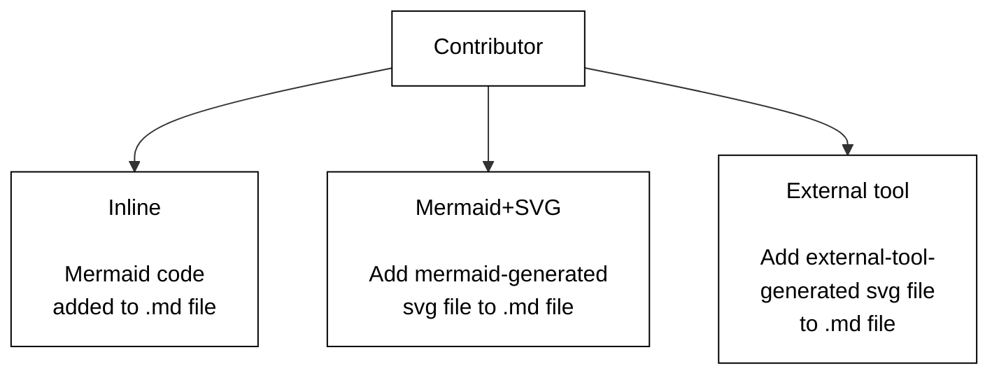

# Diagram Guide (part 2 of 5)

## Methods for creating diagrams

Figure 2 outlines the three methods to generate and add diagrams.



Figure 2. Methods to create diagrams.

### Inline

Figure 3 outlines the steps to follow for adding a diagram using the Inline
method.

```mermaid
graph LR
A[1. Use live editor<br> to create/edit<br>diagram] -->
B[2. Store diagram<br>URL somewhere] -->
C[3. Copy Mermaid code<br>to page markdown file] -->
D[4. Add caption]

    classDef box fill:#fff,stroke:#000,stroke-width:1px,color:#000;
    class A,B,C,D box

%% you can hyperlink Mermaid diagram nodes to a URL using click statements

click A "https://mermaid-js.github.io/mermaid-live-editor/edit/#eyJjb2RlIjoiZ3JhcGggTFJcbiAgICBBWzEuIFVzZSBsaXZlIGVkaXRvcjxicj4gdG8gY3JlYXRlL2VkaXQ8YnI-ZGlhZ3JhbV0gLS0-XG4gICAgQlsyLiBTdG9yZSBkaWFncmFtPGJyPlVSTCBzb21ld2hlcmVdIC0tPlxuICAgIENbMy4gQ29weSBNZXJtYWlkIGNvZGU8YnI-dG8gcGFnZSBtYXJrZG93biBmaWxlXSAtLT5cbiAgICBEWzQuIEFkZCBjYXB0aW9uXVxuIFxuXG4gICAgY2xhc3NEZWYgYm94IGZpbGw6I2ZmZixzdHJva2U6IzAwMCxzdHJva2Utd2lkdGg6MXB4LGNvbG9yOiMwMDA7XG4gICAgY2xhc3MgQSxCLEMsRCBib3hcbiAgICAiLCJtZXJtYWlkIjoie1xuICBcInRoZW1lXCI6IFwiZGVmYXVsdFwiXG59IiwidXBkYXRlRWRpdG9yIjpmYWxzZSwiYXV0b1N5bmMiOnRydWUsInVwZGF0ZURpYWdyYW0iOmZhbHNlfQ" _blank

click B "https://mermaid-js.github.io/mermaid-live-editor/edit/#eyJjb2RlIjoiZ3JhcGggTFJcbiAgICBBWzEuIFVzZSBsaXZlIGVkaXRvcjxicj4gdG8gY3JlYXRlL2VkaXQ8YnI-ZGlhZ3JhbV0gLS0-XG4gICAgQlsyLiBTdG9yZSBkaWFncmFtPGJyPlVSTCBzb21ld2hlcmVdIC0tPlxuICAgIENbMy4gQ29weSBNZXJtYWlkIGNvZGU8YnI-dG8gcGFnZSBtYXJrZG93biBmaWxlXSAtLT5cbiAgICBEWzQuIEFkZCBjYXB0aW9uXVxuIFxuXG4gICAgY2xhc3NEZWYgYm94IGZpbGw6I2ZmZixzdHJva2U6IzAwMCxzdHJva2Utd2lkdGg6MXB4LGNvbG9yOiMwMDA7XG4gICAgY2xhc3MgQSxCLEMsRCBib3hcbiAgICAiLCJtZXJtYWlkIjoie1xuICBcInRoZW1lXCI6IFwiZGVmYXVsdFwiXG59IiwidXBkYXRlRWRpdG9yIjpmYWxzZSwiYXV0b1N5bmMiOnRydWUsInVwZGF0ZURpYWdyYW0iOmZhbHNlfQ" _blank

click C "https://mermaid-js.github.io/mermaid-live-editor/edit/#eyJjb2RlIjoiZ3JhcGggTFJcbiAgICBBWzEuIFVzZSBsaXZlIGVkaXRvcjxicj4gdG8gY3JlYXRlL2VkaXQ8YnI-ZGlhZ3JhbV0gLS0-XG4gICAgQlsyLiBTdG9yZSBkaWFncmFtPGJyPlVSTCBzb21ld2hlcmVdIC0tPlxuICAgIENbMy4gQ29weSBNZXJtYWlkIGNvZGU8YnI-dG8gcGFnZSBtYXJrZG93biBmaWxlXSAtLT5cbiAgICBEWzQuIEFkZCBjYXB0aW9uXVxuIFxuXG4gICAgY2xhc3NEZWYgYm94IGZpbGw6I2ZmZixzdHJva2U6IzAwMCxzdHJva2Utd2lkdGg6MXB4LGNvbG9yOiMwMDA7XG4gICAgY2xhc3MgQSxCLEMsRCBib3hcbiAgICAiLCJtZXJtYWlkIjoie1xuICBcInRoZW1lXCI6IFwiZGVmYXVsdFwiXG59IiwidXBkYXRlRWRpdG9yIjpmYWxzZSwiYXV0b1N5bmMiOnRydWUsInVwZGF0ZURpYWdyYW0iOmZhbHNlfQ" _blank

click D "https://mermaid-js.github.io/mermaid-live-editor/edit/#eyJjb2RlIjoiZ3JhcGggTFJcbiAgICBBWzEuIFVzZSBsaXZlIGVkaXRvcjxicj4gdG8gY3JlYXRlL2VkaXQ8YnI-ZGlhZ3JhbV0gLS0-XG4gICAgQlsyLiBTdG9yZSBkaWFncmFtPGJyPlVSTCBzb21ld2hlcmVdIC0tPlxuICAgIENbMy4gQ29weSBNZXJtYWlkIGNvZGU8YnI-dG8gcGFnZSBtYXJrZG93biBmaWxlXSAtLT5cbiAgICBEWzQuIEFkZCBjYXB0aW9uXVxuIFxuXG4gICAgY2xhc3NEZWYgYm94IGZpbGw6I2ZmZixzdHJva2U6IzAwMCxzdHJva2Utd2lkdGg6MXB4LGNvbG9yOiMwMDA7XG4gICAgY2xhc3MgQSxCLEMsRCBib3hcbiAgICAiLCJtZXJtYWlkIjoie1xuICBcInRoZW1lXCI6IFwiZGVmYXVsdFwiXG59IiwidXBkYXRlRWRpdG9yIjpmYWxzZSwiYXV0b1N5bmMiOnRydWUsInVwZGF0ZURpYWdyYW0iOmZhbHNlfQ" _blank

```



Figure 3. Inline Method steps.

The following lists the steps you should follow for adding a diagram using the Inline method:

1. Create your diagram using the live editor.
2. Store the diagram URL somewhere for later access.
3. Copy the mermaid code to the location in your `.md` file where you want the diagram to appear.
4. Add a caption below the diagram using Markdown text.

A Hugo build runs the Mermaid code and turns it into a diagram.

**Note:**
You may find keeping track of diagram URLs is cumbersome. If so, make a note
in the `.md` file that the Mermaid code is self-documenting. Contributors can
copy the Mermaid code to and from the live editor for diagram edits.

Here is a sample code snippet contained in an `.md` file:

```
---
title: My PR
---
Figure 17 shows a simple A to B process.
some markdown text
...
 
    graph TB
    A --> B


Figure 17. A to B
more text
```
**Note:**
You must include the Hugo Mermaid shortcode
tags at the start and end of the Mermaid code block. You should add a diagram
caption below the diagram.

For more details on diagram captions, see How to use captions.

The following lists advantages of the Inline method:

* Live editor tool.
* Easy to copy Mermaid code to and from the live editor and your `.md` file.
* No need for separate `.svg` image file handling.
* Content text, diagram code and diagram caption contained in the same `.md` file.

You should use the local
and Netlify previews to verify the diagram is properly rendered.

**Caution:**
The Mermaid live editor feature set may not support the kubernetes/website Mermaid feature set.
And please, note that contributors can mention `kubernetes/website` as `k/website`.
You might see a syntax error or a blank screen after the Hugo build.
If that is the case, consider using the Mermaid+SVG method.
