# Diagram Guide (part 3 of 5)

### Mermaid+SVG

Figure 4 outlines the steps to follow for adding a diagram using the Mermaid+SVG method.

```mermaid
flowchart LR
A[1. Use live editor<br> to create/edit<br>diagram]
B[2. Store diagram<br>URL somewhere]
C[3. Generate .svg file<br>and download to<br>images/ folder]
subgraph w[ ]
direction TB
D[4. Use figure shortcode<br>to reference .svg<br>file in page<br>.md file] -->
E[5. Add caption]
end
A --> B
B --> C
C --> w

    classDef box fill:#fff,stroke:#000,stroke-width:1px,color:#000;
    class A,B,C,D,E,w box

click A "https://mermaid-js.github.io/mermaid-live-editor/edit/#eyJjb2RlIjoiZmxvd2NoYXJ0IExSXG4gICAgQVsxLiBVc2UgbGl2ZSBlZGl0b3I8YnI-IHRvIGNyZWF0ZS9lZGl0PGJyPmRpYWdyYW1dXG4gICAgQlsyLiBTdG9yZSBkaWFncmFtPGJyPlVSTCBzb21ld2hlcmVdXG4gICAgQ1szLiBHZW5lcmF0ZSAuc3ZnIGZpbGU8YnI-YW5kIGRvd25sb2FkIHRvPGJyPmltYWdlcy8gZm9sZGVyXVxuICAgIHN1YmdyYXBoIHdbIF1cbiAgICBkaXJlY3Rpb24gVEJcbiAgICBEWzQuIFVzZSBmaWd1cmUgc2hvcnRjb2RlPGJyPnRvIHJlZmVyZW5jZSAuc3ZnPGJyPmZpbGUgaW4gcGFnZTxicj4ubWQgZmlsZV0gLS0-XG4gICAgRVs1LiBBZGQgY2FwdGlvbl1cbiAgICBlbmRcbkEgLS0-IEJcbkIgLS0-IENcbkMgLS0-IHdcblxuICAgIGNsYXNzRGVmIGJveCBmaWxsOiNmZmYsc3Ryb2tlOiMwMDAsc3Ryb2tlLXdpZHRoOjFweCxjb2xvcjojMDAwO1xuICAgIGNsYXNzIEEsQixDLEQsRSx3IGJveFxuICAgICIsIm1lcm1haWQiOiJ7XG4gIFwidGhlbWVcIjogXCJkZWZhdWx0XCJcbn0iLCJ1cGRhdGVFZGl0b3IiOmZhbHNlLCJhdXRvU3luYyI6dHJ1ZSwidXBkYXRlRGlhZ3JhbSI6dHJ1ZX0" _blank

click B "https://mermaid-js.github.io/mermaid-live-editor/edit/#eyJjb2RlIjoiZmxvd2NoYXJ0IExSXG4gICAgQVsxLiBVc2UgbGl2ZSBlZGl0b3I8YnI-IHRvIGNyZWF0ZS9lZGl0PGJyPmRpYWdyYW1dXG4gICAgQlsyLiBTdG9yZSBkaWFncmFtPGJyPlVSTCBzb21ld2hlcmVdXG4gICAgQ1szLiBHZW5lcmF0ZSAuc3ZnIGZpbGU8YnI-YW5kIGRvd25sb2FkIHRvPGJyPmltYWdlcy8gZm9sZGVyXVxuICAgIHN1YmdyYXBoIHdbIF1cbiAgICBkaXJlY3Rpb24gVEJcbiAgICBEWzQuIFVzZSBmaWd1cmUgc2hvcnRjb2RlPGJyPnRvIHJlZmVyZW5jZSAuc3ZnPGJyPmZpbGUgaW4gcGFnZTxicj4ubWQgZmlsZV0gLS0-XG4gICAgRVs1LiBBZGQgY2FwdGlvbl1cbiAgICBlbmRcbkEgLS0-IEJcbkIgLS0-IENcbkMgLS0-IHdcblxuICAgIGNsYXNzRGVmIGJveCBmaWxsOiNmZmYsc3Ryb2tlOiMwMDAsc3Ryb2tlLXdpZHRoOjFweCxjb2xvcjojMDAwO1xuICAgIGNsYXNzIEEsQixDLEQsRSx3IGJveFxuICAgICIsIm1lcm1haWQiOiJ7XG4gIFwidGhlbWVcIjogXCJkZWZhdWx0XCJcbn0iLCJ1cGRhdGVFZGl0b3IiOmZhbHNlLCJhdXRvU3luYyI6dHJ1ZSwidXBkYXRlRGlhZ3JhbSI6dHJ1ZX0" _blank

click C "https://mermaid-js.github.io/mermaid-live-editor/edit/#eyJjb2RlIjoiZmxvd2NoYXJ0IExSXG4gICAgQVsxLiBVc2UgbGl2ZSBlZGl0b3I8YnI-IHRvIGNyZWF0ZS9lZGl0PGJyPmRpYWdyYW1dXG4gICAgQlsyLiBTdG9yZSBkaWFncmFtPGJyPlVSTCBzb21ld2hlcmVdXG4gICAgQ1szLiBHZW5lcmF0ZSAuc3ZnIGZpbGU8YnI-YW5kIGRvd25sb2FkIHRvPGJyPmltYWdlcy8gZm9sZGVyXVxuICAgIHN1YmdyYXBoIHdbIF1cbiAgICBkaXJlY3Rpb24gVEJcbiAgICBEWzQuIFVzZSBmaWd1cmUgc2hvcnRjb2RlPGJyPnRvIHJlZmVyZW5jZSAuc3ZnPGJyPmZpbGUgaW4gcGFnZTxicj4ubWQgZmlsZV0gLS0-XG4gICAgRVs1LiBBZGQgY2FwdGlvbl1cbiAgICBlbmRcbkEgLS0-IEJcbkIgLS0-IENcbkMgLS0-IHdcblxuICAgIGNsYXNzRGVmIGJveCBmaWxsOiNmZmYsc3Ryb2tlOiMwMDAsc3Ryb2tlLXdpZHRoOjFweCxjb2xvcjojMDAwO1xuICAgIGNsYXNzIEEsQixDLEQsRSx3IGJveFxuICAgICIsIm1lcm1haWQiOiJ7XG4gIFwidGhlbWVcIjogXCJkZWZhdWx0XCJcbn0iLCJ1cGRhdGVFZGl0b3IiOmZhbHNlLCJhdXRvU3luYyI6dHJ1ZSwidXBkYXRlRGlhZ3JhbSI6dHJ1ZX0" _blank

click D "https://mermaid-js.github.io/mermaid-live-editor/edit/#eyJjb2RlIjoiZmxvd2NoYXJ0IExSXG4gICAgQVsxLiBVc2UgbGl2ZSBlZGl0b3I8YnI-IHRvIGNyZWF0ZS9lZGl0PGJyPmRpYWdyYW1dXG4gICAgQlsyLiBTdG9yZSBkaWFncmFtPGJyPlVSTCBzb21ld2hlcmVdXG4gICAgQ1szLiBHZW5lcmF0ZSAuc3ZnIGZpbGU8YnI-YW5kIGRvd25sb2FkIHRvPGJyPmltYWdlcy8gZm9sZGVyXVxuICAgIHN1YmdyYXBoIHdbIF1cbiAgICBkaXJlY3Rpb24gVEJcbiAgICBEWzQuIFVzZSBmaWd1cmUgc2hvcnRjb2RlPGJyPnRvIHJlZmVyZW5jZSAuc3ZnPGJyPmZpbGUgaW4gcGFnZTxicj4ubWQgZmlsZV0gLS0-XG4gICAgRVs1LiBBZGQgY2FwdGlvbl1cbiAgICBlbmRcbkEgLS0-IEJcbkIgLS0-IENcbkMgLS0-IHdcblxuICAgIGNsYXNzRGVmIGJveCBmaWxsOiNmZmYsc3Ryb2tlOiMwMDAsc3Ryb2tlLXdpZHRoOjFweCxjb2xvcjojMDAwO1xuICAgIGNsYXNzIEEsQixDLEQsRSx3IGJveFxuICAgICIsIm1lcm1haWQiOiJ7XG4gIFwidGhlbWVcIjogXCJkZWZhdWx0XCJcbn0iLCJ1cGRhdGVFZGl0b3IiOmZhbHNlLCJhdXRvU3luYyI6dHJ1ZSwidXBkYXRlRGlhZ3JhbSI6dHJ1ZX0" _blank

click E "https://mermaid-js.github.io/mermaid-live-editor/edit/#eyJjb2RlIjoiZmxvd2NoYXJ0IExSXG4gICAgQVsxLiBVc2UgbGl2ZSBlZGl0b3I8YnI-IHRvIGNyZWF0ZS9lZGl0PGJyPmRpYWdyYW1dXG4gICAgQlsyLiBTdG9yZSBkaWFncmFtPGJyPlVSTCBzb21ld2hlcmVdXG4gICAgQ1szLiBHZW5lcmF0ZSAuc3ZnIGZpbGU8YnI-YW5kIGRvd25sb2FkIHRvPGJyPmltYWdlcy8gZm9sZGVyXVxuICAgIHN1YmdyYXBoIHdbIF1cbiAgICBkaXJlY3Rpb24gVEJcbiAgICBEWzQuIFVzZSBmaWd1cmUgc2hvcnRjb2RlPGJyPnRvIHJlZmVyZW5jZSAuc3ZnPGJyPmZpbGUgaW4gcGFnZTxicj4ubWQgZmlsZV0gLS0-XG4gICAgRVs1LiBBZGQgY2FwdGlvbl1cbiAgICBlbmRcbkEgLS0-IEJcbkIgLS0-IENcbkMgLS0-IHdcblxuICAgIGNsYXNzRGVmIGJveCBmaWxsOiNmZmYsc3Ryb2tlOiMwMDAsc3Ryb2tlLXdpZHRoOjFweCxjb2xvcjojMDAwO1xuICAgIGNsYXNzIEEsQixDLEQsRSx3IGJveFxuICAgICIsIm1lcm1haWQiOiJ7XG4gIFwidGhlbWVcIjogXCJkZWZhdWx0XCJcbn0iLCJ1cGRhdGVFZGl0b3IiOmZhbHNlLCJhdXRvU3luYyI6dHJ1ZSwidXBkYXRlRGlhZ3JhbSI6dHJ1ZX0" _blank

```



Figure 4. Mermaid+SVG method steps.

The following lists the steps you should follow for adding a diagram using the Mermaid+SVG method:

1. Create your diagram using the live editor.
2. Store the diagram URL somewhere for later access.
3. Generate an `.svg` image file for the diagram and download it to the appropriate `images/` folder.
4. Use the `` shortcode to reference the diagram in the `.md` file.
5. Add a caption using the `` shortcode's `caption` parameter.

For example, use the live editor to create a diagram called `boxnet`.
Store the diagram URL somewhere for later access. Generate and download a
`boxnet.svg` file to the appropriate `../images/` folder.

Use the `` shortcode in your PR's `.md` file to reference
the `.svg` image file and add a caption.

```json

```

For more details on diagram captions, see How to use captions.

**Note:**
The figure shortcode is the preferred method for adding `.svg` image files
to your documentation. You can also use the standard markdown image syntax like so:
``.
And you will need to add a caption below the diagram.

You should add the live editor URL as a comment block in the `.svg` image file using a text editor.
For example, you would include the following at the beginning of the `.svg` image file:

```
<!-- To view or edit the mermaid code, use the following URL: -->
<!-- https://mermaid-js.github.io/mermaid-live-editor/edit/#eyJjb ... <remainder of the URL> -->
```

The following lists advantages of the Mermaid+SVG method:

* Live editor tool.
* Live editor tool supports the most current Mermaid feature set.
* Employ existing kubernetes/website methods for handling `.svg` image files.
* Environment doesn't require Mermaid support.

Be sure to check that your diagram renders properly using the
local
and Netlify previews.

### External tool

Figure 5 outlines the steps to follow for adding a diagram using the External Tool method.

First, use your external tool to create the diagram and save it as an `.svg`
or `.png` image file. After that, use the same steps as the __Mermaid+SVG__
method for adding `.svg` image files.

```mermaid
flowchart LR
A[1. Use external<br>tool to create/edit<br>diagram]
B[2. If possible, save<br>diagram coordinates<br>for contributor<br>access]
C[3. Generate .svg <br>or.png file<br>and download to<br>appropriate<br>images/ folder]
subgraph w[ ]
direction TB
D[4. Use figure shortcode<br>to reference svg or<br>png file in<br>page .md file] -->
E[5. Add caption]
end
A --> B
B --> C
C --> w
classDef box fill:#fff,stroke:#000,stroke-width:1px,color:#000;
class A,B,C,D,E,w box

click A "https://mermaid-js.github.io/mermaid-live-editor/edit/#eyJjb2RlIjoiZmxvd2NoYXJ0IExSXG4gICAgQVsxLiBVc2UgZXh0ZXJuYWw8YnI-dG9vbCB0byBjcmVhdGUvZWRpdDxicj5kaWFncmFtXVxuICAgIEJbMi4gSWYgcG9zc2libGUsIHNhdmU8YnI-ZGlhZ3JhbSBjb29yZGluYXRlczxicj5mb3IgY29udHJpYnV0b3I8YnI-YWNjZXNzXVxuICAgIENbMy4gR2VuZXJhdGUgLnN2ZyA8YnI-b3IucG5nIGZpbGU8YnI-YW5kIGRvd25sb2FkIHRvPGJyPmFwcHJvcHJpYXRlPGJyPmltYWdlcy8gZm9sZGVyXVxuICAgIHN1YmdyYXBoIHdbIF1cbiAgICBkaXJlY3Rpb24gVEJcbiAgICBEWzQuIFVzZSBmaWd1cmUgc2hvcnRjb2RlPGJyPnRvIHJlZmVyZW5jZSBzdmcgb3I8YnI-cG5nIGZpbGUgaW48YnI-cGFnZSAubWQgZmlsZV0gLS0-XG4gICAgRVs1LiBBZGQgY2FwdGlvbl1cbiAgICBlbmRcbiAgICBBIC0tPiBCXG4gICAgQiAtLT4gQ1xuICAgIEMgLS0-IHdcbiAgICBjbGFzc0RlZiBib3ggZmlsbDojZmZmLHN0cm9rZTojMDAwLHN0cm9rZS13aWR0aDoxcHgsY29sb3I6IzAwMDtcbiAgICBjbGFzcyBBLEIsQyxELEUsdyBib3hcbiAgICAiLCJtZXJtYWlkIjoie1xuICBcInRoZW1lXCI6IFwiZGVmYXVsdFwiXG59IiwidXBkYXRlRWRpdG9yIjpmYWxzZSwiYXV0b1N5bmMiOnRydWUsInVwZGF0ZURpYWdyYW0iOmZhbHNlfQ"

click B "https://mermaid-js.github.io/mermaid-live-editor/edit/#eyJjb2RlIjoiZmxvd2NoYXJ0IExSXG4gICAgQVsxLiBVc2UgZXh0ZXJuYWw8YnI-dG9vbCB0byBjcmVhdGUvZWRpdDxicj5kaWFncmFtXVxuICAgIEJbMi4gSWYgcG9zc2libGUsIHNhdmU8YnI-ZGlhZ3JhbSBjb29yZGluYXRlczxicj5mb3IgY29udHJpYnV0b3I8YnI-YWNjZXNzXVxuICAgIENbMy4gR2VuZXJhdGUgLnN2ZyA8YnI-b3IucG5nIGZpbGU8YnI-YW5kIGRvd25sb2FkIHRvPGJyPmFwcHJvcHJpYXRlPGJyPmltYWdlcy8gZm9sZGVyXVxuICAgIHN1YmdyYXBoIHdbIF1cbiAgICBkaXJlY3Rpb24gVEJcbiAgICBEWzQuIFVzZSBmaWd1cmUgc2hvcnRjb2RlPGJyPnRvIHJlZmVyZW5jZSBzdmcgb3I8YnI-cG5nIGZpbGUgaW48YnI-cGFnZSAubWQgZmlsZV0gLS0-XG4gICAgRVs1LiBBZGQgY2FwdGlvbl1cbiAgICBlbmRcbiAgICBBIC0tPiBCXG4gICAgQiAtLT4gQ1xuICAgIEMgLS0-IHdcbiAgICBjbGFzc0RlZiBib3ggZmlsbDojZmZmLHN0cm9rZTojMDAwLHN0cm9rZS13aWR0aDoxcHgsY29sb3I6IzAwMDtcbiAgICBjbGFzcyBBLEIsQyxELEUsdyBib3hcbiAgICAiLCJtZXJtYWlkIjoie1xuICBcInRoZW1lXCI6IFwiZGVmYXVsdFwiXG59IiwidXBkYXRlRWRpdG9yIjpmYWxzZSwiYXV0b1N5bmMiOnRydWUsInVwZGF0ZURpYWdyYW0iOmZhbHNlfQ"

click C "https://mermaid-js.github.io/mermaid-live-editor/edit/#eyJjb2RlIjoiZmxvd2NoYXJ0IExSXG4gICAgQVsxLiBVc2UgZXh0ZXJuYWw8YnI-dG9vbCB0byBjcmVhdGUvZWRpdDxicj5kaWFncmFtXVxuICAgIEJbMi4gSWYgcG9zc2libGUsIHNhdmU8YnI-ZGlhZ3JhbSBjb29yZGluYXRlczxicj5mb3IgY29udHJpYnV0b3I8YnI-YWNjZXNzXVxuICAgIENbMy4gR2VuZXJhdGUgLnN2ZyA8YnI-b3IucG5nIGZpbGU8YnI-YW5kIGRvd25sb2FkIHRvPGJyPmFwcHJvcHJpYXRlPGJyPmltYWdlcy8gZm9sZGVyXVxuICAgIHN1YmdyYXBoIHdbIF1cbiAgICBkaXJlY3Rpb24gVEJcbiAgICBEWzQuIFVzZSBmaWd1cmUgc2hvcnRjb2RlPGJyPnRvIHJlZmVyZW5jZSBzdmcgb3I8YnI-cG5nIGZpbGUgaW48YnI-cGFnZSAubWQgZmlsZV0gLS0-XG4gICAgRVs1LiBBZGQgY2FwdGlvbl1cbiAgICBlbmRcbiAgICBBIC0tPiBCXG4gICAgQiAtLT4gQ1xuICAgIEMgLS0-IHdcbiAgICBjbGFzc0RlZiBib3ggZmlsbDojZmZmLHN0cm9rZTojMDAwLHN0cm9rZS13aWR0aDoxcHgsY29sb3I6IzAwMDtcbiAgICBjbGFzcyBBLEIsQyxELEUsdyBib3hcbiAgICAiLCJtZXJtYWlkIjoie1xuICBcInRoZW1lXCI6IFwiZGVmYXVsdFwiXG59IiwidXBkYXRlRWRpdG9yIjpmYWxzZSwiYXV0b1N5bmMiOnRydWUsInVwZGF0ZURpYWdyYW0iOmZhbHNlfQ"

click D "https://mermaid-js.github.io/mermaid-live-editor/edit/#eyJjb2RlIjoiZmxvd2NoYXJ0IExSXG4gICAgQVsxLiBVc2UgZXh0ZXJuYWw8YnI-dG9vbCB0byBjcmVhdGUvZWRpdDxicj5kaWFncmFtXVxuICAgIEJbMi4gSWYgcG9zc2libGUsIHNhdmU8YnI-ZGlhZ3JhbSBjb29yZGluYXRlczxicj5mb3IgY29udHJpYnV0b3I8YnI-YWNjZXNzXVxuICAgIENbMy4gR2VuZXJhdGUgLnN2ZyA8YnI-b3IucG5nIGZpbGU8YnI-YW5kIGRvd25sb2FkIHRvPGJyPmFwcHJvcHJpYXRlPGJyPmltYWdlcy8gZm9sZGVyXVxuICAgIHN1YmdyYXBoIHdbIF1cbiAgICBkaXJlY3Rpb24gVEJcbiAgICBEWzQuIFVzZSBmaWd1cmUgc2hvcnRjb2RlPGJyPnRvIHJlZmVyZW5jZSBzdmcgb3I8YnI-cG5nIGZpbGUgaW48YnI-cGFnZSAubWQgZmlsZV0gLS0-XG4gICAgRVs1LiBBZGQgY2FwdGlvbl1cbiAgICBlbmRcbiAgICBBIC0tPiBCXG4gICAgQiAtLT4gQ1xuICAgIEMgLS0-IHdcbiAgICBjbGFzc0RlZiBib3ggZmlsbDojZmZmLHN0cm9rZTojMDAwLHN0cm9rZS13aWR0aDoxcHgsY29sb3I6IzAwMDtcbiAgICBjbGFzcyBBLEIsQyxELEUsdyBib3hcbiAgICAiLCJtZXJtYWlkIjoie1xuICBcInRoZW1lXCI6IFwiZGVmYXVsdFwiXG59IiwidXBkYXRlRWRpdG9yIjpmYWxzZSwiYXV0b1N5bmMiOnRydWUsInVwZGF0ZURpYWdyYW0iOmZhbHNlfQ"

click E "https://mermaid-js.github.io/mermaid-live-editor/edit/#eyJjb2RlIjoiZmxvd2NoYXJ0IExSXG4gICAgQVsxLiBVc2UgZXh0ZXJuYWw8YnI-dG9vbCB0byBjcmVhdGUvZWRpdDxicj5kaWFncmFtXVxuICAgIEJbMi4gSWYgcG9zc2libGUsIHNhdmU8YnI-ZGlhZ3JhbSBjb29yZGluYXRlczxicj5mb3IgY29udHJpYnV0b3I8YnI-YWNjZXNzXVxuICAgIENbMy4gR2VuZXJhdGUgLnN2ZyA8YnI-b3IucG5nIGZpbGU8YnI-YW5kIGRvd25sb2FkIHRvPGJyPmFwcHJvcHJpYXRlPGJyPmltYWdlcy8gZm9sZGVyXVxuICAgIHN1YmdyYXBoIHdbIF1cbiAgICBkaXJlY3Rpb24gVEJcbiAgICBEWzQuIFVzZSBmaWd1cmUgc2hvcnRjb2RlPGJyPnRvIHJlZmVyZW5jZSBzdmcgb3I8YnI-cG5nIGZpbGUgaW48YnI-cGFnZSAubWQgZmlsZV0gLS0-XG4gICAgRVs1LiBBZGQgY2FwdGlvbl1cbiAgICBlbmRcbiAgICBBIC0tPiBCXG4gICAgQiAtLT4gQ1xuICAgIEMgLS0-IHdcbiAgICBjbGFzc0RlZiBib3ggZmlsbDojZmZmLHN0cm9rZTojMDAwLHN0cm9rZS13aWR0aDoxcHgsY29sb3I6IzAwMDtcbiAgICBjbGFzcyBBLEIsQyxELEUsdyBib3hcbiAgICAiLCJtZXJtYWlkIjoie1xuICBcInRoZW1lXCI6IFwiZGVmYXVsdFwiXG59IiwidXBkYXRlRWRpdG9yIjpmYWxzZSwiYXV0b1N5bmMiOnRydWUsInVwZGF0ZURpYWdyYW0iOmZhbHNlfQ"

```



Figure 5. External Tool method steps

The following lists the steps you should follow for adding a diagram using the External Tool method:

1. Use your external tool to create a diagram.
2. Save the diagram coordinates for contributor access. For example, your tool
   may offer a link to the diagram image, or you could place the source code
   file, such as an `.xml` file, in a public repository for later contributor access.
3. Generate and save the diagram as an `.svg` or `.png` image file.
   Download this file to the appropriate `../images/` folder.
4. Use the `` shortcode to reference the diagram in the `.md` file.
5. Add a caption using the `` shortcode's `caption` parameter.

Here is the `` shortcode for the `images/apple.svg` diagram:
```text
 
```

If your external drawing tool permits:

* You can incorporate multiple `.svg` or `.png` logos, icons and images into your diagram.
  However, make sure you observe copyright and follow the Kubernetes documentation
  guidelines on the use of third party content.
* You should save the diagram source coordinates for later contributor access.
  For example, your tool may offer a link to the diagram image, or you could
  place the source code file, such as an `.xml` file, somewhere for contributor access.

For more information on K8s and CNCF logos and images, check out
CNCF Artwork.

The following lists advantages of the External Tool method:

* Contributor familiarity with external tool.
* Diagrams require more detail than what Mermaid can offer.

Don't forget to check that your diagram renders correctly using the
local and Netlify previews.
