# Diagram Guide (part 4 of 5)

## Examples

This section shows several examples of Mermaid diagrams.

**Note:**
The code block examples omit the Hugo Mermaid
shortcode tags. This allows you to copy the code block into the live editor
to experiment on your own.
Note that the live editor doesn't recognize Hugo shortcodes.

### Example 1 - Pod topology spread constraints

Figure 6 shows the diagram appearing in the
Pod topology spread constraints
page.

```mermaid
    graph TB
    subgraph "zoneB"
    n3(Node3)
    n4(Node4)
    end
    subgraph "zoneA"
    n1(Node1)
    n2(Node2)
    end
    
    classDef plain fill:#ddd,stroke:#fff,stroke-width:4px,color:#000;
    classDef k8s fill:#326ce5,stroke:#fff,stroke-width:4px,color:#fff;
    classDef cluster fill:#fff,stroke:#bbb,stroke-width:2px,color:#326ce5;
    class n1,n2,n3,n4 k8s;
    class zoneA,zoneB cluster;

click n3 "https://mermaid-js.github.io/mermaid-live-editor/edit/#eyJjb2RlIjoiZ3JhcGggVEJcbiAgICBzdWJncmFwaCBcInpvbmVCXCJcbiAgICAgICAgbjMoTm9kZTMpXG4gICAgICAgIG40KE5vZGU0KVxuICAgIGVuZFxuICAgIHN1YmdyYXBoIFwiem9uZUFcIlxuICAgICAgICBuMShOb2RlMSlcbiAgICAgICAgbjIoTm9kZTIpXG4gICAgZW5kXG5cbiAgICBjbGFzc0RlZiBwbGFpbiBmaWxsOiNkZGQsc3Ryb2tlOiNmZmYsc3Ryb2tlLXdpZHRoOjRweCxjb2xvcjojMDAwO1xuICAgIGNsYXNzRGVmIGs4cyBmaWxsOiMzMjZjZTUsc3Ryb2tlOiNmZmYsc3Ryb2tlLXdpZHRoOjRweCxjb2xvcjojZmZmO1xuICAgIGNsYXNzRGVmIGNsdXN0ZXIgZmlsbDojZmZmLHN0cm9rZTojYmJiLHN0cm9rZS13aWR0aDoycHgsY29sb3I6IzMyNmNlNTtcbiAgICBjbGFzcyBuMSxuMixuMyxuNCBrOHM7XG4gICAgY2xhc3Mgem9uZUEsem9uZUIgY2x1c3RlcjtcbiIsIm1lcm1haWQiOiJ7XG4gIFwidGhlbWVcIjogXCJkZWZhdWx0XCJcbn0iLCJ1cGRhdGVFZGl0b3IiOmZhbHNlLCJhdXRvU3luYyI6dHJ1ZSwidXBkYXRlRGlhZ3JhbSI6dHJ1ZX0" _blank

click n4 "https://mermaid-js.github.io/mermaid-live-editor/edit/#eyJjb2RlIjoiZ3JhcGggVEJcbiAgICBzdWJncmFwaCBcInpvbmVCXCJcbiAgICAgICAgbjMoTm9kZTMpXG4gICAgICAgIG40KE5vZGU0KVxuICAgIGVuZFxuICAgIHN1YmdyYXBoIFwiem9uZUFcIlxuICAgICAgICBuMShOb2RlMSlcbiAgICAgICAgbjIoTm9kZTIpXG4gICAgZW5kXG5cbiAgICBjbGFzc0RlZiBwbGFpbiBmaWxsOiNkZGQsc3Ryb2tlOiNmZmYsc3Ryb2tlLXdpZHRoOjRweCxjb2xvcjojMDAwO1xuICAgIGNsYXNzRGVmIGs4cyBmaWxsOiMzMjZjZTUsc3Ryb2tlOiNmZmYsc3Ryb2tlLXdpZHRoOjRweCxjb2xvcjojZmZmO1xuICAgIGNsYXNzRGVmIGNsdXN0ZXIgZmlsbDojZmZmLHN0cm9rZTojYmJiLHN0cm9rZS13aWR0aDoycHgsY29sb3I6IzMyNmNlNTtcbiAgICBjbGFzcyBuMSxuMixuMyxuNCBrOHM7XG4gICAgY2xhc3Mgem9uZUEsem9uZUIgY2x1c3RlcjtcbiIsIm1lcm1haWQiOiJ7XG4gIFwidGhlbWVcIjogXCJkZWZhdWx0XCJcbn0iLCJ1cGRhdGVFZGl0b3IiOmZhbHNlLCJhdXRvU3luYyI6dHJ1ZSwidXBkYXRlRGlhZ3JhbSI6dHJ1ZX0" _blank

click n1 "https://mermaid-js.github.io/mermaid-live-editor/edit/#eyJjb2RlIjoiZ3JhcGggVEJcbiAgICBzdWJncmFwaCBcInpvbmVCXCJcbiAgICAgICAgbjMoTm9kZTMpXG4gICAgICAgIG40KE5vZGU0KVxuICAgIGVuZFxuICAgIHN1YmdyYXBoIFwiem9uZUFcIlxuICAgICAgICBuMShOb2RlMSlcbiAgICAgICAgbjIoTm9kZTIpXG4gICAgZW5kXG5cbiAgICBjbGFzc0RlZiBwbGFpbiBmaWxsOiNkZGQsc3Ryb2tlOiNmZmYsc3Ryb2tlLXdpZHRoOjRweCxjb2xvcjojMDAwO1xuICAgIGNsYXNzRGVmIGs4cyBmaWxsOiMzMjZjZTUsc3Ryb2tlOiNmZmYsc3Ryb2tlLXdpZHRoOjRweCxjb2xvcjojZmZmO1xuICAgIGNsYXNzRGVmIGNsdXN0ZXIgZmlsbDojZmZmLHN0cm9rZTojYmJiLHN0cm9rZS13aWR0aDoycHgsY29sb3I6IzMyNmNlNTtcbiAgICBjbGFzcyBuMSxuMixuMyxuNCBrOHM7XG4gICAgY2xhc3Mgem9uZUEsem9uZUIgY2x1c3RlcjtcbiIsIm1lcm1haWQiOiJ7XG4gIFwidGhlbWVcIjogXCJkZWZhdWx0XCJcbn0iLCJ1cGRhdGVFZGl0b3IiOmZhbHNlLCJhdXRvU3luYyI6dHJ1ZSwidXBkYXRlRGlhZ3JhbSI6dHJ1ZX0" _blank

click n2 "https://mermaid-js.github.io/mermaid-live-editor/edit/#eyJjb2RlIjoiZ3JhcGggVEJcbiAgICBzdWJncmFwaCBcInpvbmVCXCJcbiAgICAgICAgbjMoTm9kZTMpXG4gICAgICAgIG40KE5vZGU0KVxuICAgIGVuZFxuICAgIHN1YmdyYXBoIFwiem9uZUFcIlxuICAgICAgICBuMShOb2RlMSlcbiAgICAgICAgbjIoTm9kZTIpXG4gICAgZW5kXG5cbiAgICBjbGFzc0RlZiBwbGFpbiBmaWxsOiNkZGQsc3Ryb2tlOiNmZmYsc3Ryb2tlLXdpZHRoOjRweCxjb2xvcjojMDAwO1xuICAgIGNsYXNzRGVmIGs4cyBmaWxsOiMzMjZjZTUsc3Ryb2tlOiNmZmYsc3Ryb2tlLXdpZHRoOjRweCxjb2xvcjojZmZmO1xuICAgIGNsYXNzRGVmIGNsdXN0ZXIgZmlsbDojZmZmLHN0cm9rZTojYmJiLHN0cm9rZS13aWR0aDoycHgsY29sb3I6IzMyNmNlNTtcbiAgICBjbGFzcyBuMSxuMixuMyxuNCBrOHM7XG4gICAgY2xhc3Mgem9uZUEsem9uZUIgY2x1c3RlcjtcbiIsIm1lcm1haWQiOiJ7XG4gIFwidGhlbWVcIjogXCJkZWZhdWx0XCJcbn0iLCJ1cGRhdGVFZGl0b3IiOmZhbHNlLCJhdXRvU3luYyI6dHJ1ZSwidXBkYXRlRGlhZ3JhbSI6dHJ1ZX0" _blank

```



Figure 6. Pod Topology Spread Constraints.

Code block:

```text
graph TB
   subgraph "zoneB"
       n3(Node3)
       n4(Node4)
   end
   subgraph "zoneA"
       n1(Node1)
       n2(Node2)
   end
 
   classDef plain fill:#ddd,stroke:#fff,stroke-width:4px,color:#000;
   classDef k8s fill:#326ce5,stroke:#fff,stroke-width:4px,color:#fff;
   classDef cluster fill:#fff,stroke:#bbb,stroke-width:2px,color:#326ce5;
   class n1,n2,n3,n4 k8s;
   class zoneA,zoneB cluster;
```

### Example 2 - Ingress

Figure 7 shows the diagram appearing in the What is Ingress page.

```mermaid
graph LR;
client([client])-. Ingress-managed <br> load balancer .->ingress[Ingress];
ingress-->|routing rule|service[Service];
subgraph cluster
ingress;
service-->pod1[Pod];
service-->pod2[Pod];
end
classDef plain fill:#ddd,stroke:#fff,stroke-width:4px,color:#000;
classDef k8s fill:#326ce5,stroke:#fff,stroke-width:4px,color:#fff;
classDef cluster fill:#fff,stroke:#bbb,stroke-width:2px,color:#326ce5;
class ingress,service,pod1,pod2 k8s;
class client plain;
class cluster cluster;

click client "https://mermaid-js.github.io/mermaid-live-editor/edit/#eyJjb2RlIjoiZ3JhcGggIExSXG4gIGNsaWVudChbY2xpZW50XSktLiBJbmdyZXNzLW1hbmFnZWQgPGJyPiBsb2FkIGJhbGFuY2VyIC4tPmluZ3Jlc3NbSW5ncmVzc107XG4gIGluZ3Jlc3MtLT58cm91dGluZyBydWxlfHNlcnZpY2VbU2VydmljZV07XG4gIHN1YmdyYXBoIGNsdXN0ZXJcbiAgaW5ncmVzcztcbiAgc2VydmljZS0tPnBvZDFbUG9kXTtcbiAgc2VydmljZS0tPnBvZDJbUG9kXTtcbiAgZW5kXG4gIGNsYXNzRGVmIHBsYWluIGZpbGw6I2RkZCxzdHJva2U6I2ZmZixzdHJva2Utd2lkdGg6NHB4LGNvbG9yOiMwMDA7XG4gIGNsYXNzRGVmIGs4cyBmaWxsOiMzMjZjZTUsc3Ryb2tlOiNmZmYsc3Ryb2tlLXdpZHRoOjRweCxjb2xvcjojZmZmO1xuICBjbGFzc0RlZiBjbHVzdGVyIGZpbGw6I2ZmZixzdHJva2U6I2JiYixzdHJva2Utd2lkdGg6MnB4LGNvbG9yOiMzMjZjZTU7XG4gIGNsYXNzIGluZ3Jlc3Msc2VydmljZSxwb2QxLHBvZDIgazhzO1xuICBjbGFzcyBjbGllbnQgcGxhaW47XG4gIGNsYXNzIGNsdXN0ZXIgY2x1c3RlcjtcbiIsIm1lcm1haWQiOiJ7XG4gIFwidGhlbWVcIjogXCJkZWZhdWx0XCJcbn0iLCJ1cGRhdGVFZGl0b3IiOmZhbHNlLCJhdXRvU3luYyI6dHJ1ZSwidXBkYXRlRGlhZ3JhbSI6ZmFsc2V9" _blank

click ingress "https://mermaid-js.github.io/mermaid-live-editor/edit/#eyJjb2RlIjoiZ3JhcGggIExSXG4gIGNsaWVudChbY2xpZW50XSktLiBJbmdyZXNzLW1hbmFnZWQgPGJyPiBsb2FkIGJhbGFuY2VyIC4tPmluZ3Jlc3NbSW5ncmVzc107XG4gIGluZ3Jlc3MtLT58cm91dGluZyBydWxlfHNlcnZpY2VbU2VydmljZV07XG4gIHN1YmdyYXBoIGNsdXN0ZXJcbiAgaW5ncmVzcztcbiAgc2VydmljZS0tPnBvZDFbUG9kXTtcbiAgc2VydmljZS0tPnBvZDJbUG9kXTtcbiAgZW5kXG4gIGNsYXNzRGVmIHBsYWluIGZpbGw6I2RkZCxzdHJva2U6I2ZmZixzdHJva2Utd2lkdGg6NHB4LGNvbG9yOiMwMDA7XG4gIGNsYXNzRGVmIGs4cyBmaWxsOiMzMjZjZTUsc3Ryb2tlOiNmZmYsc3Ryb2tlLXdpZHRoOjRweCxjb2xvcjojZmZmO1xuICBjbGFzc0RlZiBjbHVzdGVyIGZpbGw6I2ZmZixzdHJva2U6I2JiYixzdHJva2Utd2lkdGg6MnB4LGNvbG9yOiMzMjZjZTU7XG4gIGNsYXNzIGluZ3Jlc3Msc2VydmljZSxwb2QxLHBvZDIgazhzO1xuICBjbGFzcyBjbGllbnQgcGxhaW47XG4gIGNsYXNzIGNsdXN0ZXIgY2x1c3RlcjtcbiIsIm1lcm1haWQiOiJ7XG4gIFwidGhlbWVcIjogXCJkZWZhdWx0XCJcbn0iLCJ1cGRhdGVFZGl0b3IiOmZhbHNlLCJhdXRvU3luYyI6dHJ1ZSwidXBkYXRlRGlhZ3JhbSI6ZmFsc2V9" _blank

click service "https://mermaid-js.github.io/mermaid-live-editor/edit/#eyJjb2RlIjoiZ3JhcGggIExSXG4gIGNsaWVudChbY2xpZW50XSktLiBJbmdyZXNzLW1hbmFnZWQgPGJyPiBsb2FkIGJhbGFuY2VyIC4tPmluZ3Jlc3NbSW5ncmVzc107XG4gIGluZ3Jlc3MtLT58cm91dGluZyBydWxlfHNlcnZpY2VbU2VydmljZV07XG4gIHN1YmdyYXBoIGNsdXN0ZXJcbiAgaW5ncmVzcztcbiAgc2VydmljZS0tPnBvZDFbUG9kXTtcbiAgc2VydmljZS0tPnBvZDJbUG9kXTtcbiAgZW5kXG4gIGNsYXNzRGVmIHBsYWluIGZpbGw6I2RkZCxzdHJva2U6I2ZmZixzdHJva2Utd2lkdGg6NHB4LGNvbG9yOiMwMDA7XG4gIGNsYXNzRGVmIGs4cyBmaWxsOiMzMjZjZTUsc3Ryb2tlOiNmZmYsc3Ryb2tlLXdpZHRoOjRweCxjb2xvcjojZmZmO1xuICBjbGFzc0RlZiBjbHVzdGVyIGZpbGw6I2ZmZixzdHJva2U6I2JiYixzdHJva2Utd2lkdGg6MnB4LGNvbG9yOiMzMjZjZTU7XG4gIGNsYXNzIGluZ3Jlc3Msc2VydmljZSxwb2QxLHBvZDIgazhzO1xuICBjbGFzcyBjbGllbnQgcGxhaW47XG4gIGNsYXNzIGNsdXN0ZXIgY2x1c3RlcjtcbiIsIm1lcm1haWQiOiJ7XG4gIFwidGhlbWVcIjogXCJkZWZhdWx0XCJcbn0iLCJ1cGRhdGVFZGl0b3IiOmZhbHNlLCJhdXRvU3luYyI6dHJ1ZSwidXBkYXRlRGlhZ3JhbSI6ZmFsc2V9" _blank

click pod1 "https://mermaid-js.github.io/mermaid-live-editor/edit/#eyJjb2RlIjoiZ3JhcGggIExSXG4gIGNsaWVudChbY2xpZW50XSktLiBJbmdyZXNzLW1hbmFnZWQgPGJyPiBsb2FkIGJhbGFuY2VyIC4tPmluZ3Jlc3NbSW5ncmVzc107XG4gIGluZ3Jlc3MtLT58cm91dGluZyBydWxlfHNlcnZpY2VbU2VydmljZV07XG4gIHN1YmdyYXBoIGNsdXN0ZXJcbiAgaW5ncmVzcztcbiAgc2VydmljZS0tPnBvZDFbUG9kXTtcbiAgc2VydmljZS0tPnBvZDJbUG9kXTtcbiAgZW5kXG4gIGNsYXNzRGVmIHBsYWluIGZpbGw6I2RkZCxzdHJva2U6I2ZmZixzdHJva2Utd2lkdGg6NHB4LGNvbG9yOiMwMDA7XG4gIGNsYXNzRGVmIGs4cyBmaWxsOiMzMjZjZTUsc3Ryb2tlOiNmZmYsc3Ryb2tlLXdpZHRoOjRweCxjb2xvcjojZmZmO1xuICBjbGFzc0RlZiBjbHVzdGVyIGZpbGw6I2ZmZixzdHJva2U6I2JiYixzdHJva2Utd2lkdGg6MnB4LGNvbG9yOiMzMjZjZTU7XG4gIGNsYXNzIGluZ3Jlc3Msc2VydmljZSxwb2QxLHBvZDIgazhzO1xuICBjbGFzcyBjbGllbnQgcGxhaW47XG4gIGNsYXNzIGNsdXN0ZXIgY2x1c3RlcjtcbiIsIm1lcm1haWQiOiJ7XG4gIFwidGhlbWVcIjogXCJkZWZhdWx0XCJcbn0iLCJ1cGRhdGVFZGl0b3IiOmZhbHNlLCJhdXRvU3luYyI6dHJ1ZSwidXBkYXRlRGlhZ3JhbSI6ZmFsc2V9" _blank

click pod2 "https://mermaid-js.github.io/mermaid-live-editor/edit/#eyJjb2RlIjoiZ3JhcGggIExSXG4gIGNsaWVudChbY2xpZW50XSktLiBJbmdyZXNzLW1hbmFnZWQgPGJyPiBsb2FkIGJhbGFuY2VyIC4tPmluZ3Jlc3NbSW5ncmVzc107XG4gIGluZ3Jlc3MtLT58cm91dGluZyBydWxlfHNlcnZpY2VbU2VydmljZV07XG4gIHN1YmdyYXBoIGNsdXN0ZXJcbiAgaW5ncmVzcztcbiAgc2VydmljZS0tPnBvZDFbUG9kXTtcbiAgc2VydmljZS0tPnBvZDJbUG9kXTtcbiAgZW5kXG4gIGNsYXNzRGVmIHBsYWluIGZpbGw6I2RkZCxzdHJva2U6I2ZmZixzdHJva2Utd2lkdGg6NHB4LGNvbG9yOiMwMDA7XG4gIGNsYXNzRGVmIGs4cyBmaWxsOiMzMjZjZTUsc3Ryb2tlOiNmZmYsc3Ryb2tlLXdpZHRoOjRweCxjb2xvcjojZmZmO1xuICBjbGFzc0RlZiBjbHVzdGVyIGZpbGw6I2ZmZixzdHJva2U6I2JiYixzdHJva2Utd2lkdGg6MnB4LGNvbG9yOiMzMjZjZTU7XG4gIGNsYXNzIGluZ3Jlc3Msc2VydmljZSxwb2QxLHBvZDIgazhzO1xuICBjbGFzcyBjbGllbnQgcGxhaW47XG4gIGNsYXNzIGNsdXN0ZXIgY2x1c3RlcjtcbiIsIm1lcm1haWQiOiJ7XG4gIFwidGhlbWVcIjogXCJkZWZhdWx0XCJcbn0iLCJ1cGRhdGVFZGl0b3IiOmZhbHNlLCJhdXRvU3luYyI6dHJ1ZSwidXBkYXRlRGlhZ3JhbSI6ZmFsc2V9" _blank

```


Figure 7. Ingress

Code block:

```text
graph LR;
 client([client])-. Ingress-managed <br> load balancer .->ingress[Ingress];
 ingress-->|routing rule|service[Service];
 subgraph cluster
 ingress;
 service-->pod1[Pod];
 service-->pod2[Pod];
 end
 classDef plain fill:#ddd,stroke:#fff,stroke-width:4px,color:#000;
 classDef k8s fill:#326ce5,stroke:#fff,stroke-width:4px,color:#fff;
 classDef cluster fill:#fff,stroke:#bbb,stroke-width:2px,color:#326ce5;
 class ingress,service,pod1,pod2 k8s;
 class client plain;
 class cluster cluster;
```

### Example 3 - K8s system flow

Figure 8 depicts a Mermaid sequence diagram showing the system flow between
K8s components to start a container.

Code block:

```text
%%{init:{"theme":"neutral"}}%%
sequenceDiagram
    actor me
    participant apiSrv as control plane<br><br>api-server
    participant etcd as control plane<br><br>etcd datastore
    participant cntrlMgr as control plane<br><br>controller<br>manager
    participant sched as control plane<br><br>scheduler
    participant kubelet as node<br><br>kubelet
    participant container as node<br><br>container<br>runtime
    me->>apiSrv: 1. kubectl create -f pod.yaml
    apiSrv-->>etcd: 2. save new state
    cntrlMgr->>apiSrv: 3. check for changes
    sched->>apiSrv: 4. watch for unassigned pods(s)
    apiSrv->>sched: 5. notify about pod w nodename=" "
    sched->>apiSrv: 6. assign pod to node
    apiSrv-->>etcd: 7. save new state
    kubelet->>apiSrv: 8. look for newly assigned pod(s)
    apiSrv->>kubelet: 9. bind pod to node
    kubelet->>container: 10. start container
    kubelet->>apiSrv: 11. update pod status
    apiSrv-->>etcd: 12. save new state
```

## How to style diagrams

You can style one or more diagram elements using well-known CSS nomenclature.
You accomplish this using two types of statements in the Mermaid code.

* `classDef` defines a class of style attributes.
* `class` defines one or more elements to apply the class to.

In the code for
figure 7,
you can see examples of both.

```text
classDef k8s fill:#326ce5,stroke:#fff,stroke-width:4px,color:#fff; // defines style for the k8s class
class ingress,service,pod1,pod2 k8s; // k8s class is applied to elements ingress, service, pod1 and pod2.
```

You can include one or multiple `classDef` and `class` statements in your diagram.
You can also use the official K8s `#326ce5` hex color code for K8s components in your diagram.

For more information on styling and classes, see
Mermaid Styling and classes docs.
