# Diagram Guide (part 5 of 5)

## How to use captions

A caption is a brief description of a diagram. A title or a short description
of the diagram are examples of captions. Captions aren't meant to replace
explanatory text you have in your documentation. Rather, they serve as a
"context link" between that text and your diagram.

The combination of some text and a diagram tied together with a caption help
provide a concise representation of the information you wish to convey to the
user.

Without captions, you are asking the user to scan the text above or below the
diagram to figure out a meaning. This can be frustrating for the user.

Figure 9 lays out the three components for proper captioning: diagram, diagram
caption and the diagram referral.

```mermaid
flowchart
A[Diagram<br><br>Inline Mermaid or<br>SVG image files]
B[Diagram Caption<br><br>Add Figure Number. and<br>Caption Text]
C[Diagram Referral<br><br>Reference Figure Number<br>in text]

    classDef box fill:#fff,stroke:#000,stroke-width:1px,color:#000;
    class A,B,C box

click A "https://mermaid-js.github.io/mermaid-live-editor/edit#eyJjb2RlIjoiZmxvd2NoYXJ0XG4gICAgQVtEaWFncmFtPGJyPjxicj5JbmxpbmUgTWVybWFpZCBvcjxicj5TVkcgaW1hZ2UgZmlsZXNdXG4gICAgQltEaWFncmFtIENhcHRpb248YnI-PGJyPkFkZCBGaWd1cmUgTnVtYmVyLiBhbmQ8YnI-Q2FwdGlvbiBUZXh0XVxuICAgIENbRGlhZ3JhbSBSZWZlcnJhbDxicj48YnI-UmVmZXJlbmVuY2UgRmlndXJlIE51bWJlcjxicj5pbiB0ZXh0XVxuXG4gICAgY2xhc3NEZWYgYm94IGZpbGw6I2ZmZixzdHJva2U6IzAwMCxzdHJva2Utd2lkdGg6MXB4LGNvbG9yOiMwMDA7XG4gICAgY2xhc3MgQSxCLEMgYm94IiwibWVybWFpZCI6IntcbiAgXCJ0aGVtZVwiOiBcImRlZmF1bHRcIlxufSIsInVwZGF0ZUVkaXRvciI6ZmFsc2UsImF1dG9TeW5jIjp0cnVlLCJ1cGRhdGVEaWFncmFtIjpmYWxzZX0" _blank

click B "https://mermaid-js.github.io/mermaid-live-editor/edit#eyJjb2RlIjoiZmxvd2NoYXJ0XG4gICAgQVtEaWFncmFtPGJyPjxicj5JbmxpbmUgTWVybWFpZCBvcjxicj5TVkcgaW1hZ2UgZmlsZXNdXG4gICAgQltEaWFncmFtIENhcHRpb248YnI-PGJyPkFkZCBGaWd1cmUgTnVtYmVyLiBhbmQ8YnI-Q2FwdGlvbiBUZXh0XVxuICAgIENbRGlhZ3JhbSBSZWZlcnJhbDxicj48YnI-UmVmZXJlbmVuY2UgRmlndXJlIE51bWJlcjxicj5pbiB0ZXh0XVxuXG4gICAgY2xhc3NEZWYgYm94IGZpbGw6I2ZmZixzdHJva2U6IzAwMCxzdHJva2Utd2lkdGg6MXB4LGNvbG9yOiMwMDA7XG4gICAgY2xhc3MgQSxCLEMgYm94IiwibWVybWFpZCI6IntcbiAgXCJ0aGVtZVwiOiBcImRlZmF1bHRcIlxufSIsInVwZGF0ZUVkaXRvciI6ZmFsc2UsImF1dG9TeW5jIjp0cnVlLCJ1cGRhdGVEaWFncmFtIjpmYWxzZX0" _blank

click C "https://mermaid-js.github.io/mermaid-live-editor/edit#eyJjb2RlIjoiZmxvd2NoYXJ0XG4gICAgQVtEaWFncmFtPGJyPjxicj5JbmxpbmUgTWVybWFpZCBvcjxicj5TVkcgaW1hZ2UgZmlsZXNdXG4gICAgQltEaWFncmFtIENhcHRpb248YnI-PGJyPkFkZCBGaWd1cmUgTnVtYmVyLiBhbmQ8YnI-Q2FwdGlvbiBUZXh0XVxuICAgIENbRGlhZ3JhbSBSZWZlcnJhbDxicj48YnI-UmVmZXJlbmVuY2UgRmlndXJlIE51bWJlcjxicj5pbiB0ZXh0XVxuXG4gICAgY2xhc3NEZWYgYm94IGZpbGw6I2ZmZixzdHJva2U6IzAwMCxzdHJva2Utd2lkdGg6MXB4LGNvbG9yOiMwMDA7XG4gICAgY2xhc3MgQSxCLEMgYm94IiwibWVybWFpZCI6IntcbiAgXCJ0aGVtZVwiOiBcImRlZmF1bHRcIlxufSIsInVwZGF0ZUVkaXRvciI6ZmFsc2UsImF1dG9TeW5jIjp0cnVlLCJ1cGRhdGVEaWFncmFtIjpmYWxzZX0" _blank

```


Figure 9. Caption Components.

**Note:**
You should always add a caption to each diagram in your documentation.

**Diagram**

The `Mermaid+SVG` and `External Tool` methods generate `.svg` image files.

Here is the `` shortcode for the diagram defined in an
`.svg` image file saved to `/images/docs/components-of-kubernetes.svg`:

```none

```

You should pass the `src`, `alt`, `class` and `caption` values into the
`` shortcode. You can adjust the size of the diagram using
`diagram-large`, `diagram-medium` and `diagram-small` classes.

**Note:**
Diagrams created using the `Inline` method don't use the figure
shortcode. The Mermaid code defines how the diagram will render on your page.

See Methods for creating diagrams
for more information on the different methods for creating diagrams.

**Diagram Caption**

Next, add a diagram caption.

If you define your diagram in an `.svg` image file, then you should use the
`` shortcode's `caption` parameter.

```none

```

If you define your diagram using inline Mermaid code, then you should use Markdown text.

```none
Figure 4. Kubernetes Architecture Components
```

The following lists several items to consider when adding diagram captions:

* Use the `` shortcode to add a diagram caption for `Mermaid+SVG`
  and `External Tool` diagrams.
* Use simple Markdown text to add a diagram caption for the `Inline` method.
* Prepend your diagram caption with `Figure NUMBER.`. You must use `Figure`
  and the number must be unique for each diagram in your documentation page.
  Add a period after the number.
* Add your diagram caption text after the `Figure NUMBER.` on the same line.
  You must punctuate the caption with a period. Keep the caption text short.
* Position your diagram caption __BELOW__ your diagram.

**Diagram Referral**

Finally, you can add a diagram referral. This is used inside your text and
should precede the diagram itself. It allows a user to connect your text with
the associated diagram. The `Figure NUMBER` in your referral and caption must
match.

You should avoid using spatial references such as `..the image below..` or
`..the following figure ..`

Here is an example of a diagram referral:

```text
Figure 10 depicts the components of the Kubernetes architecture.
The control plane ...
```
Diagram referrals are optional and there are cases where they might not be
suitable. If you are not sure, add a diagram referral to your text to see if
it looks and sounds okay. When in doubt, use a diagram referral.

**Complete picture**

Figure 10 shows the Kubernetes Architecture diagram that includes the diagram,
diagram caption and diagram referral. The `` shortcode
renders the diagram, adds the caption and includes the optional `link`
parameter so you can hyperlink the diagram. The diagram referral is contained
in this paragraph.

Here is the `` shortcode for this diagram:

```

```

## Tips

* Always use the live editor to create/edit your diagram.

* Always use Hugo local and Netlify previews to check out how the diagram
  appears in the documentation.

* Include diagram source pointers such as a URL, source code location, or
  indicate the code is self-documenting.

* Always use diagram captions.

* Very helpful to include the diagram `.svg` or `.png` image and/or Mermaid
  source code in issues and PRs.

* With the `Mermaid+SVG` and `External Tool` methods, use `.svg` image files
  because they stay sharp when you zoom in on the diagram.

* Best practice for `.svg` files is to load it into an SVG editing tool and use the
  "Convert text to paths" function.
  This ensures that the diagram renders the same on all systems, regardless of font
  availability and font rendering support.

* No Mermaid support for additional icons or artwork.

* Hugo Mermaid shortcodes don't work in the live editor.

* Any time you modify a diagram in the live editor, you __must__ save it
  to generate a new URL for the diagram.

* Click on the diagrams in this section to view the code and diagram rendering
  in the live editor.

* Look over the source code of this page, `diagram-guide.md`, for more examples.

* Check out the Mermaid docs
  for explanations and examples.

Most important, __Keep Diagrams Simple__.
This will save time for you and fellow contributors, and allow for easier reading
by new and experienced users.
