# Diagram Guide

This guide shows you how to create, edit and share diagrams using the Mermaid
JavaScript library. Mermaid.js allows you to generate diagrams using a simple
markdown-like syntax inside Markdown files. You can also use Mermaid to
generate `.svg` or `.png` image files that you can add to your documentation.

The target audience for this guide is anybody wishing to learn about Mermaid
and/or how to create and add diagrams to Kubernetes documentation.

Figure 1 outlines the topics covered in this section.

```mermaid
flowchart LR
subgraph m[Mermaid.js]
direction TB
S[ ]-.-
C[build<br>diagrams<br>with markdown] -->
D[on-line<br>live editor]
end
A[Why are diagrams<br>useful?] --> m
m --> N[3 x methods<br>for creating<br>diagrams]
N --> T[Examples]
T --> X[Styling<br>and<br>captions]
X --> V[Tips]

    classDef box fill:#fff,stroke:#000,stroke-width:1px,color:#000;
    classDef spacewhite fill:#ffffff,stroke:#fff,stroke-width:0px,color:#000
    class A,C,D,N,X,m,T,V box
    class S spacewhite

%% you can hyperlink Mermaid diagram nodes to a URL using click statements

click A "https://mermaid-js.github.io/mermaid-live-editor/edit/#eyJjb2RlIjoiZmxvd2NoYXJ0IExSXG4gICAgc3ViZ3JhcGggbVtNZXJtYWlkLmpzXVxuICAgIGRpcmVjdGlvbiBUQlxuICAgICAgICBTWyBdLS4tXG4gICAgICAgIENbYnVpbGQ8YnI-ZGlhZ3JhbXM8YnI-d2l0aCBtYXJrZG93bl0gLS0-XG4gICAgICAgIERbb24tbGluZTxicj5saXZlIGVkaXRvcl1cbiAgICBlbmRcbiAgICBBW1doeSBhcmUgZGlhZ3JhbXM8YnI-dXNlZnVsP10gLS0-IG1cbiAgICBtIC0tPiBOWzMgeCBtZXRob2RzPGJyPmZvciBjcmVhdGluZzxicj5kaWFncmFtc11cbiAgICBOIC0tPiBUW0V4YW1wbGVzXVxuICAgIFQgLS0-IFhbU3R5bGluZzxicj5hbmQ8YnI-Y2FwdGlvbnNdXG4gICAgWCAtLT4gVltUaXBzXVxuICAgIFxuIFxuICAgIGNsYXNzRGVmIGJveCBmaWxsOiNmZmYsc3Ryb2tlOiMwMDAsc3Ryb2tlLXdpZHRoOjFweCxjb2xvcjojMDAwO1xuICAgIGNsYXNzRGVmIHNwYWNld2hpdGUgZmlsbDojZmZmZmZmLHN0cm9rZTojZmZmLHN0cm9rZS13aWR0aDowcHgsY29sb3I6IzAwMFxuICAgIGNsYXNzIEEsQyxELE4sWCxtLFQsViBib3hcbiAgICBjbGFzcyBTIHNwYWNld2hpdGUiLCJtZXJtYWlkIjoie1xuICBcInRoZW1lXCI6IFwiZGVmYXVsdFwiXG59IiwidXBkYXRlRWRpdG9yIjpmYWxzZSwiYXV0b1N5bmMiOnRydWUsInVwZGF0ZURpYWdyYW0iOnRydWV9" _blank
click C "https://mermaid-js.github.io/mermaid-live-editor/edit/#eyJjb2RlIjoiZmxvd2NoYXJ0IExSXG4gICAgc3ViZ3JhcGggbVtNZXJtYWlkLmpzXVxuICAgIGRpcmVjdGlvbiBUQlxuICAgICAgICBTWyBdLS4tXG4gICAgICAgIENbYnVpbGQ8YnI-ZGlhZ3JhbXM8YnI-d2l0aCBtYXJrZG93bl0gLS0-XG4gICAgICAgIERbb24tbGluZTxicj5saXZlIGVkaXRvcl1cbiAgICBlbmRcbiAgICBBW1doeSBhcmUgZGlhZ3JhbXM8YnI-dXNlZnVsP10gLS0-IG1cbiAgICBtIC0tPiBOWzMgeCBtZXRob2RzPGJyPmZvciBjcmVhdGluZzxicj5kaWFncmFtc11cbiAgICBOIC0tPiBUW0V4YW1wbGVzXVxuICAgIFQgLS0-IFhbU3R5bGluZzxicj5hbmQ8YnI-Y2FwdGlvbnNdXG4gICAgWCAtLT4gVltUaXBzXVxuICAgIFxuIFxuICAgIGNsYXNzRGVmIGJveCBmaWxsOiNmZmYsc3Ryb2tlOiMwMDAsc3Ryb2tlLXdpZHRoOjFweCxjb2xvcjojMDAwO1xuICAgIGNsYXNzRGVmIHNwYWNld2hpdGUgZmlsbDojZmZmZmZmLHN0cm9rZTojZmZmLHN0cm9rZS13aWR0aDowcHgsY29sb3I6IzAwMFxuICAgIGNsYXNzIEEsQyxELE4sWCxtLFQsViBib3hcbiAgICBjbGFzcyBTIHNwYWNld2hpdGUiLCJtZXJtYWlkIjoie1xuICBcInRoZW1lXCI6IFwiZGVmYXVsdFwiXG59IiwidXBkYXRlRWRpdG9yIjpmYWxzZSwiYXV0b1N5bmMiOnRydWUsInVwZGF0ZURpYWdyYW0iOnRydWV9" _blank
click D "https://mermaid-js.github.io/mermaid-live-editor/edit/#eyJjb2RlIjoiZmxvd2NoYXJ0IExSXG4gICAgc3ViZ3JhcGggbVtNZXJtYWlkLmpzXVxuICAgIGRpcmVjdGlvbiBUQlxuICAgICAgICBTWyBdLS4tXG4gICAgICAgIENbYnVpbGQ8YnI-ZGlhZ3JhbXM8YnI-d2l0aCBtYXJrZG93bl0gLS0-XG4gICAgICAgIERbb24tbGluZTxicj5saXZlIGVkaXRvcl1cbiAgICBlbmRcbiAgICBBW1doeSBhcmUgZGlhZ3JhbXM8YnI-dXNlZnVsP10gLS0-IG1cbiAgICBtIC0tPiBOWzMgeCBtZXRob2RzPGJyPmZvciBjcmVhdGluZzxicj5kaWFncmFtc11cbiAgICBOIC0tPiBUW0V4YW1wbGVzXVxuICAgIFQgLS0-IFhbU3R5bGluZzxicj5hbmQ8YnI-Y2FwdGlvbnNdXG4gICAgWCAtLT4gVltUaXBzXVxuICAgIFxuIFxuICAgIGNsYXNzRGVmIGJveCBmaWxsOiNmZmYsc3Ryb2tlOiMwMDAsc3Ryb2tlLXdpZHRoOjFweCxjb2xvcjojMDAwO1xuICAgIGNsYXNzRGVmIHNwYWNld2hpdGUgZmlsbDojZmZmZmZmLHN0cm9rZTojZmZmLHN0cm9rZS13aWR0aDowcHgsY29sb3I6IzAwMFxuICAgIGNsYXNzIEEsQyxELE4sWCxtLFQsViBib3hcbiAgICBjbGFzcyBTIHNwYWNld2hpdGUiLCJtZXJtYWlkIjoie1xuICBcInRoZW1lXCI6IFwiZGVmYXVsdFwiXG59IiwidXBkYXRlRWRpdG9yIjpmYWxzZSwiYXV0b1N5bmMiOnRydWUsInVwZGF0ZURpYWdyYW0iOnRydWV9" _blank
click N "https://mermaid-js.github.io/mermaid-live-editor/edit/#eyJjb2RlIjoiZmxvd2NoYXJ0IExSXG4gICAgc3ViZ3JhcGggbVtNZXJtYWlkLmpzXVxuICAgIGRpcmVjdGlvbiBUQlxuICAgICAgICBTWyBdLS4tXG4gICAgICAgIENbYnVpbGQ8YnI-ZGlhZ3JhbXM8YnI-d2l0aCBtYXJrZG93bl0gLS0-XG4gICAgICAgIERbb24tbGluZTxicj5saXZlIGVkaXRvcl1cbiAgICBlbmRcbiAgICBBW1doeSBhcmUgZGlhZ3JhbXM8YnI-dXNlZnVsP10gLS0-IG1cbiAgICBtIC0tPiBOWzMgeCBtZXRob2RzPGJyPmZvciBjcmVhdGluZzxicj5kaWFncmFtc11cbiAgICBOIC0tPiBUW0V4YW1wbGVzXVxuICAgIFQgLS0-IFhbU3R5bGluZzxicj5hbmQ8YnI-Y2FwdGlvbnNdXG4gICAgWCAtLT4gVltUaXBzXVxuICAgIFxuIFxuICAgIGNsYXNzRGVmIGJveCBmaWxsOiNmZmYsc3Ryb2tlOiMwMDAsc3Ryb2tlLXdpZHRoOjFweCxjb2xvcjojMDAwO1xuICAgIGNsYXNzRGVmIHNwYWNld2hpdGUgZmlsbDojZmZmZmZmLHN0cm9rZTojZmZmLHN0cm9rZS13aWR0aDowcHgsY29sb3I6IzAwMFxuICAgIGNsYXNzIEEsQyxELE4sWCxtLFQsViBib3hcbiAgICBjbGFzcyBTIHNwYWNld2hpdGUiLCJtZXJtYWlkIjoie1xuICBcInRoZW1lXCI6IFwiZGVmYXVsdFwiXG59IiwidXBkYXRlRWRpdG9yIjpmYWxzZSwiYXV0b1N5bmMiOnRydWUsInVwZGF0ZURpYWdyYW0iOnRydWV9" _blank
click T "https://mermaid-js.github.io/mermaid-live-editor/edit/#eyJjb2RlIjoiZmxvd2NoYXJ0IExSXG4gICAgc3ViZ3JhcGggbVtNZXJtYWlkLmpzXVxuICAgIGRpcmVjdGlvbiBUQlxuICAgICAgICBTWyBdLS4tXG4gICAgICAgIENbYnVpbGQ8YnI-ZGlhZ3JhbXM8YnI-d2l0aCBtYXJrZG93bl0gLS0-XG4gICAgICAgIERbb24tbGluZTxicj5saXZlIGVkaXRvcl1cbiAgICBlbmRcbiAgICBBW1doeSBhcmUgZGlhZ3JhbXM8YnI-dXNlZnVsP10gLS0-IG1cbiAgICBtIC0tPiBOWzMgeCBtZXRob2RzPGJyPmZvciBjcmVhdGluZzxicj5kaWFncmFtc11cbiAgICBOIC0tPiBUW0V4YW1wbGVzXVxuICAgIFQgLS0-IFhbU3R5bGluZzxicj5hbmQ8YnI-Y2FwdGlvbnNdXG4gICAgWCAtLT4gVltUaXBzXVxuICAgIFxuIFxuICAgIGNsYXNzRGVmIGJveCBmaWxsOiNmZmYsc3Ryb2tlOiMwMDAsc3Ryb2tlLXdpZHRoOjFweCxjb2xvcjojMDAwO1xuICAgIGNsYXNzRGVmIHNwYWNld2hpdGUgZmlsbDojZmZmZmZmLHN0cm9rZTojZmZmLHN0cm9rZS13aWR0aDowcHgsY29sb3I6IzAwMFxuICAgIGNsYXNzIEEsQyxELE4sWCxtLFQsViBib3hcbiAgICBjbGFzcyBTIHNwYWNld2hpdGUiLCJtZXJtYWlkIjoie1xuICBcInRoZW1lXCI6IFwiZGVmYXVsdFwiXG59IiwidXBkYXRlRWRpdG9yIjpmYWxzZSwiYXV0b1N5bmMiOnRydWUsInVwZGF0ZURpYWdyYW0iOnRydWV9" _blank
click X "https://mermaid-js.github.io/mermaid-live-editor/edit/#eyJjb2RlIjoiZmxvd2NoYXJ0IExSXG4gICAgc3ViZ3JhcGggbVtNZXJtYWlkLmpzXVxuICAgIGRpcmVjdGlvbiBUQlxuICAgICAgICBTWyBdLS4tXG4gICAgICAgIENbYnVpbGQ8YnI-ZGlhZ3JhbXM8YnI-d2l0aCBtYXJrZG93bl0gLS0-XG4gICAgICAgIERbb24tbGluZTxicj5saXZlIGVkaXRvcl1cbiAgICBlbmRcbiAgICBBW1doeSBhcmUgZGlhZ3JhbXM8YnI-dXNlZnVsP10gLS0-IG1cbiAgICBtIC0tPiBOWzMgeCBtZXRob2RzPGJyPmZvciBjcmVhdGluZzxicj5kaWFncmFtc11cbiAgICBOIC0tPiBUW0V4YW1wbGVzXVxuICAgIFQgLS0-IFhbU3R5bGluZzxicj5hbmQ8YnI-Y2FwdGlvbnNdXG4gICAgWCAtLT4gVltUaXBzXVxuICAgIFxuIFxuICAgIGNsYXNzRGVmIGJveCBmaWxsOiNmZmYsc3Ryb2tlOiMwMDAsc3Ryb2tlLXdpZHRoOjFweCxjb2xvcjojMDAwO1xuICAgIGNsYXNzRGVmIHNwYWNld2hpdGUgZmlsbDojZmZmZmZmLHN0cm9rZTojZmZmLHN0cm9rZS13aWR0aDowcHgsY29sb3I6IzAwMFxuICAgIGNsYXNzIEEsQyxELE4sWCxtLFQsViBib3hcbiAgICBjbGFzcyBTIHNwYWNld2hpdGUiLCJtZXJtYWlkIjoie1xuICBcInRoZW1lXCI6IFwiZGVmYXVsdFwiXG59IiwidXBkYXRlRWRpdG9yIjpmYWxzZSwiYXV0b1N5bmMiOnRydWUsInVwZGF0ZURpYWdyYW0iOnRydWV9" _blank
click V "https://mermaid-js.github.io/mermaid-live-editor/edit/#eyJjb2RlIjoiZmxvd2NoYXJ0IExSXG4gICAgc3ViZ3JhcGggbVtNZXJtYWlkLmpzXVxuICAgIGRpcmVjdGlvbiBUQlxuICAgICAgICBTWyBdLS4tXG4gICAgICAgIENbYnVpbGQ8YnI-ZGlhZ3JhbXM8YnI-d2l0aCBtYXJrZG93bl0gLS0-XG4gICAgICAgIERbb24tbGluZTxicj5saXZlIGVkaXRvcl1cbiAgICBlbmRcbiAgICBBW1doeSBhcmUgZGlhZ3JhbXM8YnI-dXNlZnVsP10gLS0-IG1cbiAgICBtIC0tPiBOWzMgeCBtZXRob2RzPGJyPmZvciBjcmVhdGluZzxicj5kaWFncmFtc11cbiAgICBOIC0tPiBUW0V4YW1wbGVzXVxuICAgIFQgLS0-IFhbU3R5bGluZzxicj5hbmQ8YnI-Y2FwdGlvbnNdXG4gICAgWCAtLT4gVltUaXBzXVxuICAgIFxuIFxuICAgIGNsYXNzRGVmIGJveCBmaWxsOiNmZmYsc3Ryb2tlOiMwMDAsc3Ryb2tlLXdpZHRoOjFweCxjb2xvcjojMDAwO1xuICAgIGNsYXNzRGVmIHNwYWNld2hpdGUgZmlsbDojZmZmZmZmLHN0cm9rZTojZmZmLHN0cm9rZS13aWR0aDowcHgsY29sb3I6IzAwMFxuICAgIGNsYXNzIEEsQyxELE4sWCxtLFQsViBib3hcbiAgICBjbGFzcyBTIHNwYWNld2hpdGUiLCJtZXJtYWlkIjoie1xuICBcInRoZW1lXCI6IFwiZGVmYXVsdFwiXG59IiwidXBkYXRlRWRpdG9yIjpmYWxzZSwiYXV0b1N5bmMiOnRydWUsInVwZGF0ZURpYWdyYW0iOnRydWV9" _blank

```

Figure 1. Topics covered in this section.

All you need to begin working with Mermaid is the following:

* Basic understanding of markdown.
* Using the Mermaid live editor.
* Using Hugo shortcodes.
* Using the Hugo  shortcode.
* Performing Hugo local previews.
* Familiar with the Contributing new content process.

**Note:**
You can click on each diagram in this section to view the code and rendered
diagram in the Mermaid live editor.

## Why you should use diagrams in documentation

Diagrams improve documentation clarity and comprehension. There are advantages for both the user and the contributor.

The user benefits include:

* __Friendly landing spot__. A detailed text-only greeting page could
  intimidate users, in particular, first-time Kubernetes users.
* __Faster grasp of concepts__. A diagram can help users understand the key
  points of a complex topic. Your diagram can serve as a visual learning guide
  to dive into the topic details.
* __Better retention__. For some, it is easier to recall pictures rather than text.

The contributor benefits include:

* __Assist in developing the structure and content__ of your contribution. For
  example, you can start with a simple diagram covering the high-level points
  and then dive into details.
* __Expand and grow the user community__. Easily consumed documentation
  augmented with diagrams attracts new users who might previously have been
  reluctant to engage due to perceived complexities.

You should consider your target audience. In addition to experienced K8s
users, you will have many who are new to Kubernetes. Even a simple diagram can
assist new users in absorbing Kubernetes concepts. They become emboldened and
more confident to further explore Kubernetes and the documentation.

## Mermaid

Mermaid is an open source
JavaScript library that allows you to create, edit and easily share diagrams
using a simple, markdown-like syntax configured inline in Markdown files.

The following lists features of Mermaid:

* Simple code syntax.
* Includes a web-based tool allowing you to code and preview your diagrams.
* Supports multiple formats including flowchart, state and sequence.
* Easy collaboration with colleagues by sharing a per-diagram URL.
* Broad selection of shapes, lines, themes and styling.

The following lists advantages of using Mermaid:

* No need for separate, non-Mermaid diagram tools.
* Adheres to existing PR workflow. You can think of Mermaid code as just
  Markdown text included in your PR.
* Simple tool builds simple diagrams. You don't want to get bogged down
  (re)crafting an overly complex and detailed picture. Keep it simple!

Mermaid provides a simple, open and transparent method for the SIG communities
to add, edit and collaborate on diagrams for new or existing documentation.

**Note:**
You can still use Mermaid to create/edit diagrams even if it's not supported
in your environment. This method is called __Mermaid+SVG__ and is explained
below.

### Live editor

The Mermaid live editor is
a web-based tool that enables you to create, edit and review diagrams.

The following lists live editor functions:

* Displays Mermaid code and rendered diagram.
* Generates a URL for each saved diagram. The URL is displayed in the URL
  field of your browser. You can share the URL with colleagues who can access
  and modify the diagram.
* Option to download `.svg` or `.png` files.

**Note:**
The live editor is the easiest and fastest way to create and edit Mermaid diagrams.
