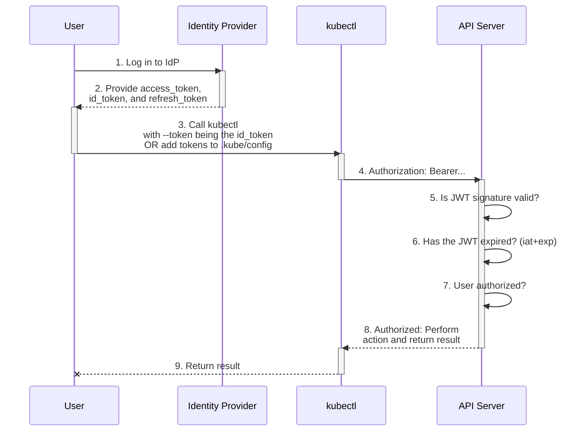

# Authenticating (part 4 of 9)

### JSON Web Token authentication

You can configure Kubernetes to authenticate users using JSON Web Token
(JWT) compliant tokens. JWT authentication mechanism is used for the ServiceAccount tokens that Kubernetes itself issues,
and you can also use it to integrate with other identity sources.

The authenticator attempts to parse a raw ID token, verify it's been signed by the configured issuer.
For externally issued tokens, the public key to verify the signature is discovered from the issuer's public endpoint using OIDC discovery.

The minimum valid JWT payload **must** contain the following claims:

```javascript
{
  "iss": "https://example.com",   // must match the issuer.url
  "aud": ["my-app"],              // at least one of the entries in issuer.audiences must match the "aud" claim in presented JWTs.
  "exp": 1234567890,              // token expiration as Unix time (the number of seconds elapsed since January 1, 1970 UTC)
  "<username-claim>": "user"      // this is the username claim configured in the claimMappings.username.claim or claimMappings.username.expression
}
```

#### JWT egress selector type

**Feature state:**

The `egressSelectorType` field in the JWT issuer configuration allows you to specify which _egress selector_
should be used for sending all traffic related to the issuer (discovery, JWKS, distributed claims, etc).
This feature requires the `StructuredAuthenticationConfigurationEgressSelector` feature gate to be enabled.

#### OpenID Connect tokens

OpenID Connect is a flavor of OAuth2 supported by
some OAuth2 providers, notably Microsoft Entra ID, Salesforce, and Google.
The protocol's main extension of OAuth2 is an additional field returned with
the access token called an ID Token.
This token is a JSON Web Token (JWT) with well known fields, such as a user's
email, signed by the server.

To identify the user, the authenticator uses the `id_token` (not the `access_token`)
from the OAuth2 token response
as a bearer token. See above for how the token
is included in a request.



1. Log in to your identity provider
1. Your identity provider will provide you with an `access_token`, `id_token` and a `refresh_token`
1. When using `kubectl`, use your `id_token` with the `--token` command line argument or add it directly to your `kubeconfig`
1. `kubectl` sends your `id_token` in a header called Authorization to the API server
1. The API server will make sure the JWT signature is valid
1. Check to make sure the `id_token` hasn't expired

   Perform claim and/or user validation if CEL expressions are configured with `AuthenticationConfiguration`.

1. Make sure the user is authorized
1. Once authorized the API server returns a response to `kubectl`
1. `kubectl` provides feedback to the user

Since all of the data needed to validate who you are is in the `id_token`, Kubernetes doesn't need to
"phone home" to the identity provider. In a model where every request is stateless this provides a
very scalable solution for authentication. It does offer a few challenges:

1. Kubernetes has no "web interface" to trigger the authentication process. There is no browser or
   interface to collect credentials which is why you need to authenticate to your identity provider first.
1. The `id_token` can't be revoked, it's like a certificate so it should be short-lived (only a few minutes)
   so it can be very annoying to have to get a new token every few minutes.
1. To authenticate to the Kubernetes dashboard, you must use the `kubectl proxy` command or a reverse proxy
   that injects the `id_token`.

#### Configuring the API Server

##### Using command line arguments

To enable the plugin, configure the following command line arguments for the API server:

| Parameter | Description | Example | Required |
| --------- | ----------- | ------- | ------- |
| `--oidc-issuer-url` | URL of the provider that allows the API server to discover public signing keys. Only URLs that use the `https://` scheme are accepted. This is typically the provider's discovery URL, changed to have an empty path. | If the issuer's OIDC discovery URL is `https://accounts.provider.example/.well-known/openid-configuration`, the value should be `https://accounts.provider.example` | Yes |
| `--oidc-client-id` |  A client id that all tokens must be issued for. | kubernetes | Yes |
| `--oidc-username-claim` | JWT claim to use as the user name. By default `sub`, which is expected to be a unique identifier of the end user. Admins can choose other claims, such as `email` or `name`, depending on their provider. However, claims other than `email` will be prefixed with the issuer URL to prevent naming clashes with other plugins. | sub | No |
| `--oidc-username-prefix` | Prefix prepended to username claims to prevent clashes with existing names (such as `system:` users). For example, the value `oidc:` will create usernames like `oidc:jane.doe`. If this argument isn't provided and `--oidc-username-claim` is a value other than `email` the prefix defaults to `( Issuer URL )#` where `( Issuer URL )` is the value of `--oidc-issuer-url`. The value `-` can be used to disable all prefixing. | `oidc:` | No |
| `--oidc-groups-claim` | JWT claim to use as the user's group. If the claim is present it must be an array of strings. | groups | No |
| `--oidc-groups-prefix` | Prefix prepended to group claims to prevent clashes with existing names (such as `system:` groups). For example, the value `oidc:` will create group names like `oidc:engineering` and `oidc:infra`. | `oidc:` | No |
| `--oidc-required-claim` | A key=value pair that describes a required claim in the ID Token. If set, the claim is verified to be present in the ID Token with a matching value. Repeat this argument to specify multiple claims. | `claim=value` | No |
| `--oidc-ca-file` | The path to the certificate for the CA that signed your identity provider's web certificate. Defaults to the host's root CAs. | `/etc/kubernetes/ssl/kc-ca.pem` | No |
| `--oidc-signing-algs` | The signing algorithms accepted. Default is RS256. Allowed values are: RS256, RS384, RS512, ES256, ES384, ES512, PS256, PS384, PS512. Values are defined by RFC 7518 https://tools.ietf.org/html/rfc7518#section-3.1. | `RS512` | No |

##### Authentication configuration from a file {#using-authentication-configuration}

**Feature state:**

The configuration file approach allows you to configure multiple JWT authenticators, each with a unique
`issuer.url` and `issuer.discoveryURL`. The configuration file even allows you to specify CEL
expressions to map claims to user attributes, and to validate claims and user information.
The API server also automatically reloads the authenticators when the configuration file is modified.
You can use `apiserver_authentication_config_controller_automatic_reload_last_timestamp_seconds` metric
to monitor the last time the configuration was reloaded by the API server.

You must specify the path to the authentication configuration using the `--authentication-config` command line argument to the API server. If you want to use command line arguments instead of the configuration file, those will
continue to work as-is. To access the new capabilities like configuring multiple authenticators,
setting multiple audiences for an issuer, switch to using the configuration file.

To use structured authentication, specify the `--authentication-config` command line
argument to the kube-apiserver. An example of the structured authentication configuration file is shown below.

**Note:**
If you specify `--authentication-config` along with any of the `--oidc-*` command line arguments, this is
a misconfiguration. In this situation, the API server reports an error and then immediately exits.
If you want to switch to using structured authentication configuration, you have to remove the `--oidc-*`
command line arguments, and use the configuration file instead.
