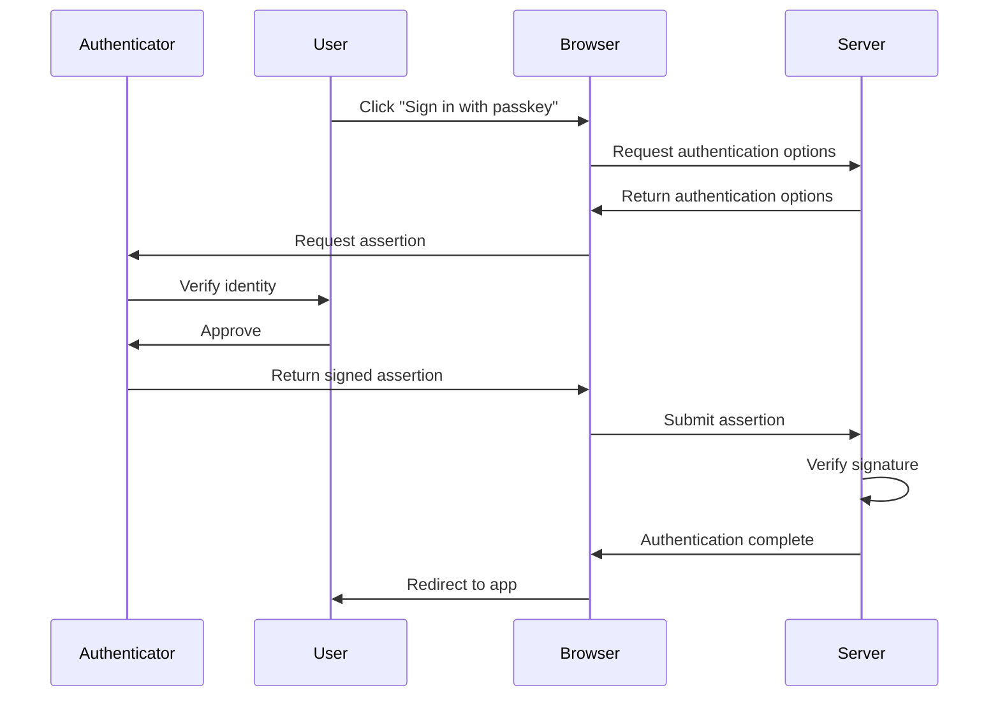

# Enable Web Authentication API (WebAuthn) passkeys (part 4 of 4)

## Authentication flow

This section explains how users authenticate with their passkeys, from initiating the sign-in process to establishing an authenticated session.



### Step 1: Initiating authentication

Users typically initiate passkey <example-value> through a dedicated button or link on the login page. Some apps also support conditional UI, where passkeys appear as autofill suggestions in the username field. The initiation method triggers JavaScript code that manages the authentication flow, similar to the registration process.

### Step 2: Requesting authentication options

The browser requests authentication options from the server to begin the authentication process. These options include a list of acceptable credentials and a new challenge to be signed:

```javascript
async function requestCredential(email, mediation, signal) {
  // Step 2: Request authentication options from the server
  const optionsResponse = 
    await fetchWithErrorHandling(`/Account/PasskeyRequestOptions?username=${encodeURIComponent(email)}`,
    {
      method: 'POST',
      signal,
    });
  const optionsJson = await optionsResponse.json();
  const options = PublicKeyCredential.parseRequestOptionsFromJSON(optionsJson);
  return await navigator.credentials.get({ publicKey: <example-value>, mediation, signal });
}
```

The `Microsoft.AspNetCore.Identity.SignInManager`1.MakePasskeyRequestOptionsAsync*` method generates these options. When you provide a specific user, it includes only that user's credentials in the allow list. When called without a user, it generates options suitable for conditional UI or username-less authentication:

```csharp
app.MapPost("/Account/PasskeyRequestOptions", async (
    SignInManager<ApplicationUser> signInManager,
    string? username) =>
{
    var user = string.IsNullOrEmpty(username) 
        ? null 
        : await userManager.FindByNameAsync(username);

    var optionsJson = await signInManager.MakePasskeyRequestOptionsAsync(user);

    return TypedResults.Content(optionsJson, contentType: "application/json");
});
```

### Step 3: Server generates options

The server generates authentication options using the same `Microsoft.AspNetCore.Identity.IdentityPasskeyOptions` configuration used during registration. The `Microsoft.AspNetCore.Identity.IdentityPasskeyOptions.ServerDomain` must match the domain where the passkey was originally registered, or authentication fails. The `Microsoft.AspNetCore.Identity.IdentityPasskeyOptions.UserVerificationRequirement` determines whether the authenticator must verify the user's identity during authentication.

### Step 4: Client requests assertion

The client-side JavaScript passes the authentication options to the WebAuthn API to request an assertion from the authenticator:

```javascript
async function requestCredential(email, mediation, signal) {
  // Step 4: Parse the options and request an assertion from the authenticator
  const optionsResponse = 
    await fetchWithErrorHandling(`/Account/PasskeyRequestOptions?username=${encodeURIComponent(email)}`,
    {
      method: 'POST',
      signal,
    });
  const optionsJson = await optionsResponse.json();
  const options = PublicKeyCredential.parseRequestOptionsFromJSON(optionsJson);
  return await navigator.credentials.get({ publicKey: <example-value>, mediation, signal });
}
```

The `navigator.credentials.get()` call initiates the authentication process with the authenticator, which prompts the user for verification.

### Step 5: Authenticator verification

The authenticator verifies the user's identity and signs the challenge with the private key. This process is handled entirely by the browser and authenticator, similar to the verification step during registration. The user experience depends on the authenticator type and may involve biometric verification or PIN entry.

### Step 6: Assertion submission

After the authenticator creates the signed assertion, the browser serializes it to JSON and submits it to the server:

```javascript
async function requestCredentialJson(email, mediation, signal) {
  const credential = await requestCredential(email, mediation, signal);
  return JSON.stringify(credential);
}
```

The submission mechanism varies by app but typically involves either a form submission or an API call.

### Step 7: Server verification

The server verifies the assertion to authenticate the user. ASP.NET Core Identity provides the `Microsoft.AspNetCore.Identity.SignInManager`1.PasskeySignInAsync*` method, which performs the complete authentication flow in a single call:

```csharp
var result = await signInManager.PasskeySignInAsync(credentialJson);

if (result.Succeeded)
{
    return Results.Ok("Authentication successful");
}

return Results.Unauthorized();
```

The `Microsoft.AspNetCore.Identity.SignInManager`1.PasskeySignInAsync*` method internally calls `Microsoft.AspNetCore.Identity.SignInManager`1.PerformPasskeyAssertionAsync*` to:

* Validate the assertion signature using the stored public key.
* Verify that the challenge matches the one originally sent.
* Check authenticator flags for user presence and verification.
* Update the signature counter to prevent replay attacks.

If all checks pass, the method signs in the user and returns a `SignInResult` indicating success.

The method distinguishes between a recoverable user action and an app error. If the passkey <example-value> state is missing or expired, for example because the user took too long to respond to the authenticator, the method returns `Microsoft.AspNetCore.Identity.SignInResult.Failed`. Calling the method without a preceding call to `Microsoft.AspNetCore.Identity.SignInManager`1.MakePasskeyRequestOptionsAsync*` throws an `System.InvalidOperationException` because that indicates a problem in the app rather than something the user can retry.

For scenarios requiring more control, you can use `Microsoft.AspNetCore.Identity.SignInManager`1.PerformPasskeyAssertionAsync*` directly to validate the assertion without immediately signing in the user:

* `Microsoft.AspNetCore.Identity.SignInManager`1.PerformPasskeyAssertionAsync*` returns a `Microsoft.AspNetCore.Identity.PasskeyAssertionResult` containing the authenticated user and updated passkey information.
* Because the passkey's sign-in count and authenticator flags may have changed since the last assertion and the updated passkey isn't automatically stored when calling `Microsoft.AspNetCore.Identity.SignInManager`1.PerformPasskeyAssertionAsync*`, call `Microsoft.AspNetCore.Identity.UserManager`1.AddOrUpdatePasskeyAsync*` with the returned `Microsoft.AspNetCore.Identity.PasskeyAssertionResult`.

### Step 8: Session establishment

Upon successful authentication, ASP.NET Core Identity establishes an authenticated session for the user. The `Microsoft.AspNetCore.Identity.SignInManager`1.PasskeySignInAsync*` method handles this automatically, creating the necessary authentication cookies and claims. The app then redirects the user to protected resources or displays personalized content.

## Mitigate `PublicKeyCredential.toJSON` error (`TypeError: Illegal invocation`)

The `PublicKeyCredential.toJSON` method returns a JSON representation of a `PublicKeyCredential`. The method is invoked by the password <example-value> when the app attempts to serialize a `PublicKeyCredential` by calling `JSON.stringify` while registering or authenticating a user.

Some password <example-value> don't implement the `PublicKeyCredential.toJSON` method correctly, which is required for `JSON.stringify` to work when serializing passkey credentials. When registering or authenticating a user with an app based on the Blazor Web App project template, the following error is thrown by some password <example-value> when attempting to add a passkey:

> :::no-loc text="Error: Could not add a passkey: <example-value> invocation":::

Until your selected password <example-value> is updated to implement the `PublicKeyCredential.toJSON` method correctly, make the following changes to the app. The following code manually JSON serializes the `PublicKeyCredential`.

In the `Components/Account/Shared/PasskeySubmit.razor.js` file, locate the `passkey-submit` custom element definition code block:

```javascript
customElements.define('passkey-submit', class extends HTMLElement {
  ...
});
```

Add the following `convertToBase64` function to the code block:

```javascript
convertToBase64(o) {
  if (!o) {
    return undefined;
  }

  // Normalize Array to Uint8Array
  if (Array.isArray(o)) {
    o = Uint8Array.from(o);
  }

  // Normalize ArrayBuffer to Uint8Array
  if (o instanceof ArrayBuffer) {
    o = new Uint8Array(o);
  }

  // Convert Uint8Array to base64
  if (o instanceof Uint8Array) {
    let str = '';
    for (let i = 0; i < o.byteLength; i++) {
      str += String.fromCharCode(o[i]);
    }
    o = window.btoa(str);
  }

  if (typeof o !== 'string') {
    throw new Error("Could not convert to base64 string");
  }

  // Convert base64 to base64url
  o = o.replace(/\+/g, "-").replace(/\//g, "_").replace(/=*$/g, "");

  return o;
}
```

In the `obtainAndSubmitCredential` function of the code block, locate the line that calls `JSON.stringify` with the user's credential and remove the line:

```diff
- const credentialJson = JSON.stringify(credential);
```

Replace the preceding line with the following code:

```javascript
const credentialJson = JSON.stringify({
  authenticatorAttachment: credential.authenticatorAttachment,
  clientExtensionResults: credential.getClientExtensionResults(),
  id: credential.id,
  rawId: this.convertToBase64(credential.rawId),
  response: {
    attestationObject: this.convertToBase64(credential.response.attestationObject),
    authenticatorData: this.convertToBase64(credential.response.authenticatorData ?? 
      credential.response.getAuthenticatorData?.() ?? undefined),
    clientDataJSON: this.convertToBase64(credential.response.clientDataJSON),
    publicKey: this.convertToBase64(credential.response.getPublicKey?.() ?? undefined),
    publicKeyAlgorithm: credential.response.getPublicKeyAlgorithm?.() ?? undefined,
    transports: credential.response.getTransports?.() ?? undefined,
    signature: this.convertToBase64(credential.response.signature),
    userHandle: this.convertToBase64(credential.response.userHandle),
  },
  type: credential.type,
});
```

The preceding workaround is only required until the password <example-value> is updated to implement the `PublicKeyCredential.toJSON` method correctly. We recommend tracking your password <example-value>'s release notes and reverting the preceding changes after the password <example-value> is updated.

## Related content

* Web Authentication API (MDN documentation)
* Get started with phishing-resistant passwordless authentication deployment in Microsoft Entra ID
