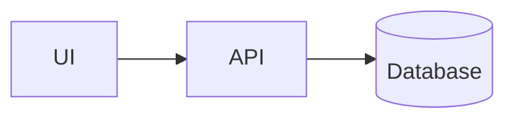

# Architecture mapping

**Core rule:** every box and arrow of the map comes from code you searched (imports, calls, configs), not from names or guesses.

## Procedure

1. List the modules: top-level folders of the source, packages, services in compose or deployment files.
   - Check: each module has a one-line role read from its code or README.
2. Find the entry points: `main` functions, HTTP routes, CLI commands, scheduled jobs, message consumers.
   - Check: each entry point has its file.
3. Find dependencies between modules from imports: `grep -rn -E '^(import|from) ' <module> | grep '<other module>'` (adapt per language).
   - Check: each arrow has one import or call as evidence.
4. Trace one main data flow from entry to storage.
   - Check: the flow names each step's function.
5. Write `docs/architecture.md`: module table, Mermaid diagram, main flow, open questions.
   - Check: the Mermaid block renders (`mermaid-diagrams` if present) and every node is in the table.

## Map template

````markdown
# Architecture of <project>
| Module | Role | Entry points | Depends on |
|---|---|---|---|



## Main flow: <name>
1. <entry> -> <function> -> <storage>
## Open questions
- <...>
````

## Stop and ask the human if

- Parts of the system live in other repositories you cannot read.

## Common mistakes

| If you think... | Reality |
| --- | --- |
| "The folder names say it all." | Names lie; imports do not. |
| "One giant diagram." | Keep under about 15 nodes; split by subsystem. |

## Definition of done

- [ ] Module table, diagram and main flow, each backed by a search.
- [ ] Open questions listed.
